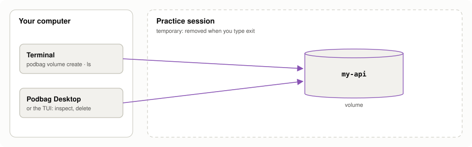
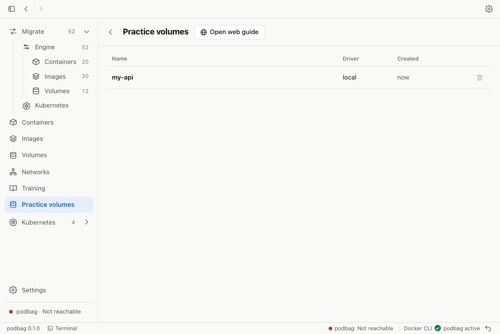
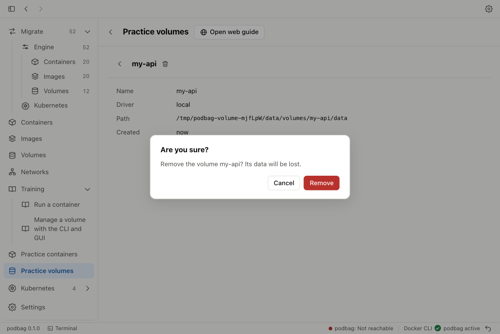
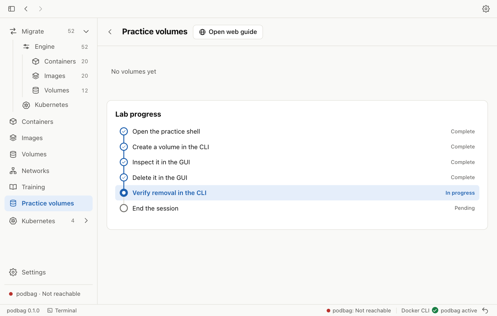
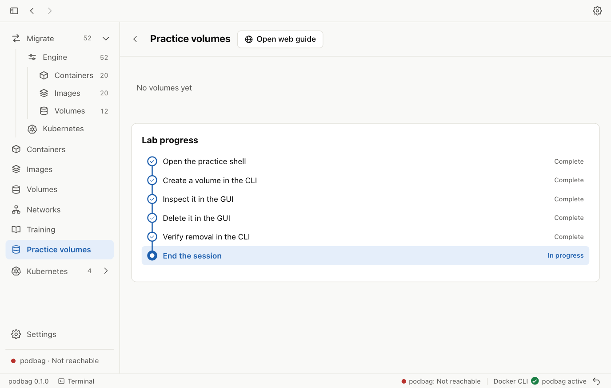

Create a volume in the CLI, inspect and remove it in Podbag Desktop, and watch your progress update.

[Download the lab module](cli-gui-volumes.podbag)



## What is a volume?

A volume stores files separately from a container. Here, `app-a` saves `note.txt` in the `my-api` volume. After `app-a` is removed, a new container, `app-b`, mounts the same volume and reads the file. Deleting the volume itself removes its files.

[](volume-life.mp4)

## Install the module

Use a compatible build of Desktop and the CLI. Select **Install module** at the top of **Training**, choose the downloaded file, and confirm. You can also run this command from your download folder.

```sh
podbag lab install cli-gui-volumes.podbag
```

## Follow your progress in Desktop

Expand **Training** in the sidebar and select the installed volume module. The module shows completed, current, and pending steps. Select **Open web guide** to return to this page.

## Start the practice session

Copy the command from the current step and run it in your terminal. Keep this page open and continue when the terminal shows `volume-lab $`.

```sh
podbag lab start volume-basics
```


## Create a volume in the CLI

Type this command at the volume-lab prompt.

```sh
podbag volume create my-api
podbag volume ls
```


## Inspect it in the GUI

After a volume appears, Training shows the GUI inspection task in progress.



In Practice volumes, select my-api to inspect its name and storage path.


## Delete it in the GUI

Select Remove for my-api. Check the name in the dialog and confirm.



After deletion the list is empty. Return to the same practice shell.



## Verify removal in the CLI

List the volumes again in the practice shell.

```sh
podbag volume ls
```



## End the session

When the shell reports `Verified`, type `exit` to clean up the temporary store. Training marks the module complete.

```sh
exit
```


## Uninstall the module

Run this command outside the practice shell to remove the module and its completion record. You can reinstall the downloaded file.

```sh
podbag lab remove volume-basics
```


