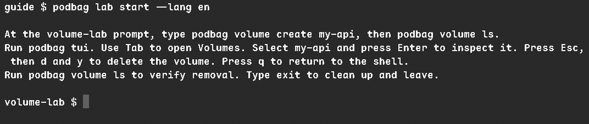
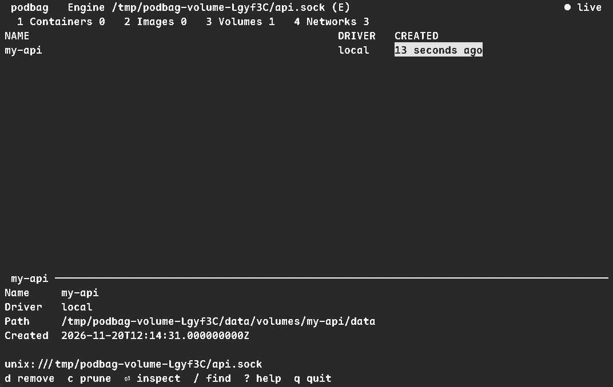

Use a Podbag build that supports `podbag lab --help`. Download the file below and open a terminal in its folder. The lab gets its own temporary store.

[Download the lab module](cli-tui-volumes.podbag)

## Install the module

Install the downloaded file. In Podbag Desktop you can also use **Tutorials → Choose file → Install module**.

```sh
podbag lab install cli-tui-volumes.podbag
```


## Open a practice shell

Start the session. Wait for the `volume-lab $` prompt and type the remaining commands there.

```sh
podbag lab start --lang en
```



## Create a volume

Create `my-api` and list the volumes. Look for `my-api` under `VOLUME NAME`.

```sh
podbag volume create my-api
podbag volume ls
```


## Find it in the TUI

Start the TUI in the same shell. Use `Tab` to reach **Volumes** and select `my-api`. The engine address at the top belongs to this session.

```sh
podbag tui
```



## Inspect the volume

Press `Enter` to open **Inspect**. Check `Name` and `Mountpoint` to see the name and temporary storage path. Press `Esc` to return.


## Remove the selected volume

Press `d` on `my-api`. Check the name in the confirmation dialog and press `y`.


## Check the empty list

The TUI shows **No volumes on this engine.** Press `q` to return to the practice shell.


## Finish the session

List the volumes again. After the `Verified` message, type `exit`. The service and temporary files are removed. You can also type `exit` to leave early.

```sh
podbag volume ls
exit
```


## Uninstall the module

Run this command outside the practice shell to remove the module and its completion record. You can reinstall the downloaded file.

```sh
podbag lab remove
```


