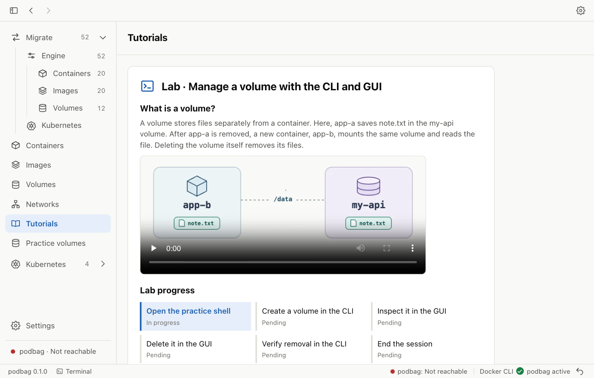
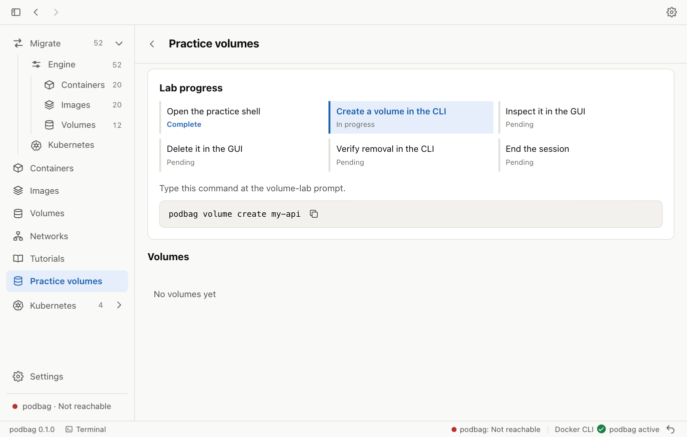
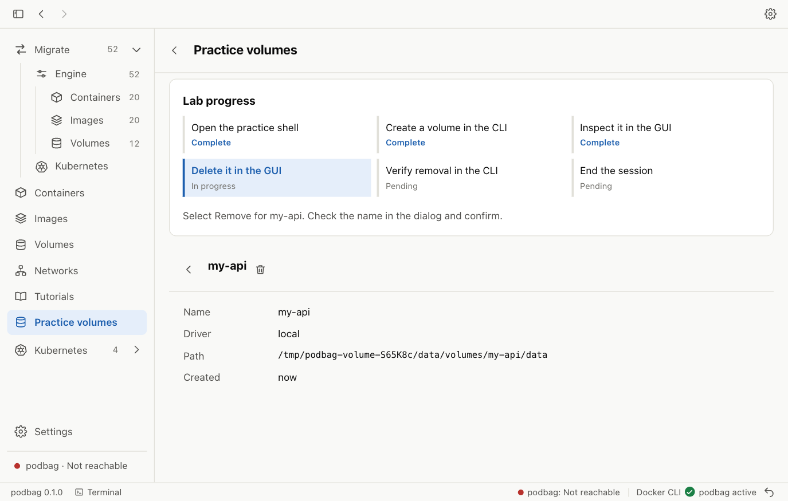
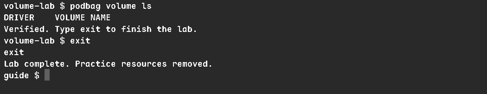
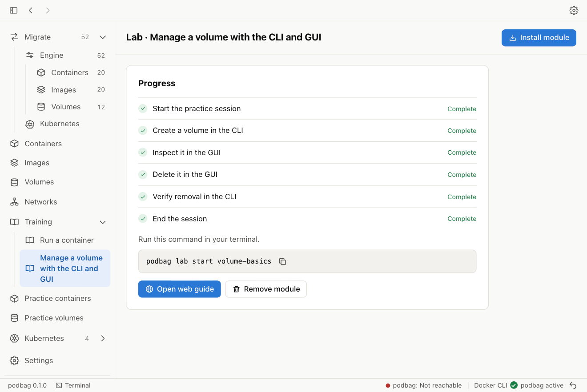

Create a volume in the CLI, inspect and remove it in Podbag Desktop, and watch your progress update.

[Download the lab module](cli-gui-volumes.podbag)

## What is a volume?

A volume stores files separately from a container. Here, `app-a` saves `note.txt` in the `my-api` volume. After `app-a` is removed, a new container, `app-b`, mounts the same volume and reads the file. Deleting the volume itself removes its files.

[](volume-life.mp4)

## Install the module

Use a matching build of Podbag Desktop and the CLI. Download the module and install it under **Training → Choose file → Install module**, or run the command below from the download folder.

```sh
podbag lab install cli-gui-volumes.podbag
```


## Open the lab in Desktop

Open the installed module under **Training**. **Lab progress** marks the current task as **In progress**. Select **Terminal** to open the practice shell.



## Open the practice shell

Leave the terminal open and select **Practice volumes** in the Desktop sidebar. The current step shows the command to type.



## Create a volume in the CLI

Type this command at the volume-lab prompt.

```sh
podbag volume create my-api
podbag volume ls
```


## Inspect it in the GUI

When the volume appears, the CLI creation step changes to **Complete** and the GUI inspection step becomes **In progress**.


In Practice volumes, select my-api to inspect its name and storage path.



## Delete it in the GUI

Select Remove for my-api. Check the name in the dialog and confirm.


After deletion the list is empty and CLI verification is in progress. Return to the same practice shell.


## Verify removal in the CLI

List the volumes again in the practice shell.

```sh
podbag volume ls
```


## End the session

When the shell reports `Verified`, Desktop marks the exit step in progress. Type `exit` to stop the service, remove the temporary store, and see every step marked complete.

```sh
exit
```





## Uninstall the module

Run this command outside the practice shell to remove the module and its completion record. You can reinstall the downloaded file.

```sh
podbag lab remove volume-basics
```


