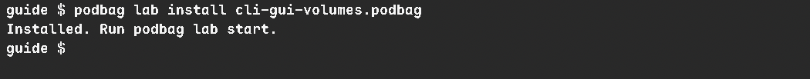
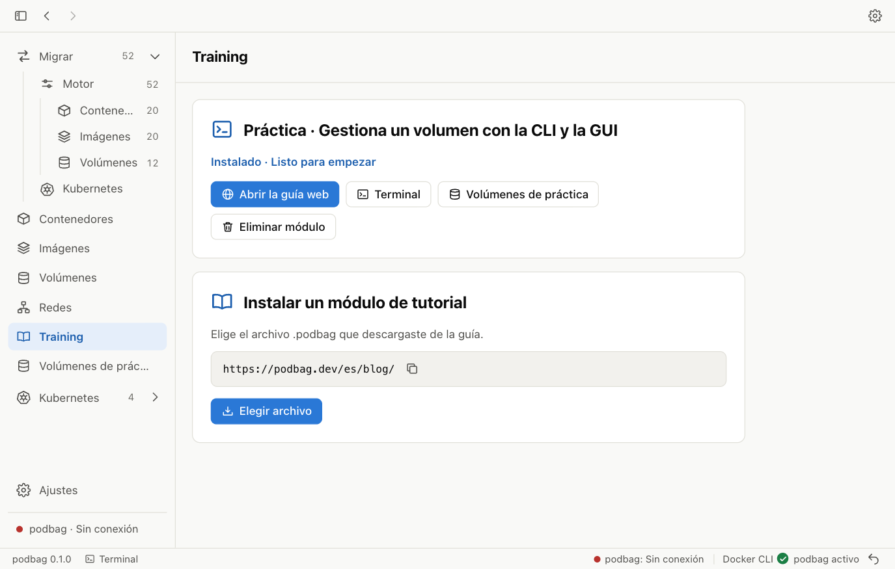
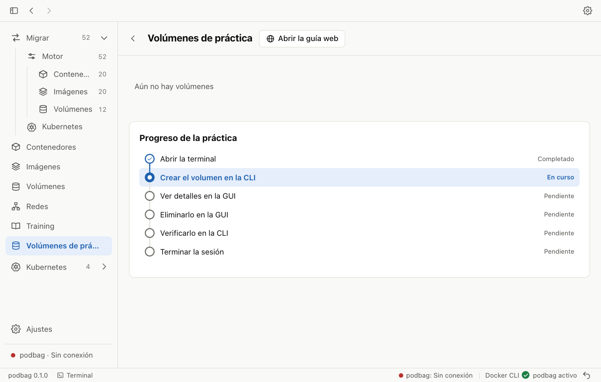
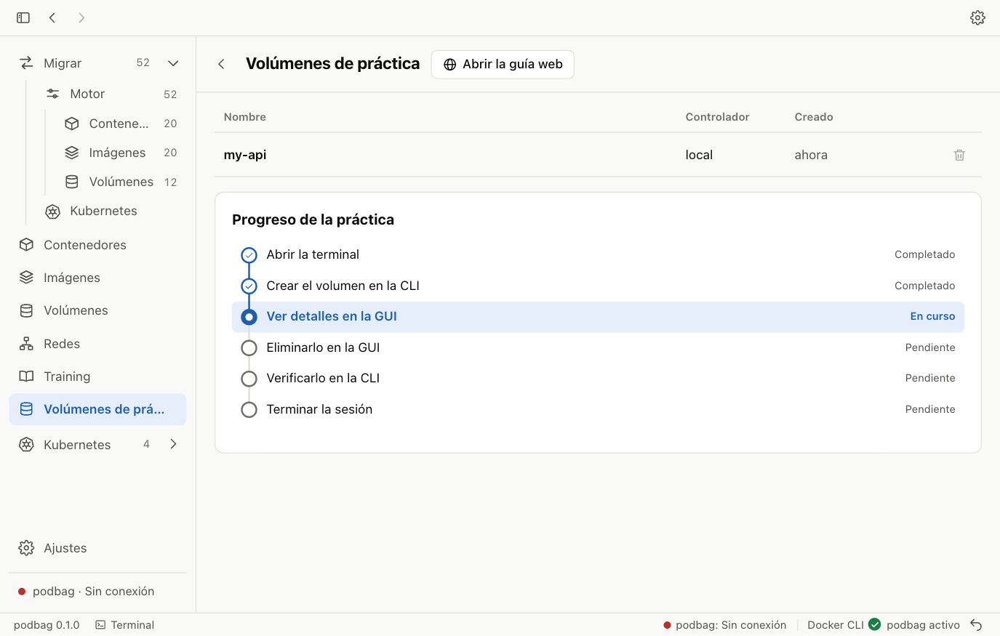
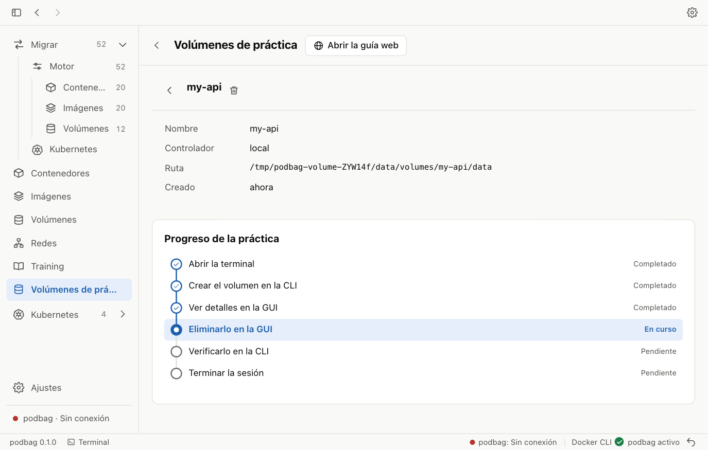
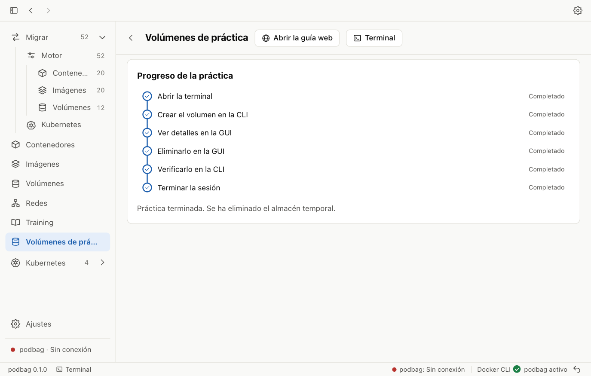

Crea un volumen en la CLI, inspecciónalo y elimínalo en Desktop siguiendo el progreso.

[Descargar el módulo](cli-gui-volumes.podbag)

## ¿Qué es un volumen?

Un volumen guarda archivos por separado del contenedor. Aquí, `app-a` guarda `note.txt` en el volumen `my-api`. Después de eliminar `app-a`, el nuevo contenedor `app-b` monta el mismo volumen y lee el archivo. Al eliminar el propio volumen también se borran sus archivos.

[](volume-life.mp4)

## Instala el módulo

Usa versiones compatibles de Desktop y la CLI. Descarga el archivo e instálalo desde los tutoriales de Desktop o ejecuta este comando en la carpeta de descarga.

```sh
podbag lab install cli-gui-volumes.podbag
```



## Abre la práctica en Desktop

Busca el módulo instalado en **Training**. Selecciona **Abrir la guía web** para volver a esta página. Pulsa Terminal para abrir el shell de práctica.



## Abrir la terminal

Deja abiertos la terminal y esta guía. Elige **Volúmenes de práctica** en la barra lateral de Desktop para ver los recursos que crees.



## Crear el volumen en la CLI

Escribe este comando en el prompt volume-lab.

```sh
podbag volume create my-api
podbag volume ls
```


## Ver detalles en la GUI

Al aparecer my-api, la creación queda completada y la inspección en la GUI pasa a estar en curso.



En Volúmenes de práctica, selecciona my-api para ver su nombre y ruta.



## Eliminarlo en la GUI

Pulsa Eliminar en my-api. Comprueba el nombre y confirma.


Tras eliminar el volumen, la lista queda vacía. Vuelve a la misma terminal para comprobarlo.


## Verificarlo en la CLI

Vuelve a listar los volúmenes en la terminal de prácticas.

```sh
podbag volume ls
```


## Terminar la sesión

Cuando aparezca Verified, escribe exit. El servicio se detiene, el almacén temporal se borra y todos los pasos quedan completados.

```sh
exit
```




## Desinstala el módulo

Ejecuta el comando en la terminal original para eliminar el módulo y su registro de finalización.

```sh
podbag lab remove volume-basics
```


