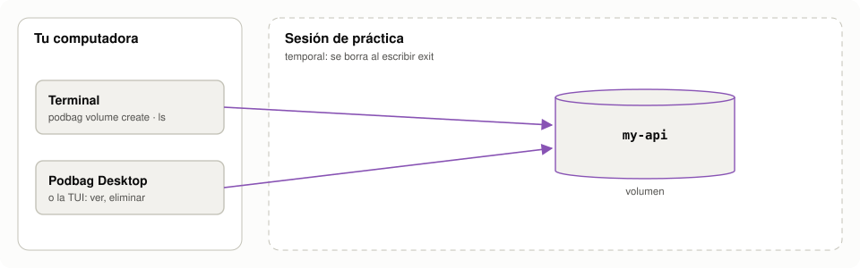
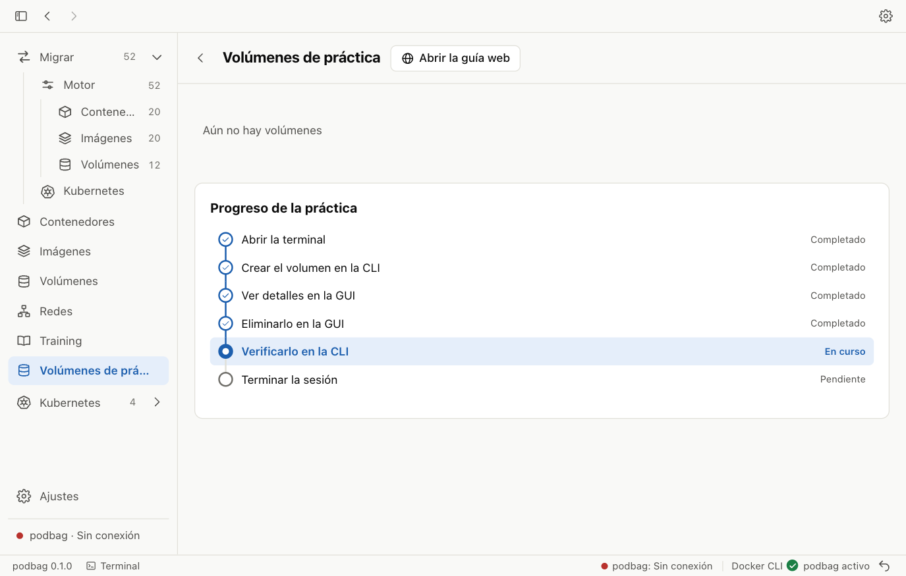
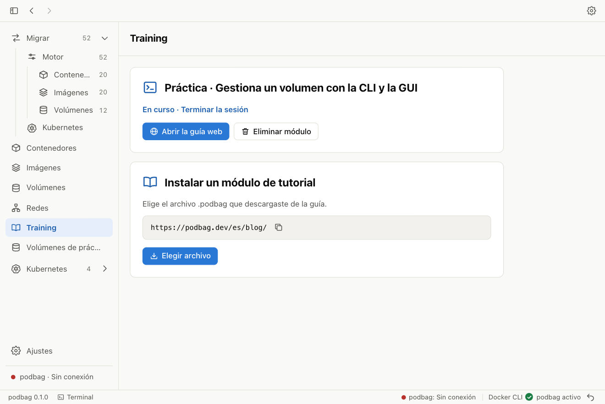

Crea un volumen en la CLI, inspecciónalo y elimínalo en Desktop siguiendo el progreso.

[Descargar el módulo](cli-gui-volumes.podbag)



## ¿Qué es un volumen?

Un volumen guarda archivos por separado del contenedor. Aquí, `app-a` guarda `note.txt` en el volumen `my-api`. Después de eliminar `app-a`, el nuevo contenedor `app-b` monta el mismo volumen y lee el archivo. Al eliminar el propio volumen también se borran sus archivos.

[](volume-life.mp4)

## Instala el módulo

Usa versiones compatibles de Desktop y la CLI. En **Training**, elige **Instalar módulo** en la parte superior, selecciona el archivo descargado y confirma. También puedes ejecutar este comando en la carpeta de descarga.

```sh
podbag lab install cli-gui-volumes.podbag
```

## Consulta el progreso en Desktop

Despliega **Training** en la barra lateral y selecciona el módulo de volúmenes. Puedes ver las tareas completadas, en curso y pendientes. Selecciona **Abrir la guía web** para volver a esta página.

## Inicia la sesión de práctica

Copia el comando del paso actual y ejecútalo en tu terminal. Mantén abierta esta página y continúa cuando aparezca `volume-lab $`.

```sh
podbag lab start volume-basics
```


## Crear el volumen en la CLI

Escribe este comando en el prompt volume-lab.

```sh
podbag volume create my-api
podbag volume ls
```


## Ver detalles en la GUI

Cuando aparezca el volumen, Training indica que toca inspeccionarlo en la GUI.


En Volúmenes de práctica, selecciona my-api para ver su nombre y ruta.


## Eliminarlo en la GUI

Pulsa Eliminar en my-api. Comprueba el nombre y confirma.


Tras eliminarlo, la lista queda vacía. Vuelve a la misma terminal de prácticas.



## Verificarlo en la CLI

Vuelve a listar los volúmenes en la terminal de prácticas.

```sh
podbag volume ls
```



## Terminar la sesión

Cuando aparezca `Verified`, escribe `exit` para limpiar el almacenamiento temporal. Training marca el módulo como completado.

```sh
exit
```


## Desinstala el módulo

Ejecuta el comando en la terminal original para eliminar el módulo y su registro de finalización.

```sh
podbag lab remove volume-basics
```


