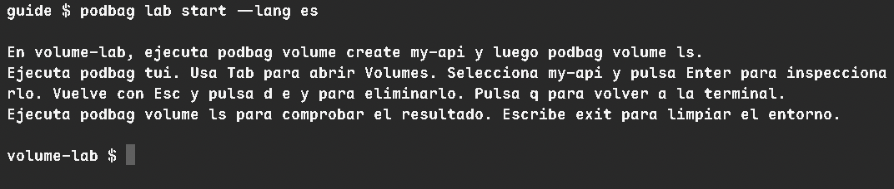

Usa una versión que admita `podbag lab --help`. Descarga el archivo y abre una terminal en su carpeta. La práctica usa un almacén temporal propio.

[Descargar el módulo](cli-tui-volumes.podbag)

## Instala el módulo

Instala el archivo descargado. También puedes elegirlo desde los tutoriales de Desktop.

```sh
podbag lab install cli-tui-volumes.podbag
```


## Abre la terminal de prácticas

Inicia la sesión y espera a que aparezca `volume-lab $`. Escribe los comandos en esa terminal.

```sh
podbag lab start --lang es
```



## Crea un volumen

Crea `my-api` y busca su nombre en la columna `VOLUME NAME`.

```sh
podbag volume create my-api
podbag volume ls
```


## Busca el volumen en la TUI

Inicia la TUI en la misma terminal. Usa `Tab` para abrir **Volumes** y selecciona `my-api`.

```sh
podbag tui
```


## Inspecciona el volumen

Pulsa `Enter` para abrir **Inspect**. Comprueba `Name` y `Mountpoint`. Vuelve con `Esc`.


## Elimina el volumen

Pulsa `d` sobre `my-api`. Comprueba el nombre en el diálogo y confirma con `y`.


## Comprueba la lista vacía

Aparece **No volumes on this engine.** Pulsa `q` para volver a la terminal.


## Termina la sesión

Consulta la lista otra vez. Cuando aparezca `Verified`, escribe `exit` para detener el servicio y borrar sus archivos temporales.

```sh
podbag volume ls
exit
```


## Desinstala el módulo

Ejecuta el comando en la terminal original para eliminar el módulo y su registro de finalización.

```sh
podbag lab remove
```


