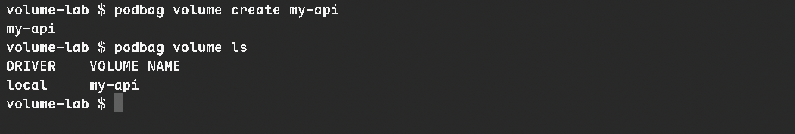
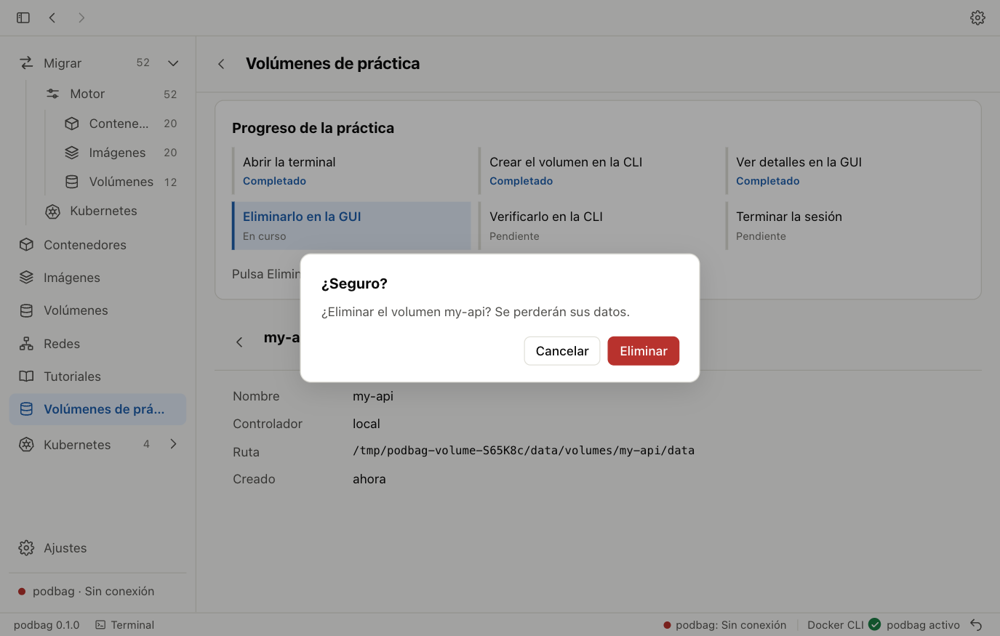

Crea un volumen en la CLI, inspecciónalo y elimínalo en Desktop siguiendo el progreso.

[Descargar el módulo](cli-gui-volumes.podbag)

## Instala el módulo

Usa versiones compatibles de Desktop y la CLI. Descarga el archivo e instálalo desde los tutoriales de Desktop o ejecuta este comando en la carpeta de descarga.

```sh
podbag lab install cli-gui-volumes.podbag
```


## Abre la práctica en Desktop

Selecciona el módulo instalado en los tutoriales. El panel indica la tarea en curso. Abre la terminal con el botón de la práctica.


## Abrir la terminal

Deja la terminal abierta y elige Volúmenes de práctica en la barra lateral. El paso actual muestra el comando que debes escribir.


## Crear el volumen en la CLI

Escribe este comando en el prompt volume-lab.

```sh
podbag volume create my-api
podbag volume ls
```



## Ver detalles en la GUI

Al aparecer my-api, la creación queda completada y la inspección en la GUI pasa a estar en curso.


En Volúmenes de práctica, selecciona my-api para ver su nombre y ruta.


## Eliminarlo en la GUI

Pulsa Eliminar en my-api. Comprueba el nombre y confirma.



Tras eliminar el volumen, la lista queda vacía. Vuelve a la misma terminal para comprobarlo.


## Verificarlo en la CLI

Vuelve a listar los volúmenes en la terminal de prácticas.

```sh
podbag volume ls
```


## Terminar la sesión

Cuando aparezca Verified, escribe exit. El servicio se detiene, el almacén temporal se borra y todos los pasos quedan completados.

```sh
exit
```


## Desinstala el módulo

Ejecuta el comando en la terminal original para eliminar el módulo y su registro de finalización.

```sh
podbag lab remove
```


