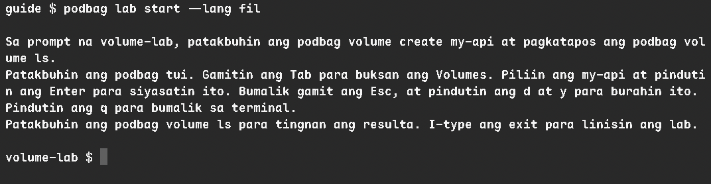

Gumamit ng bersiyon na may `podbag lab --help`. I-download ang file at buksan ang terminal sa folder nito. May sariling pansamantalang storage ang lab.

[I-download ang module](cli-tui-volumes.podbag)

## I-install ang module

I-install ang na-download na file. Maaari rin itong piliin sa Tutorials ng Desktop.

```sh
podbag lab install cli-tui-volumes.podbag
```


## Buksan ang practice shell

Simulan ang lab. Hintayin ang `volume-lab $` at dito ilagay ang mga susunod na command.

```sh
podbag lab start --lang fil
```



## Gumawa ng volume

Gawin ang `my-api` at hanapin ito sa ilalim ng `VOLUME NAME`.

```sh
podbag volume create my-api
podbag volume ls
```


## Hanapin ang volume sa TUI

Buksan ang TUI sa parehong shell. Gamitin ang `Tab` para pumunta sa **Volumes** at piliin ang `my-api`.

```sh
podbag tui
```


## Suriin ang volume

Pindutin ang `Enter` para buksan ang **Inspect**. Tingnan ang `Name` at `Mountpoint`. Bumalik gamit ang `Esc`.


## Burahin ang napiling volume

Pindutin ang `d` sa `my-api`. Tingnan ang pangalan sa dialog at kumpirmahin gamit ang `y`.


## Tingnan ang walang lamang listahan

Kapag lumabas ang **No volumes on this engine.**, pindutin ang `q` para bumalik sa shell.


## Tapusin ang lab

Ilista muli ang mga volume. Kapag nakita ang `Verified`, i-type ang `exit` para ihinto ang serbisyo at burahin ang mga pansamantalang file.

```sh
podbag volume ls
exit
```


## Alisin ang module

Patakbuhin ito sa orihinal na terminal para alisin ang module at ang tala ng pagkumpleto.

```sh
podbag lab remove
```


