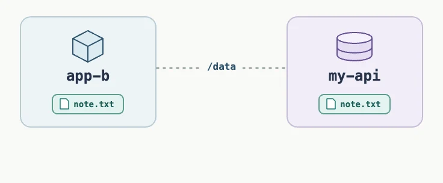
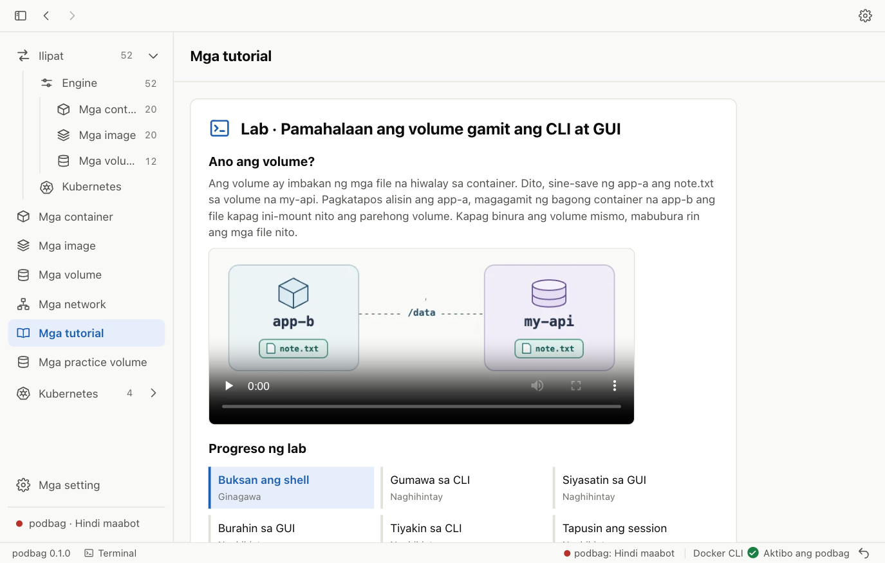
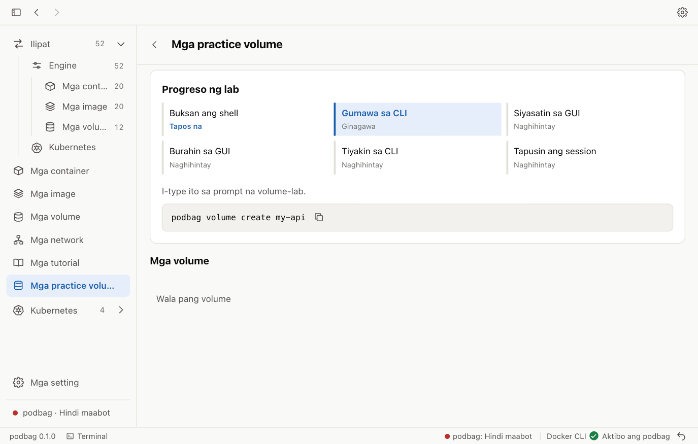
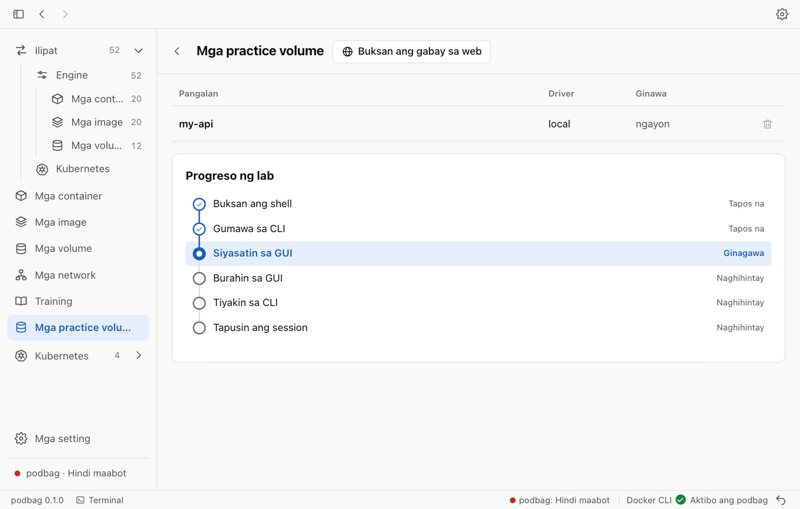
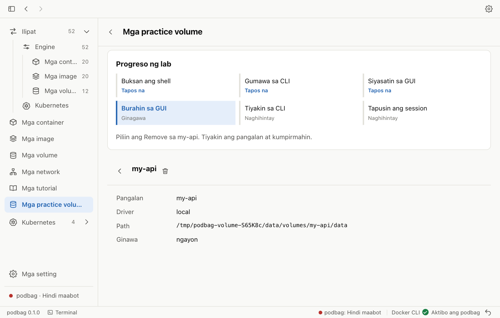
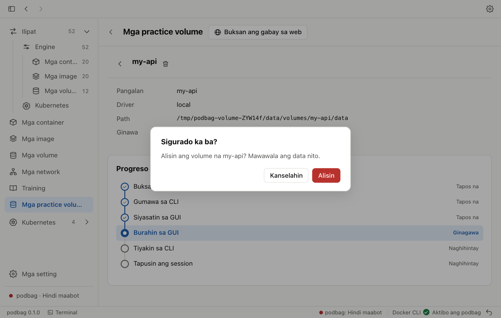
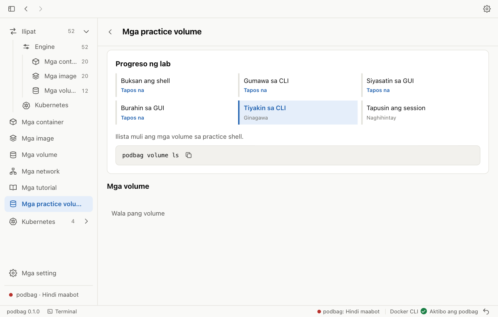
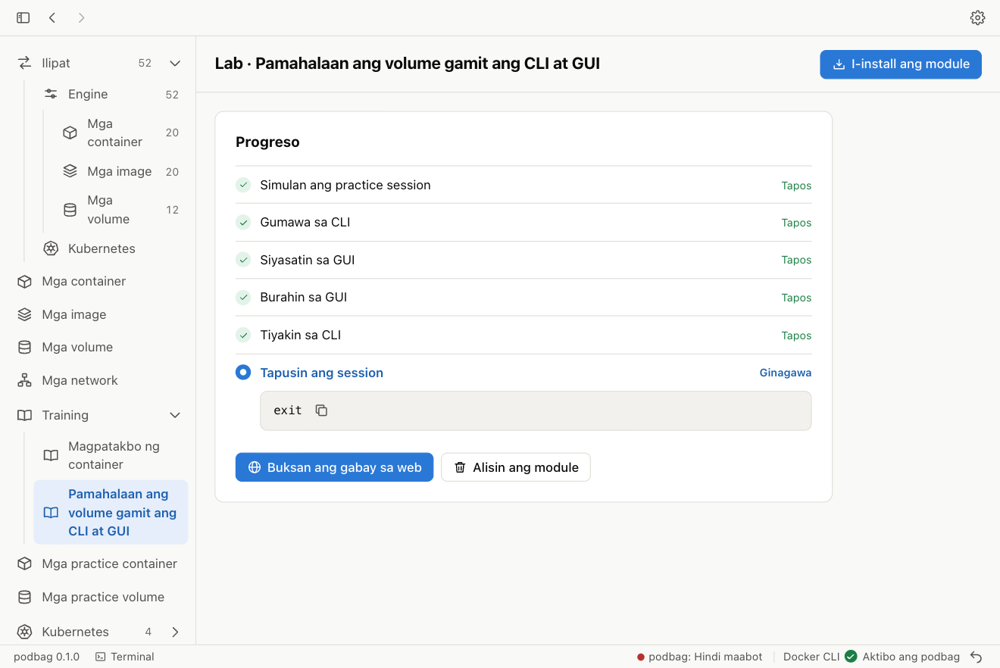
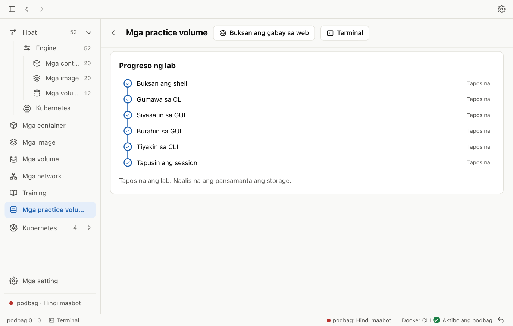

Gumawa ng volume sa CLI, siyasatin at burahin ito sa Desktop, at tingnan ang progreso.

[I-download ang module](cli-gui-volumes.podbag)

## Ano ang volume?

Ang volume ay imbakan ng mga file na hiwalay sa container. Dito, sine-save ng `app-a` ang `note.txt` sa volume na `my-api`. Pagkatapos alisin ang `app-a`, magagamit ng bagong container na `app-b` ang file kapag ini-mount nito ang parehong volume. Kapag binura ang volume mismo, mabubura rin ang mga file nito.

[](volume-life.mp4)

## I-install ang module

Gumamit ng magkatugmang bersiyon ng Desktop at CLI. I-download ang file at i-install mula sa Tutorials o patakbuhin ang command sa folder ng download.

```sh
podbag lab install cli-gui-volumes.podbag
```


## Buksan ang lab sa Desktop

Piliin ang **Buksan ang gabay sa web** sa **Training** para bumalik sa pahinang ito. Ipinapakita ng Training ang status ng module at ang kasalukuyang gawain.



## Buksan ang shell

Buksan ang **Mga practice volume** sa sidebar ng Desktop at piliin ang Terminal. Panatilihing bukas ang pahinang ito at ang terminal.



## Gumawa sa CLI

I-type ito sa prompt na volume-lab.

```sh
podbag volume create my-api
podbag volume ls
```


## Siyasatin sa GUI

Kapag lumitaw ang volume, makikita sa Training na susunod ang pagtingin sa detalye sa GUI.



Sa Mga practice volume, piliin ang my-api at tingnan ang pangalan at lokasyon.



## Burahin sa GUI

Piliin ang Remove sa my-api. Tiyakin ang pangalan at kumpirmahin.



Pagkatapos alisin ang volume, magiging walang laman ang listahan. Bumalik sa parehong practice terminal.



## Tiyakin sa CLI

Ilista muli ang mga volume sa practice shell.

```sh
podbag volume ls
```



## Tapusin ang session

Kapag lumabas ang `Verified`, i-type ang `exit` para linisin ang pansamantalang storage. Ipapakita ng Training na tapos na ang module.

```sh
exit
```




## Alisin ang module

Patakbuhin ito sa orihinal na terminal para alisin ang module at ang tala ng pagkumpleto.

```sh
podbag lab remove volume-basics
```


