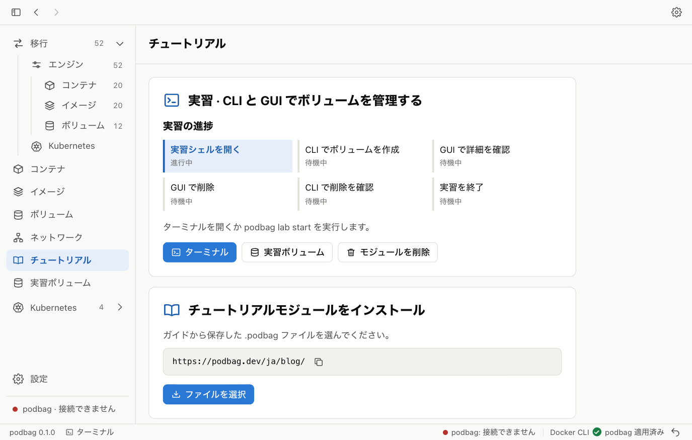
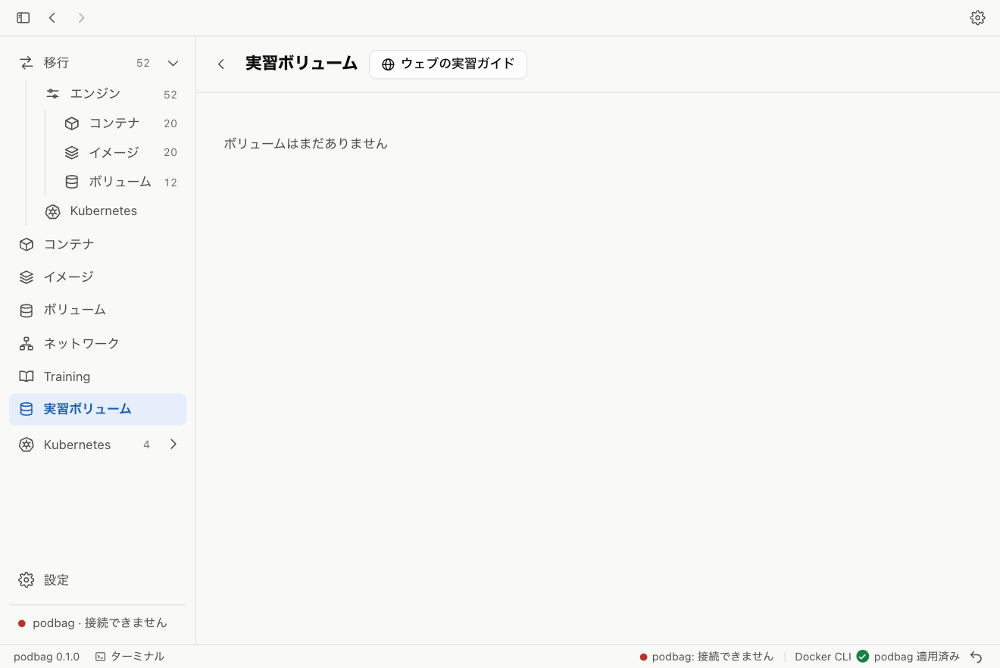
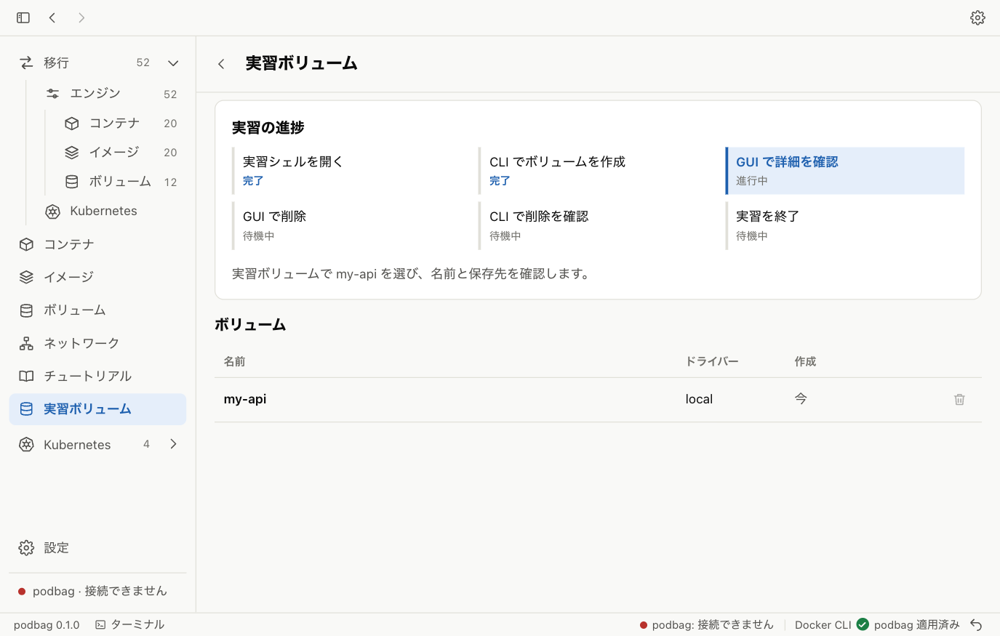
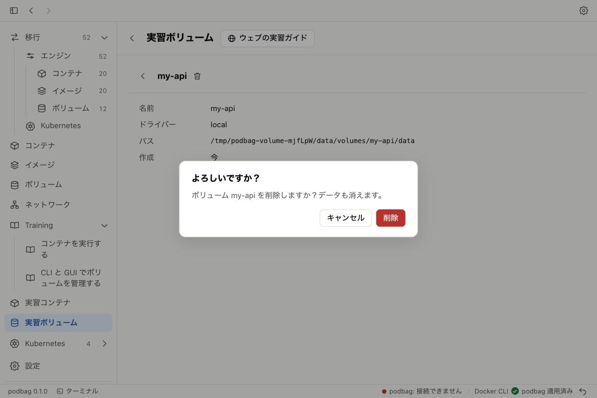
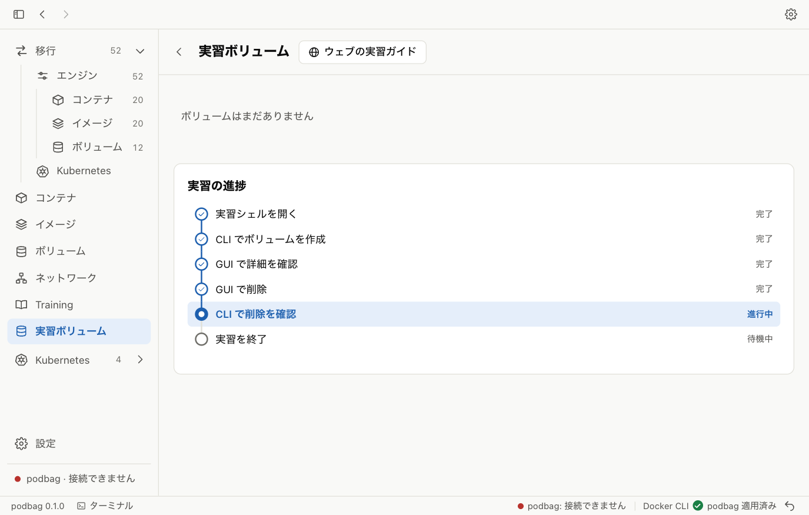
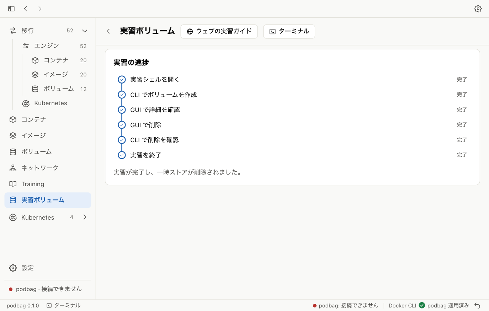

CLI で作成したボリュームを Desktop で確認し、削除します。実習画面には現在の作業が表示されます。

[実習モジュールをダウンロード](cli-gui-volumes.podbag)

## ボリュームとは？

ボリュームはコンテナとは別にファイルを保存する領域です。ここでは `app-a` が `my-api` ボリュームに `note.txt` を保存します。`app-a` を削除しても、新しいコンテナ `app-b` に同じボリュームをマウントすると、そのファイルを読み取れます。 ボリューム自体を削除すると、中のファイルも消えます。

[](volume-life.mp4)

## モジュールをインストールする

対応する Desktop と CLI を使います。下のファイルをチュートリアル画面で選んでインストールするか、ダウンロード先で次のコマンドを実行します。

```sh
podbag lab install cli-gui-volumes.podbag
```


## Desktop で実習を開く

チュートリアルからインストール済みの実習を開き、進行中の作業を確認します。ターミナルボタンで専用シェルを開きます。



## 実習シェルを開く

シェルを開いたまま、Desktop のサイドバーで実習ボリュームを選びます。現在の作業にコマンドが表示されます。



## CLI でボリュームを作成

volume-lab のプロンプトで次のコマンドを入力します。

```sh
podbag volume create my-api
podbag volume ls
```


## GUI で詳細を確認

my-api が表示されると作成が完了し、GUI での詳細確認が進行中になります。



実習ボリュームで my-api を選び、名前と保存先を確認します。


## GUI で削除

my-api の削除を選び、確認画面で名前を確認して削除します。



削除後に一覧が空になります。実習シェルに戻って削除を確認します。



## CLI で削除を確認

実習シェルで一覧を再表示します。

```sh
podbag volume ls
```


## 実習を終了

Verified が表示されたら exit を入力します。一時ストアが片付き、全項目が完了になります。

```sh
exit
```




## モジュールを削除する

元のシェルで実行すると、モジュールと完了記録を削除できます。

```sh
podbag lab remove volume-basics
```


