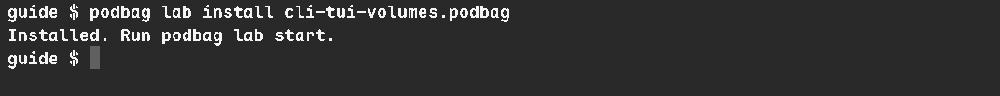
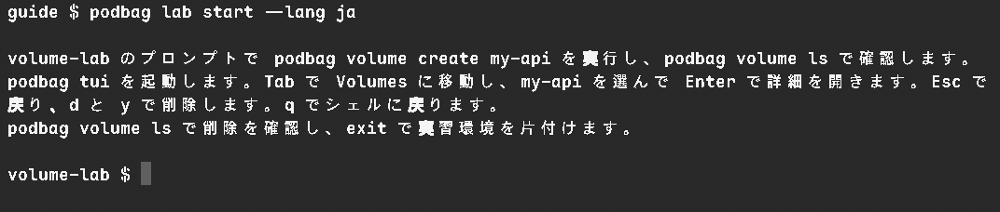
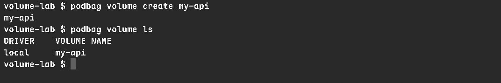
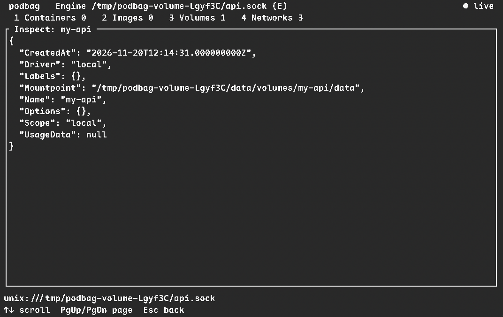
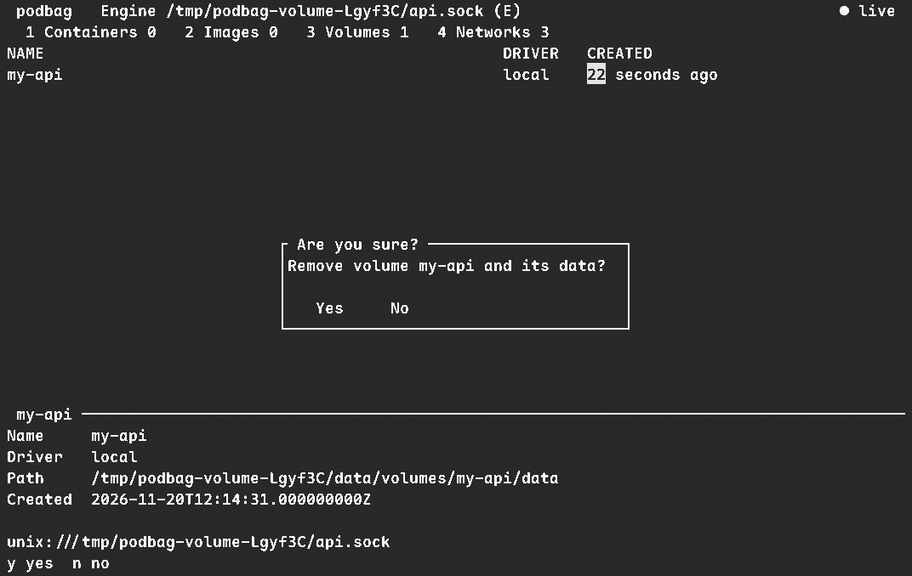

`podbag lab --help` が使える Podbag を用意します。ファイルをダウンロードし、そのフォルダーでターミナルを開きます。実習は専用の一時ストアを使います。

[実習モジュールをダウンロード](cli-tui-volumes.podbag)

## モジュールをインストールする

ダウンロードしたファイルをインストールします。Desktop のチュートリアル画面からも選択できます。

```sh
podbag lab install cli-tui-volumes.podbag
```



## 実習シェルを開く

起動したら `volume-lab $` を確認し、このシェルで作業します。

```sh
podbag lab start --lang ja
```



## ボリュームを作成する

`my-api` を作成し、一覧の `VOLUME NAME` に表示されることを確認します。

```sh
podbag volume create my-api
podbag volume ls
```



## TUI で探す

同じシェルで TUI を起動します。`Tab` で **Volumes** を開き、`my-api` を選択します。

```sh
podbag tui
```


## 詳細を確認する

`Enter` で **Inspect** を開きます。`Name` と `Mountpoint` を確認し、`Esc` で戻ります。



## ボリュームを削除する

`my-api` で `d` を押し、確認画面の名前を見てから `y` を押します。



## 空の一覧を確認する

**No volumes on this engine.** を確認し、`q` でシェルに戻ります。


## 実習を終了する

一覧を再表示します。`Verified` が出たら `exit` を入力します。サービスと一時ファイルが削除されます。

```sh
podbag volume ls
exit
```


## モジュールを削除する

元のシェルで実行すると、モジュールと完了記録を削除できます。

```sh
podbag lab remove
```


