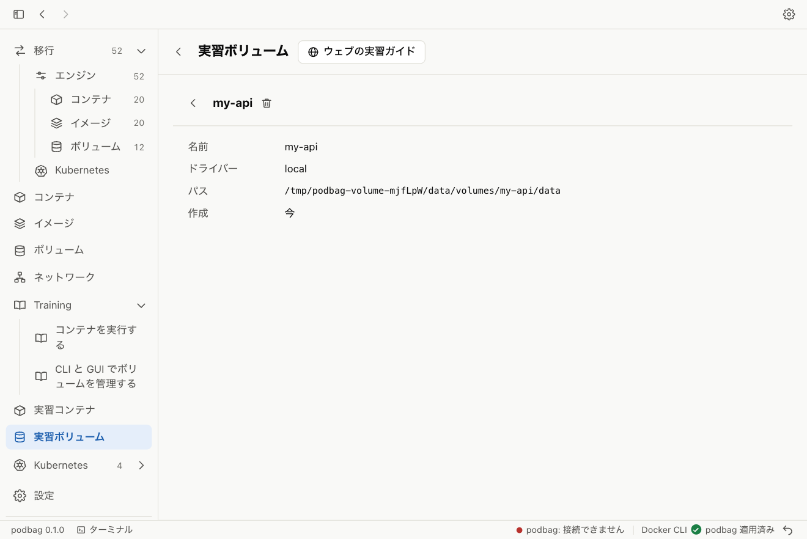
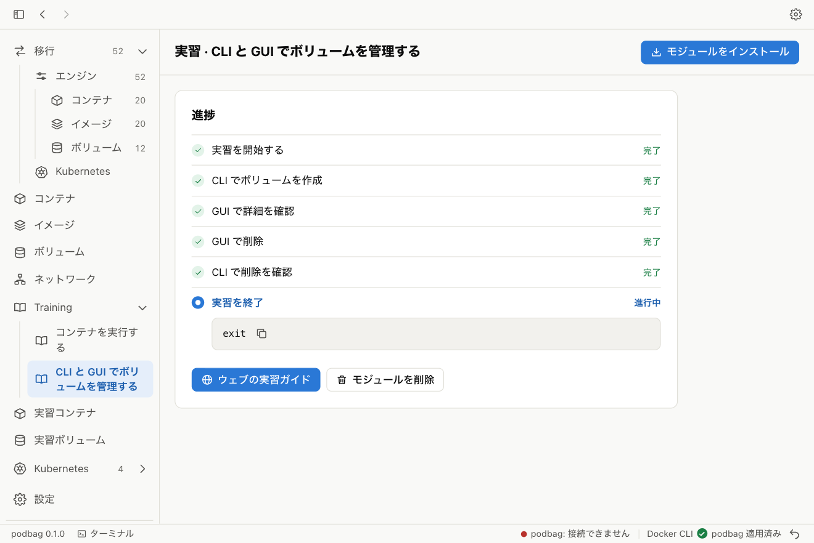

CLI で作成したボリュームを Desktop で確認し、削除します。実習画面には現在の作業が表示されます。

[実習モジュールをダウンロード](cli-gui-volumes.podbag)

## ボリュームとは？

ボリュームはコンテナとは別にファイルを保存する領域です。ここでは `app-a` が `my-api` ボリュームに `note.txt` を保存します。`app-a` を削除しても、新しいコンテナ `app-b` に同じボリュームをマウントすると、そのファイルを読み取れます。 ボリューム自体を削除すると、中のファイルも消えます。

[](volume-life.mp4)

## モジュールをインストールする

対応する Desktop と CLI を使います。**Training** の上部にある**モジュールをインストール**を選び、ダウンロードしたファイルを指定して確認します。ダウンロード先で次のコマンドを実行してもインストールできます。

```sh
podbag lab install cli-gui-volumes.podbag
```

## Desktop で進捗を確認する

サイドバーの **Training** を展開し、インストールしたボリュームモジュールを選びます。完了済み、進行中、未着手の作業を確認できます。**ウェブの実習ガイド**を選ぶとこのページに戻れます。

## 実習を開始する

現在の作業に表示されるコマンドをコピーし、お使いのターミナルで実行します。このページを開いたまま、`volume-lab $` が表示されたら続けます。

```sh
podbag lab start volume-basics
```


## CLI でボリュームを作成

volume-lab のプロンプトで次のコマンドを入力します。

```sh
podbag volume create my-api
podbag volume ls
```


## GUI で詳細を確認

作成したボリュームが表示されます。Training では GUI で詳細を開く作業が進行中になります。


実習ボリュームで my-api を選び、名前と保存先を確認します。



## GUI で削除

my-api の削除を選び、確認画面で名前を確認して削除します。


削除すると一覧が空になります。同じ実習ターミナルに戻ります。


## CLI で削除を確認

実習シェルで一覧を再表示します。

```sh
podbag volume ls
```



## 実習を終了

`Verified` が表示されたら `exit` で一時ストアを片付けます。Training に完了と表示されます。

```sh
exit
```


## モジュールを削除する

元のシェルで実行すると、モジュールと完了記録を削除できます。

```sh
podbag lab remove volume-basics
```


