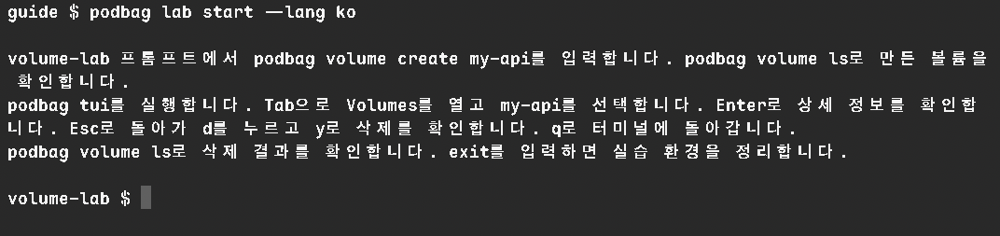
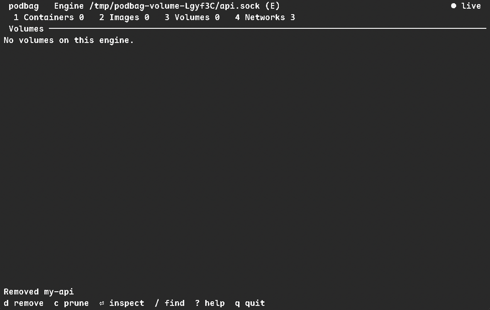
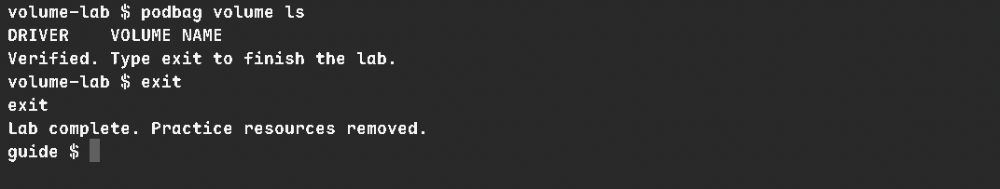
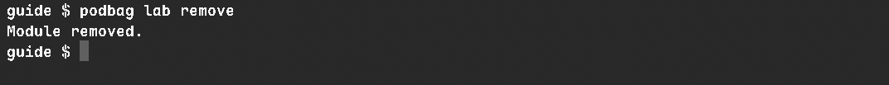

Podbag CLI에서 `podbag lab --help`가 열리는지 확인합니다. 이 실습은 별도 임시 저장소를 사용합니다. 아래 파일을 받고 터미널에서 파일을 저장한 폴더로 이동합니다.

[실습 모듈 다운로드](cli-tui-volumes.podbag)

## 모듈 설치하기

다운로드한 모듈을 설치합니다. Podbag Desktop에서는 **튜토리얼 → 파일 선택 → 모듈 설치**를 사용할 수 있습니다.

```sh
podbag lab install cli-tui-volumes.podbag
```


## 실습 터미널 열기

실습을 시작하고 프롬프트가 `volume-lab $`로 바뀌었는지 확인합니다. 이후 명령은 그 프롬프트에 입력합니다.

```sh
podbag lab start --lang ko
```



## 볼륨 만들기

`my-api` 볼륨을 만들고 목록을 출력합니다. `VOLUME NAME` 아래에 `my-api`가 보여야 합니다.

```sh
podbag volume create my-api
podbag volume ls
```


## TUI에서 볼륨 찾기

같은 터미널에서 TUI를 실행합니다. `Tab`으로 **Volumes** 탭을 열고 `my-api` 행을 선택합니다. 상단의 엔진 주소는 이번 실습 전용 소켓입니다.

```sh
podbag tui
```


## 볼륨 상세 정보 열기

`Enter`를 눌러 **Inspect** 화면을 엽니다. `Name`과 `Mountpoint`에서 볼륨 이름과 임시 저장 경로를 확인합니다. `Esc`로 목록에 돌아갑니다.


## 선택한 볼륨 삭제하기

`my-api` 행에서 `d`를 누릅니다. 확인창에 삭제할 이름이 `my-api`로 표시되면 `y`를 누릅니다.


## 삭제 결과 확인하기

TUI에 **No volumes on this engine.**이 표시됩니다. `q`로 TUI를 닫고 실습 프롬프트로 돌아갑니다.



## 실습 마치기

볼륨 목록을 다시 조회합니다. 이름이 사라지고 `Verified` 메시지가 나오면 `exit`로 마칩니다. 실습 서버와 임시 파일이 정리됩니다. 중간에 종료할 때도 `exit`를 사용합니다.

```sh
podbag volume ls
exit
```



## 모듈 삭제하기

원래 터미널에서 아래 명령을 실행하면 새 모듈과 완료 기록이 삭제됩니다. 다시 연습하려면 다운로드한 파일을 다시 설치합니다.

```sh
podbag lab remove
```


