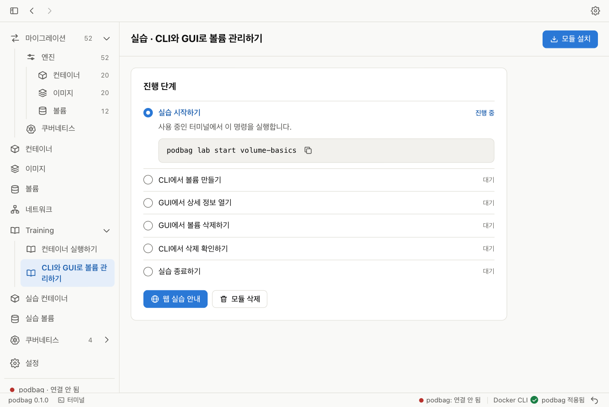
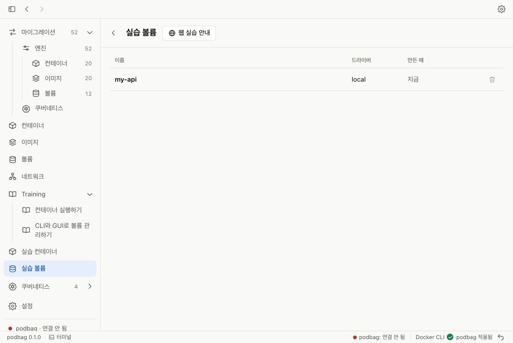
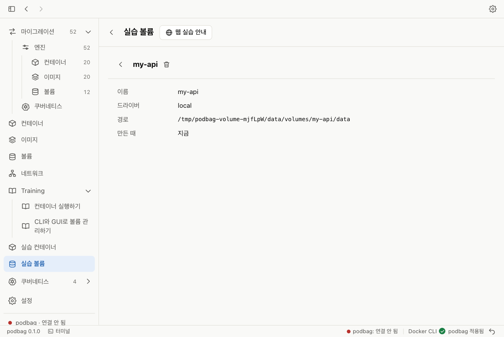
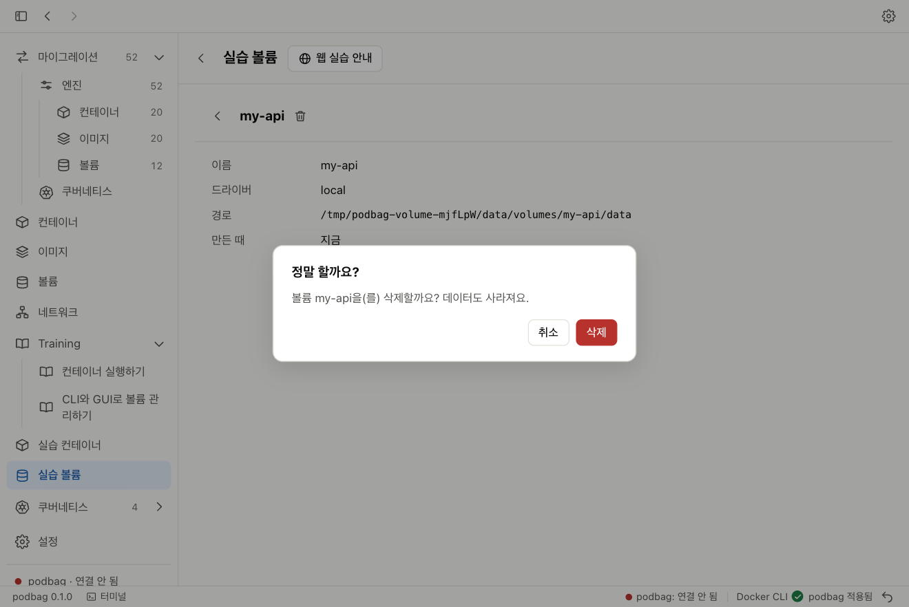
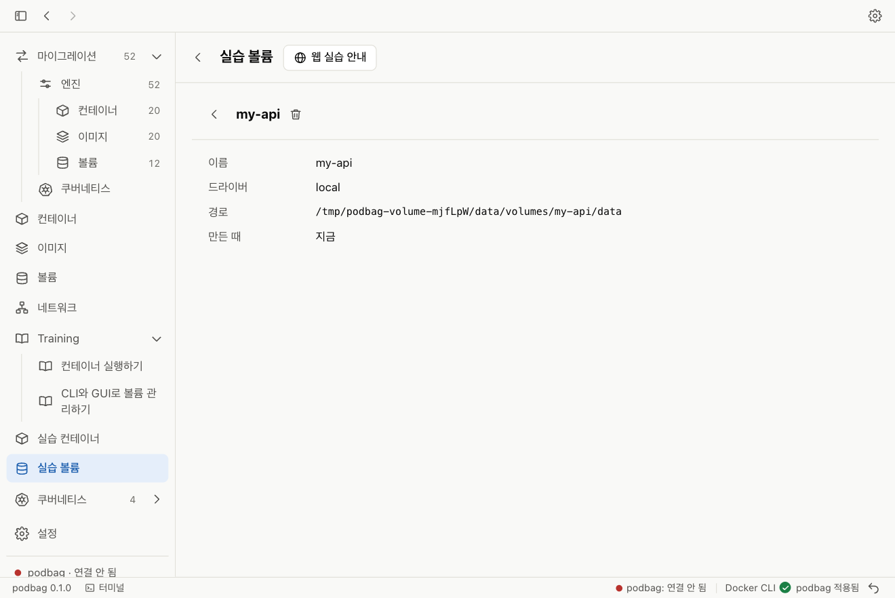
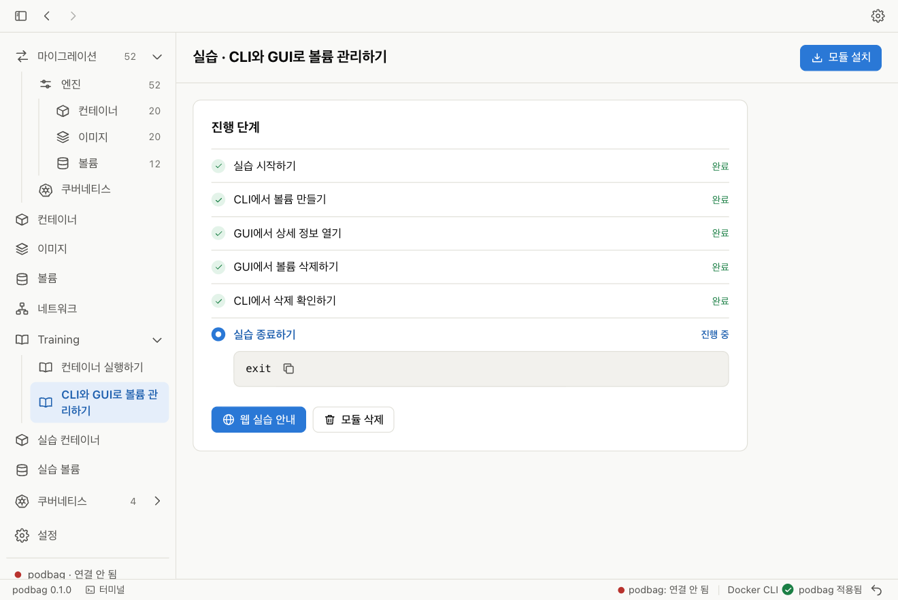
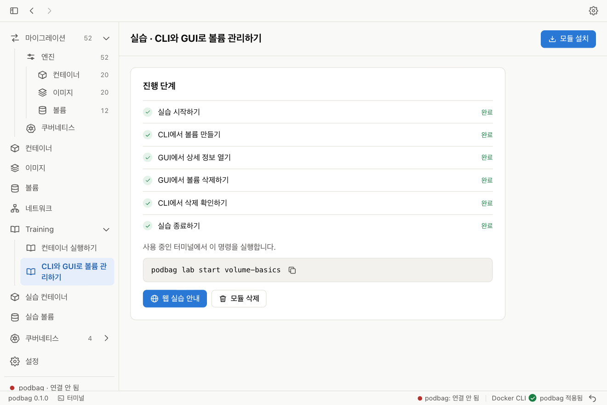

CLI에서 만든 볼륨을 Podbag Desktop에서 열고 삭제합니다. 실습 화면에서 현재 단계와 남은 작업을 확인합니다.

[실습 모듈 다운로드](cli-gui-volumes.podbag)

## 볼륨이란?

볼륨은 컨테이너 밖에 파일을 보관하는 저장 공간입니다. `app-a`가 `my-api` 볼륨에 `note.txt`를 저장합니다. `app-a`를 삭제한 뒤 새 컨테이너 `app-b`에 같은 볼륨을 연결하면 파일을 다시 읽을 수 있습니다. 볼륨 자체를 삭제하면 그 안의 파일도 삭제됩니다.

[](volume-life.mp4)

## 모듈 설치하기

실습을 지원하는 Desktop과 CLI를 사용합니다. **Training** 화면 위의 **모듈 설치**를 누르고 다운로드한 파일을 선택한 뒤 확인합니다. 다운로드한 폴더에서 다음 명령으로 설치할 수도 있습니다.

```sh
podbag lab install cli-gui-volumes.podbag
```

## Desktop에서 진행 상태 확인하기

왼쪽 메뉴에서 **Training**을 펼치고 설치한 볼륨 모듈을 선택합니다. 완료한 단계, 현재 단계, 남은 단계가 표시됩니다. **웹 실습 안내**를 누르면 이 글이 다시 열립니다.

## 실습 시작하기

현재 단계의 명령을 복사해 사용 중인 터미널에서 실행합니다. 이 글을 열어 둔 채 `volume-lab $` 프롬프트가 나타나면 다음 단계로 이동합니다.

```sh
podbag lab start volume-basics
```



## CLI에서 볼륨 만들기

volume-lab 프롬프트에 다음 명령을 입력합니다.

```sh
podbag volume create my-api
podbag volume ls
```


## GUI에서 상세 정보 열기

볼륨이 나타나면 Training에서 GUI로 상세 정보를 열 차례인지 확인할 수 있습니다.



실습 볼륨 화면에서 my-api 이름을 눌러 이름과 저장 경로를 확인합니다.



## GUI에서 볼륨 삭제하기

my-api의 삭제 버튼을 누르고 확인창에서 이름을 확인한 뒤 삭제합니다.



삭제하면 목록이 비워집니다. 같은 실습 터미널로 돌아갑니다.



## CLI에서 삭제 확인하기

실습 터미널에서 목록을 다시 조회합니다.

```sh
podbag volume ls
```



## 실습 종료하기

터미널에 `Verified`가 나타나면 `exit`를 입력해 임시 저장소를 정리합니다. Training에 모듈이 완료로 표시됩니다.

```sh
exit
```




## 모듈 삭제하기

원래 터미널에서 아래 명령을 실행하면 새 모듈과 완료 기록이 삭제됩니다. 다시 연습하려면 다운로드한 파일을 다시 설치합니다.

```sh
podbag lab remove volume-basics
```


