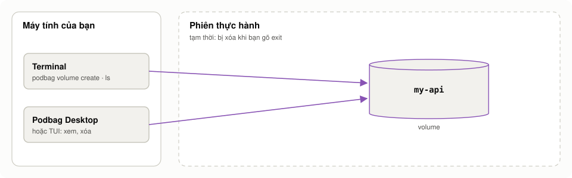
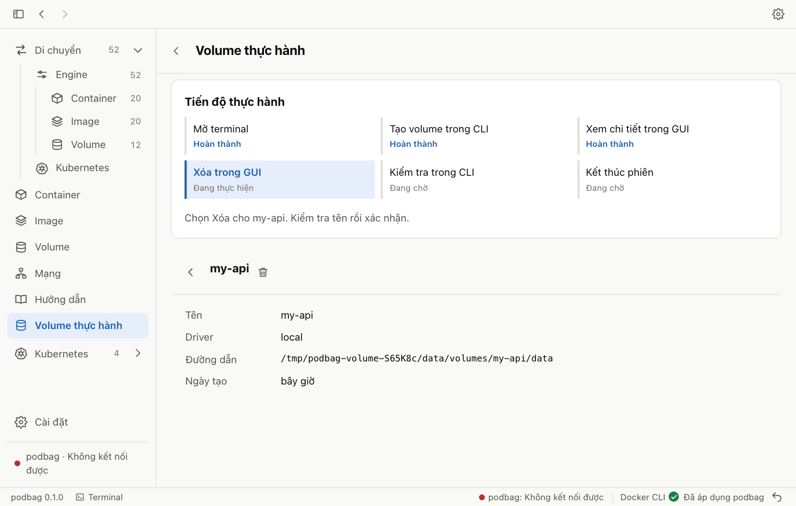
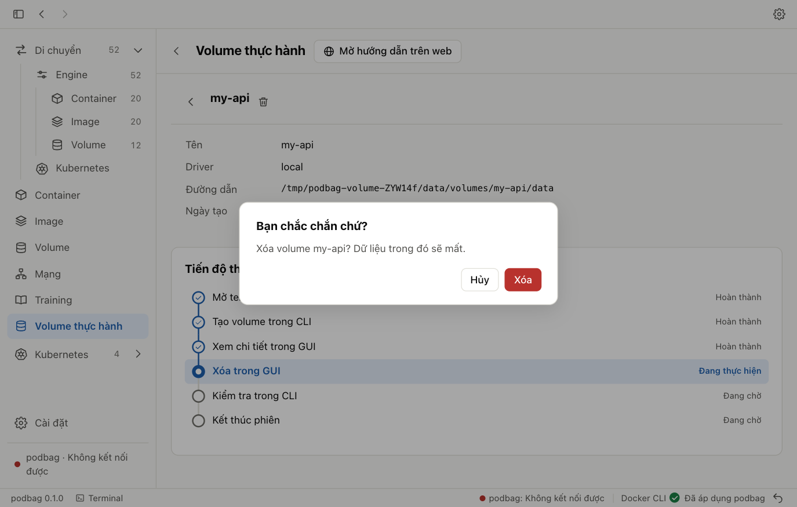

Tạo volume trong CLI, xem chi tiết và xóa trong Desktop, rồi theo dõi tiến độ.

[Tải mô-đun](cli-gui-volumes.podbag)



## Volume là gì?

Volume là nơi lưu tệp độc lập với container. Trong ví dụ này, `app-a` lưu `note.txt` vào volume `my-api`. Sau khi xóa `app-a`, container mới `app-b` gắn cùng volume và đọc lại tệp. Nếu xóa chính volume đó, các tệp bên trong cũng sẽ bị xóa.

[](volume-life.mp4)

## Cài mô-đun

Dùng bản Desktop và CLI hỗ trợ bài này. Ở đầu mục **Training**, chọn **Cài mô-đun**, chọn tệp đã tải và xác nhận. Bạn cũng có thể chạy lệnh sau trong thư mục tải xuống.

```sh
podbag lab install cli-gui-volumes.podbag
```

## Xem tiến độ trong Desktop

Mở rộng **Training** ở thanh bên và chọn mô-đun volume đã cài. Mô-đun hiển thị các bước đã xong, đang thực hiện và chưa thực hiện. Chọn **Mở hướng dẫn trên web** để quay lại trang này.

## Bắt đầu phiên thực hành

Sao chép lệnh của bước hiện tại và chạy trong terminal của bạn. Giữ trang này mở và tiếp tục khi thấy `volume-lab $`.

```sh
podbag lab start volume-basics
```


## Tạo volume trong CLI

Nhập lệnh này tại dấu nhắc volume-lab.

```sh
podbag volume create my-api
podbag volume ls
```


## Xem chi tiết trong GUI

Khi volume xuất hiện, Training hiển thị tác vụ xem chi tiết trong GUI.


Trong Volume thực hành, chọn my-api để xem tên và đường dẫn lưu trữ.



## Xóa trong GUI

Chọn Xóa cho my-api. Kiểm tra tên rồi xác nhận.



Sau khi xóa, danh sách sẽ trống. Hãy quay lại cùng terminal thực hành.


## Kiểm tra trong CLI

Liệt kê lại các volume trong terminal thực hành.

```sh
podbag volume ls
```


## Kết thúc phiên

Khi thấy `Verified`, nhập `exit` để dọn kho tạm. Training hiển thị mô-đun đã hoàn thành.

```sh
exit
```


## Gỡ mô-đun

Chạy lệnh này trong terminal ban đầu để xóa mô-đun và bản ghi hoàn thành.

```sh
podbag lab remove volume-basics
```


