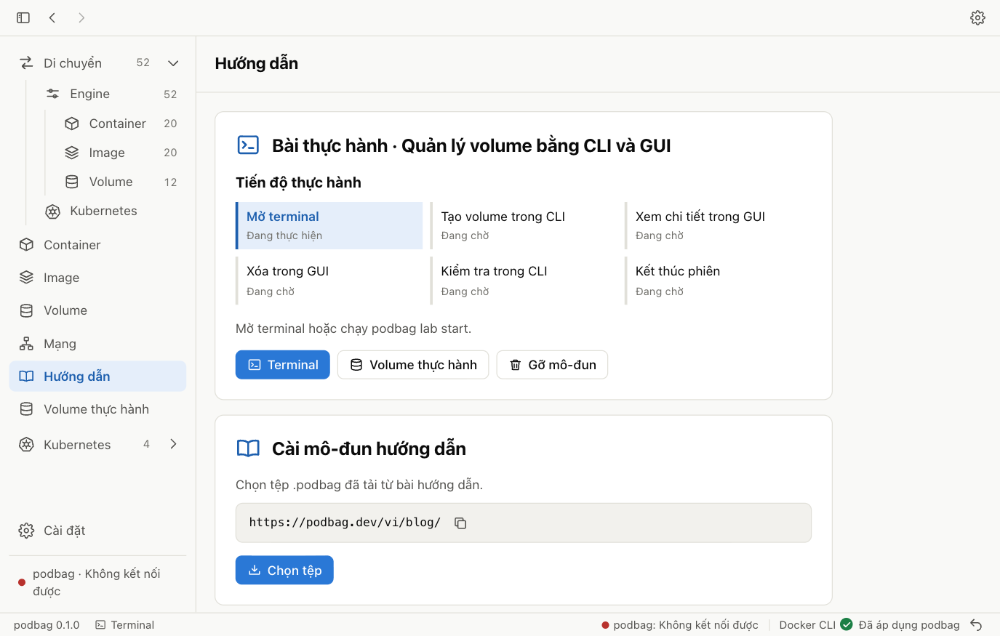
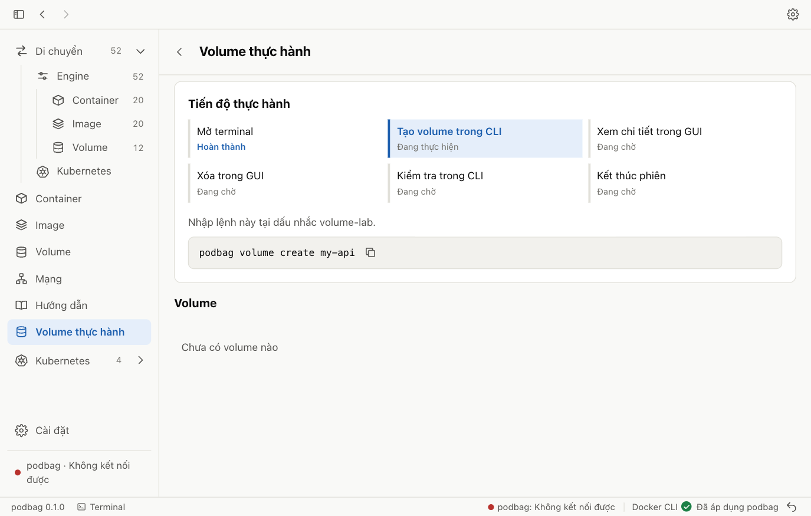
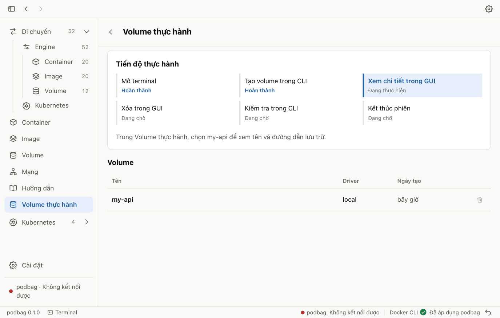
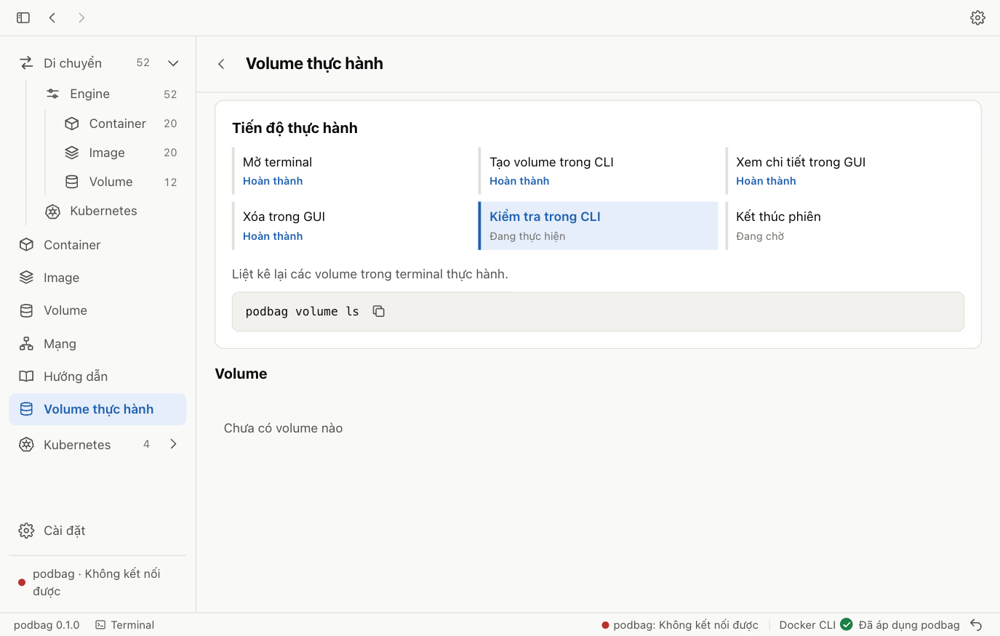
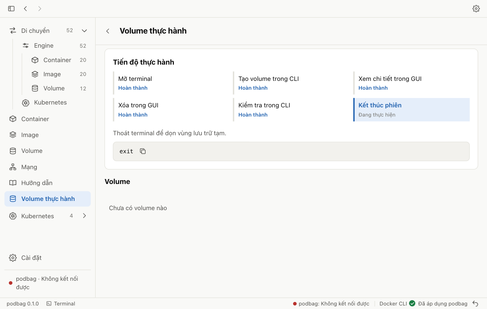
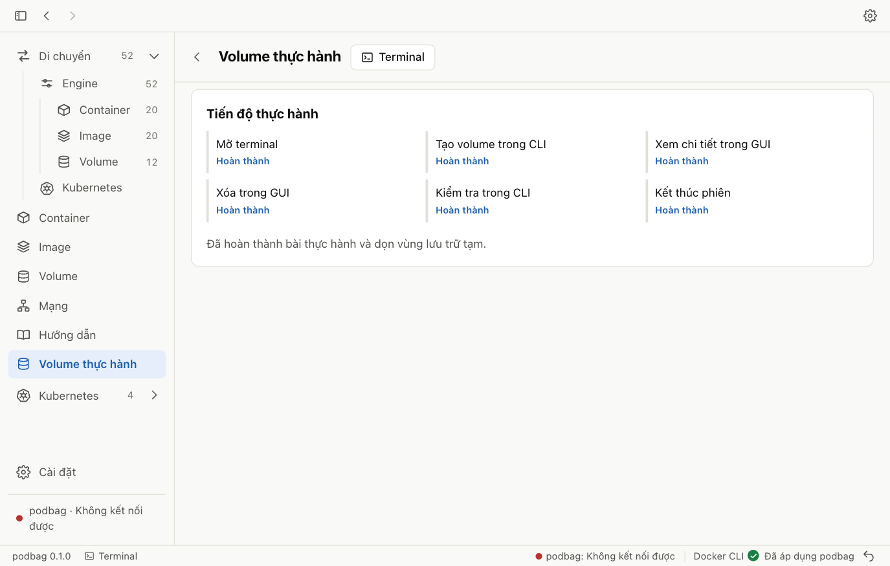

Tạo volume trong CLI, xem chi tiết và xóa trong Desktop, rồi theo dõi tiến độ.

[Tải mô-đun](cli-gui-volumes.podbag)

## Cài mô-đun

Dùng bản Desktop và CLI hỗ trợ bài này. Tải tệp rồi cài từ mục hướng dẫn trên Desktop, hoặc chạy lệnh dưới đây trong thư mục tải xuống.

```sh
podbag lab install cli-gui-volumes.podbag
```


## Mở bài thực hành trong Desktop

Chọn mô-đun đã cài ở mục hướng dẫn. Bảng tiến độ hiển thị tác vụ hiện tại. Nhấn Terminal để mở terminal thực hành.



## Mở terminal

Giữ terminal mở và chọn Volume thực hành ở thanh bên Desktop. Bước hiện tại hiển thị lệnh cần nhập.



## Tạo volume trong CLI

Nhập lệnh này tại dấu nhắc volume-lab.

```sh
podbag volume create my-api
podbag volume ls
```


## Xem chi tiết trong GUI

Khi my-api xuất hiện, bước tạo đã hoàn thành và bước xem chi tiết trong GUI chuyển sang trạng thái đang thực hiện.



Trong Volume thực hành, chọn my-api để xem tên và đường dẫn lưu trữ.


## Xóa trong GUI

Chọn Xóa cho my-api. Kiểm tra tên rồi xác nhận.


Danh sách trống sau khi xóa. Quay lại terminal thực hành để kiểm tra.



## Kiểm tra trong CLI

Liệt kê lại các volume trong terminal thực hành.

```sh
podbag volume ls
```



## Kết thúc phiên

Khi thấy Verified, nhập exit. Dịch vụ dừng, vùng lưu trữ tạm được dọn và tất cả các bước đều hoàn thành.

```sh
exit
```




## Gỡ mô-đun

Chạy lệnh này trong terminal ban đầu để xóa mô-đun và bản ghi hoàn thành.

```sh
podbag lab remove
```


