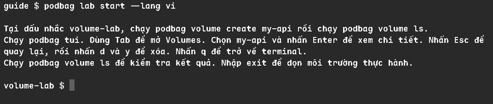

Dùng bản Podbag hỗ trợ `podbag lab --help`. Tải tệp rồi mở terminal tại thư mục chứa tệp. Bài thực hành dùng vùng lưu trữ tạm riêng.

[Tải mô-đun](cli-tui-volumes.podbag)

## Cài mô-đun

Cài tệp đã tải. Bạn cũng có thể chọn tệp trong mục hướng dẫn của Desktop.

```sh
podbag lab install cli-tui-volumes.podbag
```


## Mở terminal thực hành

Bắt đầu phiên. Khi thấy `volume-lab $`, hãy nhập các lệnh tiếp theo tại đó.

```sh
podbag lab start --lang vi
```



## Tạo volume

Tạo `my-api`, liệt kê volume và tìm tên trong cột `VOLUME NAME`.

```sh
podbag volume create my-api
podbag volume ls
```


## Tìm volume trong TUI

Chạy TUI trong cùng terminal. Nhấn `Tab` đến **Volumes** rồi chọn `my-api`.

```sh
podbag tui
```


## Xem thông tin volume

Nhấn `Enter` để mở **Inspect**. Kiểm tra `Name` và `Mountpoint`, rồi nhấn `Esc` để quay lại.


## Xóa volume đã chọn

Nhấn `d` tại dòng `my-api`. Kiểm tra tên trong hộp thoại và nhấn `y` để xác nhận.


## Kiểm tra danh sách trống

Khi thấy **No volumes on this engine.**, nhấn `q` để quay lại terminal.


## Kết thúc phiên

Liệt kê volume lần nữa. Khi thấy `Verified`, nhập `exit` để dừng dịch vụ và dọn các tệp tạm.

```sh
podbag volume ls
exit
```


## Gỡ mô-đun

Chạy lệnh này trong terminal ban đầu để xóa mô-đun và bản ghi hoàn thành.

```sh
podbag lab remove
```


