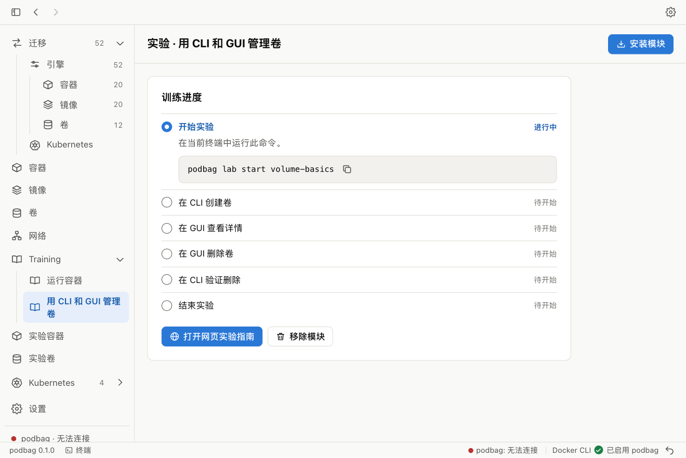
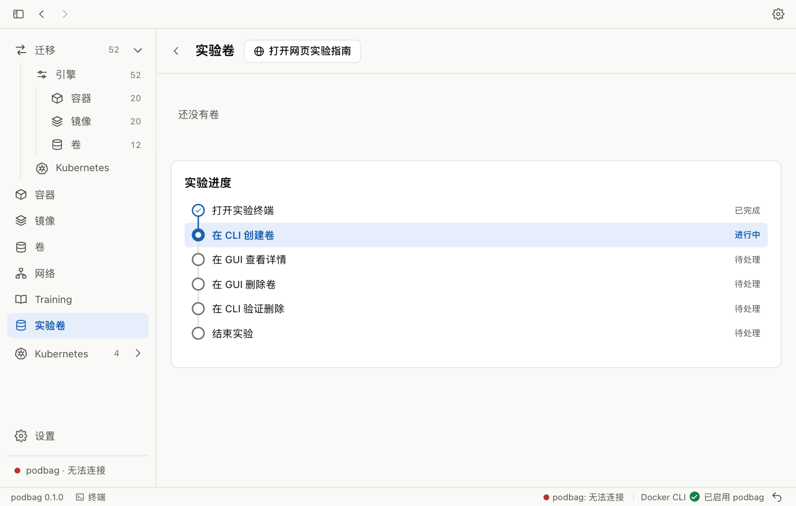
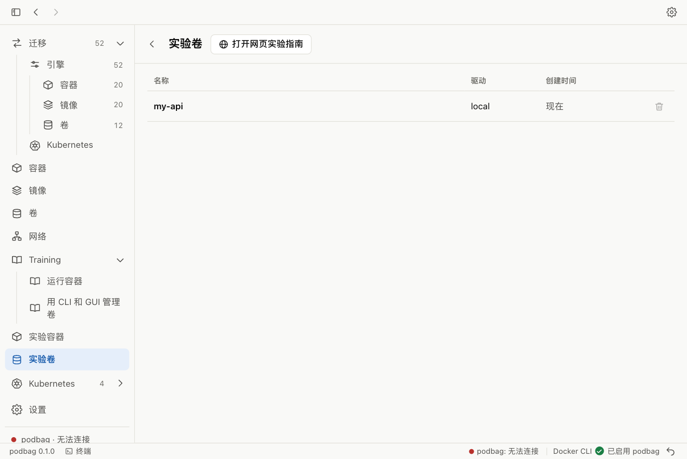
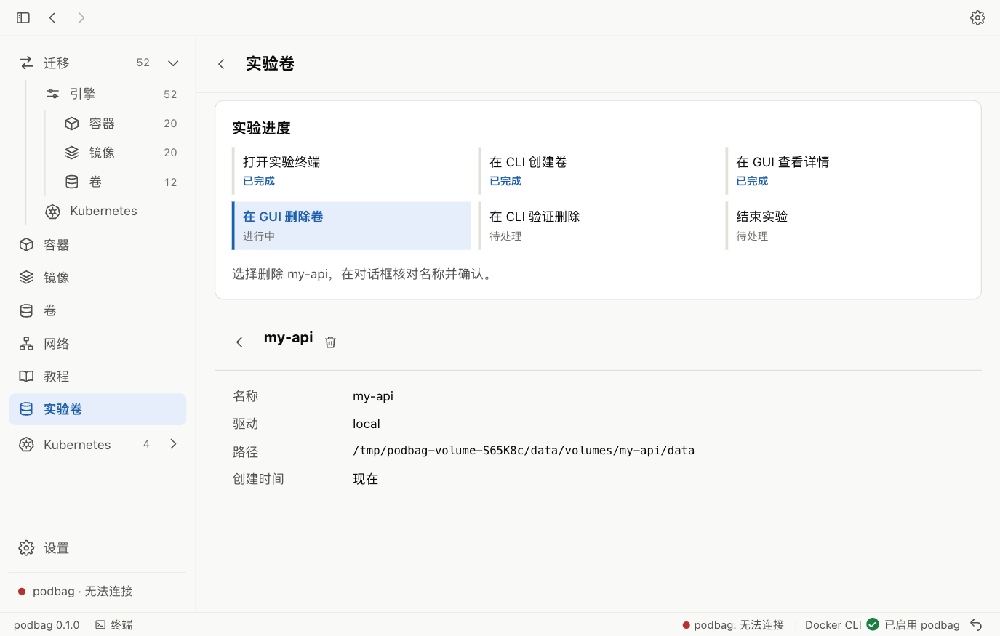
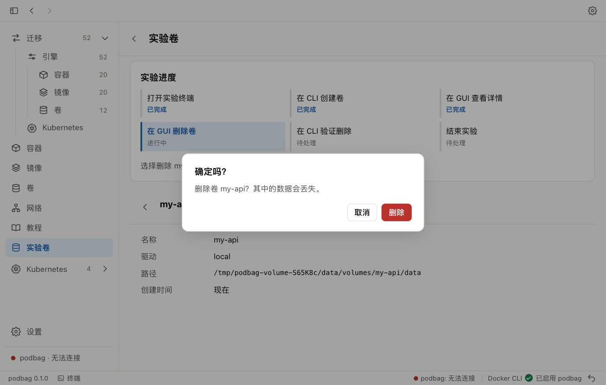
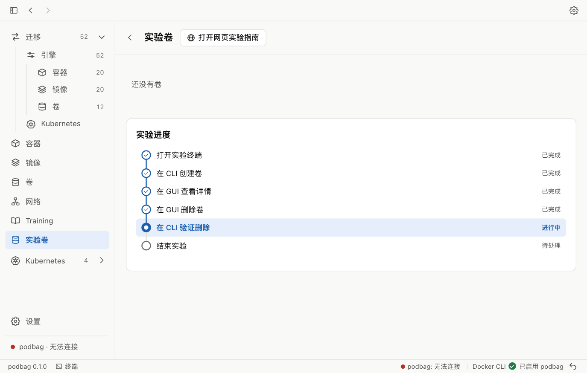
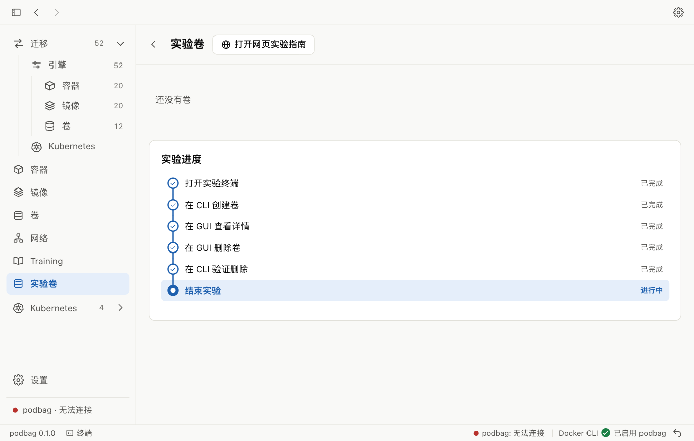
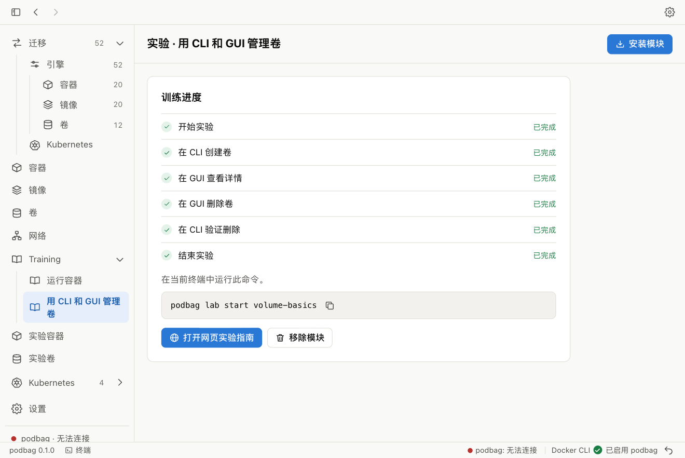

在 CLI 创建卷，在 Desktop 查看详情并删除。进度面板会标出当前任务。

[下载实验模块](cli-gui-volumes.podbag)

## 什么是卷？

卷是独立于容器的存储空间。`app-a` 将 `note.txt` 保存到 `my-api` 卷。删除 `app-a` 后，新容器 `app-b` 挂载同一个卷，仍然可以读取该文件。 如果删除卷本身，其中的文件也会被删除。

[](volume-life.mp4)

## 安装模块

使用支持本实验的 Desktop 和 CLI。下载文件后在教程页面选择并安装，也可以在下载目录中运行以下命令。

```sh
podbag lab install cli-gui-volumes.podbag
```


## 在 Desktop 打开实验

在 Desktop 的 **Training** 中点击**打开网页实验指南**可返回本页。Training 会显示模块状态及当前任务。



## 打开实验终端

在 Desktop 侧栏打开实验卷，点击终端按钮。实验期间保持本页和终端打开。



## 在 CLI 创建卷

在 volume-lab 提示符下输入此命令。

```sh
podbag volume create my-api
podbag volume ls
```


## 在 GUI 查看详情

卷出现后，Training 会显示接下来在 GUI 中查看详情。



在实验卷页面选择 my-api，查看名称和存储路径。



## 在 GUI 删除卷

选择删除 my-api，在对话框核对名称并确认。



删除后列表为空。返回同一个实验终端。



## 在 CLI 验证删除

在实验终端再次列出卷。

```sh
podbag volume ls
```



## 结束实验

终端显示 `Verified` 后输入 `exit` 清理临时存储。Training 会显示实验完成。

```sh
exit
```




## 卸载模块

在原终端运行此命令可删除模块及其完成记录。

```sh
podbag lab remove volume-basics
```


