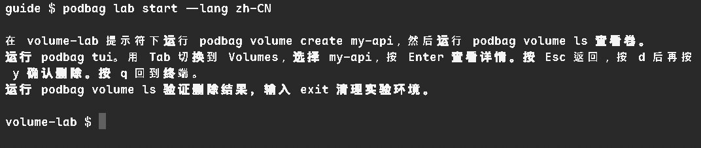

确认 Podbag 支持 `podbag lab --help`。下载文件，在其所在目录打开终端。实验使用独立的临时存储区。

[下载实验模块](cli-tui-volumes.podbag)

## 安装模块

安装下载的文件，也可以在 Desktop 的教程页面中选择文件并安装。

```sh
podbag lab install cli-tui-volumes.podbag
```


## 打开实验终端

启动实验。看到 `volume-lab $` 后，在这个终端输入后续命令。

```sh
podbag lab start --lang zh-CN
```



## 创建卷

创建 `my-api`，列出卷，检查 `VOLUME NAME` 下的名称。

```sh
podbag volume create my-api
podbag volume ls
```


## 在 TUI 中找到卷

在同一终端启动 TUI。用 `Tab` 切换到 **Volumes** 并选择 `my-api`。

```sh
podbag tui
```


## 查看详情

按 `Enter` 打开 **Inspect**，检查 `Name` 和 `Mountpoint`。按 `Esc` 返回。


## 删除所选卷

选中 `my-api` 后按 `d`，核对确认框中的名称，再按 `y`。


## 检查空列表

看到 **No volumes on this engine.** 后按 `q` 返回实验终端。


## 结束实验

再次查询卷。看到 `Verified` 后输入 `exit`，系统会停止服务并清理临时文件。

```sh
podbag volume ls
exit
```


## 卸载模块

在原终端运行此命令可删除模块及其完成记录。

```sh
podbag lab remove
```


