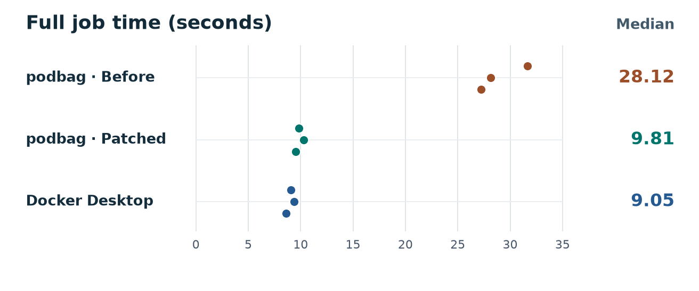

A short Python repair job ran in one container. A second container read the report and verified it. The report was already on disk when we saw the long pauses. Compose showed them between `Stopping` and `Stopped`, once for each container.

Both containers used Harbor’s default keep-alive, `sh -c "sleep infinity"`. The shell ran as PID 1 and had no handler for SIGTERM. Compose sent the one-second grace period as `Config.StopTimeout` when it created the container. podbag discarded that value. At shutdown it waited ten seconds before sending SIGKILL.

## What changed

The patch stores the timeout and returns it in Docker inspect. Stop and restart use an explicit request timeout first, then the saved value. A container without either still gets ten seconds. Choose a grace period that gives the service time to finish its work.

## Median time for the full job

We used one Apple M5 Mac, the same Linux arm64 Python 3.13.9 image and the same offline package. Each container had one CPU and 512 MiB of memory. We warmed each engine once, then rotated the run order for three timed trials. Every trial produced the expected report and passed the separate verifier.



<!-- compare-rows: podbag podbag docker -->
| Engine | Time (seconds) |
|---|---:|
| podbag · Parent revision (`7836256`) | {{n:28.12}} |
| podbag · Patched revision (`1743d75`) | {{n:9.81}} |
| Docker Desktop 4.97.0 | {{n:9.05}} |

We also ran the original Compose setup with no grace period. The parent took 30.43 seconds and the patched build took 30.56 seconds in one trial each. The shorter wait depends on the service choosing a grace period.

To reproduce the setting, add the block below to both Compose services. Then check the saved value with Docker inspect. These figures apply to the branch build and this two-container workload.

```yaml
services:
  main:
    stop_grace_period: 1s
```

```sh
docker inspect --format '{{.Config.StopTimeout}}' CONTAINER
```

Reproduction and patch — [#12](https://github.com/SteelCrab/podbag/issues/12) · [PR #13](https://github.com/SteelCrab/podbag/pull/13)
