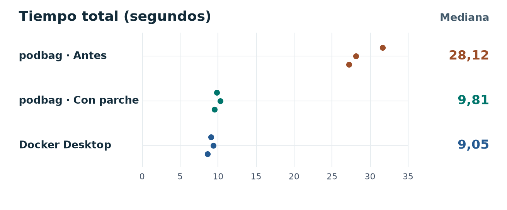

Un contenedor reparaba un entorno virtual de Python y generaba un informe. Otro leía el informe y lo verificaba. La espera continuaba después de guardar el archivo. El registro de Compose situaba las dos pausas entre `Stopping` y `Stopped`.

Harbor mantenía los contenedores activos con `sh -c "sleep infinity"`. El intérprete se ejecutaba como PID 1 y no tenía un manejador para SIGTERM. Compose enviaba un plazo de un segundo en `Config.StopTimeout` al crear el contenedor. podbag descartaba el valor y esperaba diez segundos antes de enviar SIGKILL.

## Cómo se elige el plazo

El parche conserva el plazo y lo muestra en Docker inspect. Al detener o reiniciar el contenedor, el motor utiliza primero el plazo de la petición y después el guardado. Si faltan ambos, espera diez segundos. Conviene elegir un plazo que permita al servicio terminar su trabajo.

## Mediana del tiempo total

Usamos un Mac con Apple M5, la misma imagen Linux arm64 de Python 3.13.9 y el mismo paquete sin conexión. Cada contenedor tenía una CPU y 512 MiB. Tras una ejecución de calentamiento por motor, alternamos el orden en tres rondas cronometradas. Todos los informes pasaron la verificación en el segundo contenedor.



| Motor | Tiempo (segundos) |
|---|---:|
| podbag · Antes del parche (`7836256`) | 28,12 |
| podbag · Con el parche (`1743d75`) | 9,81 |
| Docker Desktop 4.97.0 | 9,05 |

También ejecutamos una prueba por versión sin configurar el plazo de parada. La revisión anterior tardó 30,43 segundos y la del parche, 30,56. En esta tarea, la espera se reduce cuando el servicio especifica un plazo.

Para reproducir la configuración, añade este bloque a los servicios de trabajo y verificación de Compose. Comprueba el valor con Docker inspect. Las cifras corresponden a la compilación de la rama y a esta carga de dos contenedores.

```yaml
services:
  main:
    stop_grace_period: 1s
```

```sh
docker inspect --format '{{.Config.StopTimeout}}' CONTAINER
```

Pasos de reproducción y parche — [#12](https://github.com/SteelCrab/podbag/issues/12) · [PR #13](https://github.com/SteelCrab/podbag/pull/13)
