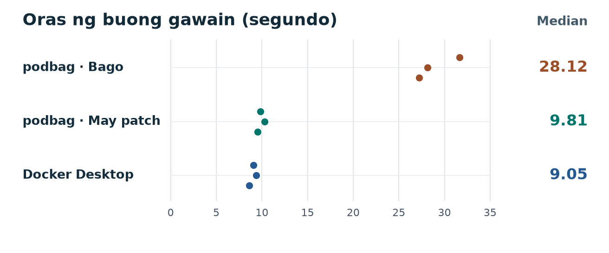

Nag-ayos ng Python virtual environment ang unang container at gumawa ng ulat. Binasa at sinuri ito ng pangalawang container. Nakasulat na sa disk ang ulat nang mapansin ang paghihintay. Sa log ng Compose, parehong natagalan ang paglipat mula `Stopping` patungong `Stopped`.

Ginagamit ng Harbor ang `sh -c "sleep infinity"` para panatilihing tumatakbo ang mga container. Ang shell ang PID 1 at wala itong handler para sa SIGTERM. Sa paggawa ng container, ipinasa ng Compose ang isang segundo sa `Config.StopTimeout`. Binalewala ito ng podbag kaya naghintay ito ng sampung segundo bago magpadala ng SIGKILL.

## Paano pinipili ang oras ng paghihintay

Iniimbak ng patch ang halagang ito at ipinapakita ito sa Docker inspect. Sa paghinto o pag-restart, nauuna ang halagang nasa request, kasunod ang nakaimbak na halaga. Kung walang nakatakda, sampung segundo pa rin ang hihintayin. Pumili ng oras na sapat para matapos ng serbisyo ang ginagawa nito.

## Median ng oras para sa buong gawain

Gumamit kami ng isang Apple M5 Mac, ng parehong Linux arm64 Python 3.13.9 image at ng parehong offline na package. May isang CPU at 512 MiB ang bawat container. Pagkatapos ng isang warm-up sa bawat engine, pinagpalit namin ang pagkakasunod sa tatlong pagsukat. Pumasa ang bawat ulat sa hiwalay na container na nagsuri nito.



<!-- compare-rows: podbag podbag docker -->
| Engine | Oras (segundo) |
|---|---:|
| podbag · Bago ang patch (`7836256`) | {{n:28.12}} |
| podbag · May patch (`1743d75`) | {{n:9.81}} |
| Docker Desktop 4.97.0 | {{n:9.05}} |

Sinubukan din namin ang orihinal na configuration na walang itinakdang oras ng paghihintay. Sa tig-isang pagsukat, umabot sa 30.43 segundo ang lumang build at 30.56 segundo ang may patch. Kailangang magtakda ang serbisyo ng oras para umikli ang paghihintay sa gawaing ito.

Para maulit ang pagsukat, idagdag ang configuration sa ibaba sa parehong serbisyo ng Compose. Tingnan ang nakaimbak na halaga gamit ang Docker inspect. Ang mga bilang ay para sa build ng branch at sa gawaing ito na may dalawang container.

```yaml
services:
  main:
    stop_grace_period: 1s
```

```sh
docker inspect --format '{{.Config.StopTimeout}}' CONTAINER
```

Mga hakbang at patch — [#12](https://github.com/SteelCrab/podbag/issues/12) · [PR #13](https://github.com/SteelCrab/podbag/pull/13)
