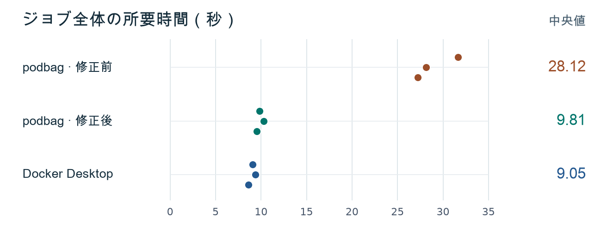

一つ目のコンテナが Python の仮想環境を復旧してレポートを生成し、二つ目が内容を検証します。レポートの保存後も処理が続きました。Compose のログでは、どちらも `Stopping` から `Stopped` に変わるまで待っていました。

Harbor は `sh -c "sleep infinity"` でコンテナを待機させます。PID 1 のシェルには SIGTERM のハンドラーがありません。Compose は作成時に1秒の猶予を `Config.StopTimeout` で送りました。podbag はこの値を破棄し、停止のたびに10秒待ってから SIGKILL を送りました。

## 猶予時間の優先順位

修正後は設定を保存し、Docker inspect で確認できます。停止と再起動では、要求時の指定、保存値の順に適用します。両方ともなければ従来どおり10秒です。猶予時間はサービスが処理を終えるのに必要な長さに設定します。

## ジョブ全体の所要時間の中央値

Apple M5 の Mac 一台で同じ Linux arm64 の Python 3.13.9 イメージとオフラインのパッケージを使いました。各コンテナは1 CPU、512 MiB です。各エンジンで一度予備実行した後、順序を入れ替えて3回計測しました。すべてのレポートが別のコンテナでの検証に合格しました。



<!-- compare-rows: podbag podbag docker -->
| エンジン | 時間（秒） |
|---|---:|
| podbag · 修正前 (`7836256`) | {{n:28.12}} |
| podbag · 修正後 (`1743d75`) | {{n:9.81}} |
| Docker Desktop 4.97.0 | {{n:9.05}} |

猶予時間を指定しない元の設定でも1回ずつ計測しました。修正前は30.43秒、修正後は30.56秒でした。この処理で待ち時間を短縮するには、サービス側で猶予時間を指定します。

再現するには、作業用と検証用の両方の Compose サービスに以下の設定を追加します。保存値は Docker inspect で確認できます。数値はこのブランチのビルドと二つのコンテナでの結果です。

```yaml
services:
  main:
    stop_grace_period: 1s
```

```sh
docker inspect --format '{{.Config.StopTimeout}}' CONTAINER
```

再現手順と修正 — [#12](https://github.com/SteelCrab/podbag/issues/12) · [PR #13](https://github.com/SteelCrab/podbag/pull/13)
