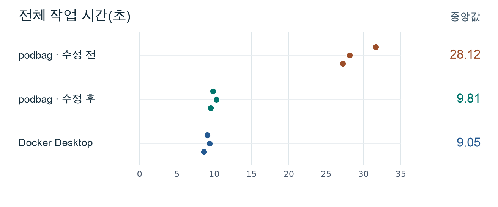

첫 컨테이너는 Python 가상환경을 복구하고 리포트를 생성합니다. 두 번째 컨테이너는 리포트를 읽고 결과를 검증합니다. 리포트가 이미 저장된 뒤에도 실행이 계속됐습니다. Compose 로그를 보니 두 컨테이너 모두 `Stopping`에서 `Stopped`로 바뀔 때 시간이 걸렸습니다.

Harbor는 두 컨테이너를 `sh -c "sleep infinity"`로 유지합니다. 첫 프로세스인 셸에는 종료 요청인 SIGTERM을 처리하는 코드가 없었습니다. Compose는 컨테이너를 만들 때 1초의 유예 시간을 `Config.StopTimeout`으로 보냈습니다. podbag은 이 값을 저장하지 않아 종료할 때마다 10초를 기다린 뒤 SIGKILL을 보냈습니다.

## 종료 시간을 선택하는 순서

수정본은 유예 시간을 저장하고 Docker inspect에도 표시합니다. 정지와 재시작 모두 요청에 지정한 시간을 먼저 사용합니다. 요청에 값이 없으면 컨테이너에 저장한 값을 사용합니다. 둘 다 없으면 기존대로 10초를 기다립니다. 유예 시간은 서비스가 하던 일을 마치는 데 필요한 시간에 맞춰야 합니다.

## 전체 작업 시간 중앙값

Apple M5 Mac 한 대에서 같은 Linux arm64 Python 3.13.9 이미지와 오프라인 패키지를 사용했습니다. 컨테이너마다 CPU 1개와 메모리 512 MiB를 할당했습니다. 각 엔진을 한 번 예열한 뒤 순서를 바꿔 세 번 측정했습니다. 모든 회차에서 기대한 리포트가 생성됐고 별도 검증기를 통과했습니다.



| 엔진 | 시간(초) |
|---|---:|
| podbag · 수정 전 (`7836256`) | 28.12 |
| podbag · 수정 후 (`1743d75`) | 9.81 |
| Docker Desktop 4.97.0 | 9.05 |

유예 시간을 생략한 원래 설정으로도 한 번씩 실행했습니다. 수정 전은 30.43초, 수정 후는 30.56초였습니다. 이 작업에서 종료 대기를 줄이려면 서비스에 유예 시간을 지정해야 합니다.

같은 조건을 재현하려면 작업용과 검증용 Compose 서비스에 아래 설정을 적용합니다. Docker inspect로 저장된 값을 확인할 수 있습니다. 표는 이 두 컨테이너를 사용한 브랜치 빌드의 결과입니다.

```yaml
services:
  main:
    stop_grace_period: 1s
```

```sh
docker inspect --format '{{.Config.StopTimeout}}' CONTAINER
```

재현 절차와 수정 코드 — [#12](https://github.com/SteelCrab/podbag/issues/12) · [PR #13](https://github.com/SteelCrab/podbag/pull/13)
