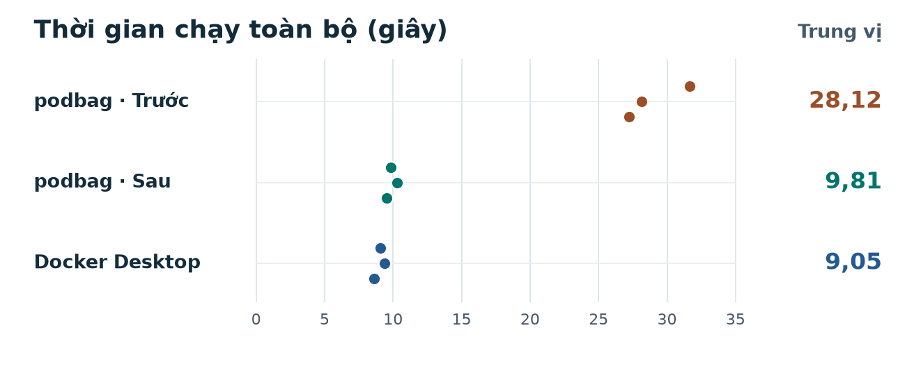

Container thứ nhất khôi phục môi trường ảo Python và tạo báo cáo. Container thứ hai đọc và kiểm tra báo cáo. Dù báo cáo đã được ghi xuống đĩa, tác vụ vẫn chưa kết thúc. Nhật ký Compose cho thấy cả hai container đều phải chờ khi chuyển từ `Stopping` sang `Stopped`.

Harbor giữ container chạy bằng `sh -c "sleep infinity"`. Shell có PID 1 và không đăng ký hàm xử lý SIGTERM. Khi tạo container, Compose gửi thời gian chờ một giây qua `Config.StopTimeout`. podbag bỏ qua giá trị này và đợi mười giây trước khi gửi SIGKILL.

## Cách chọn thời gian chờ

Bản sửa lưu thời gian chờ và hiển thị giá trị này qua Docker inspect. Khi dừng hoặc khởi động lại, giá trị trong yêu cầu được ưu tiên, sau đó mới đến giá trị đã lưu. Nếu thiếu cả hai, thời gian chờ vẫn là mười giây. Hãy chọn khoảng thời gian đủ để dịch vụ hoàn tất công việc.

## Trung vị thời gian chạy toàn bộ tác vụ

Chúng tôi dùng một máy Mac Apple M5, cùng image Python 3.13.9 cho Linux arm64 và cùng gói cài đặt ngoại tuyến. Mỗi container được cấp một CPU và 512 MiB. Sau một lần chạy làm nóng cho mỗi động cơ, chúng tôi luân phiên thứ tự trong ba lượt đo. Tất cả báo cáo đều vượt qua bước kiểm tra ở container thứ hai.



| Động cơ | Thời gian (giây) |
|---|---:|
| podbag · Trước khi sửa (`7836256`) | 28,12 |
| podbag · Sau khi sửa (`1743d75`) | 9,81 |
| Docker Desktop 4.97.0 | 9,05 |

Chúng tôi cũng chạy mỗi phiên bản một lần với cấu hình ban đầu không đặt thời gian chờ. Bản trước khi sửa mất 30,43 giây, còn bản sau mất 30,56 giây. Với tác vụ này, dịch vụ cần đặt thời gian chờ để rút ngắn bước dừng.

Để tái lập phép thử, thêm cấu hình dưới đây cho cả hai dịch vụ Compose rồi kiểm tra giá trị đã lưu bằng Docker inspect. Các số liệu áp dụng cho bản dựng từ nhánh sửa và tác vụ dùng hai container này.

```yaml
services:
  main:
    stop_grace_period: 1s
```

```sh
docker inspect --format '{{.Config.StopTimeout}}' CONTAINER
```

Cách tái lập và bản sửa — [#12](https://github.com/SteelCrab/podbag/issues/12) · [PR #13](https://github.com/SteelCrab/podbag/pull/13)
