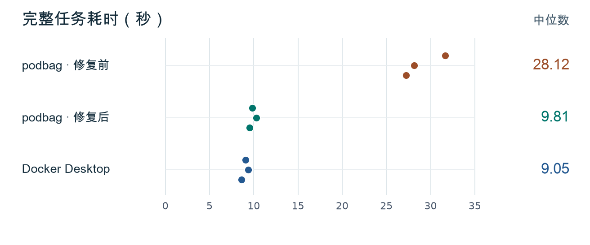

第一个容器修复 Python 虚拟环境并生成报告，第二个容器读取并验证报告。报告已经写入磁盘，任务却仍在运行。Compose 日志显示，两个容器都卡在从 `Stopping` 到 `Stopped` 的过程中。

Harbor 使用 `sh -c "sleep infinity"` 保持容器运行。作为 PID 1 的 shell 没有注册 SIGTERM 处理函数。Compose 在创建容器时通过 `Config.StopTimeout` 传入一秒的宽限期，但 podbag 丢弃了这个值。每次停止时，它都会等十秒才发送 SIGKILL。

## 停止时如何选择宽限期

修复后的引擎会保存宽限期，并通过 Docker inspect 显示它。停止和重启时优先采用请求指定的时间，其次采用保存的值。如果两者都没有，仍然等待十秒。请根据服务完成剩余工作所需的时间选择宽限期。

## 完整任务耗时的中位数

我们在同一台 Apple M5 Mac 上使用相同的 Linux arm64 Python 3.13.9 镜像和离线软件包。每个容器分配一个 CPU 和 512 MiB 内存。每个引擎先预热一次，再轮换顺序计时三次。所有报告都通过了独立容器的验证。



<!-- compare-rows: podbag podbag docker -->
| 引擎 | 时间（秒） |
|---|---:|
| podbag · 修复前 (`7836256`) | {{n:28.12}} |
| podbag · 修复后 (`1743d75`) | {{n:9.81}} |
| Docker Desktop 4.97.0 | {{n:9.05}} |

我们还用未设置宽限期的原始配置各运行了一次。修复前耗时 30.43 秒，修复后耗时 30.56 秒。这项任务需要在服务中指定宽限期才能缩短等待。

要复现这一设置，请在工作容器和验证容器的 Compose 服务中都加入以下配置，然后使用 Docker inspect 查看保存的值。表中数据来自分支构建及这项双容器任务。

```yaml
services:
  main:
    stop_grace_period: 1s
```

```sh
docker inspect --format '{{.Config.StopTimeout}}' CONTAINER
```

复现步骤和补丁 — [#12](https://github.com/SteelCrab/podbag/issues/12) · [PR #13](https://github.com/SteelCrab/podbag/pull/13)
