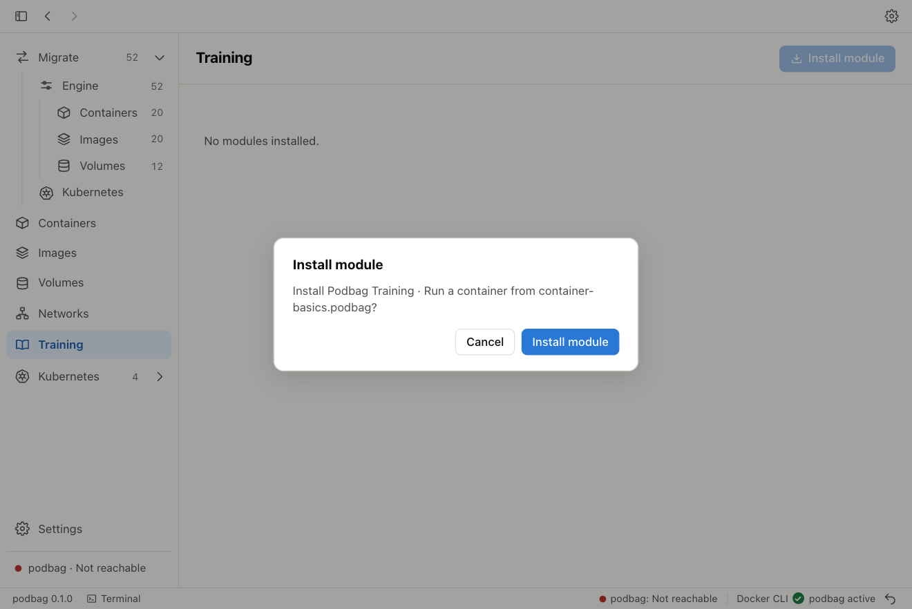
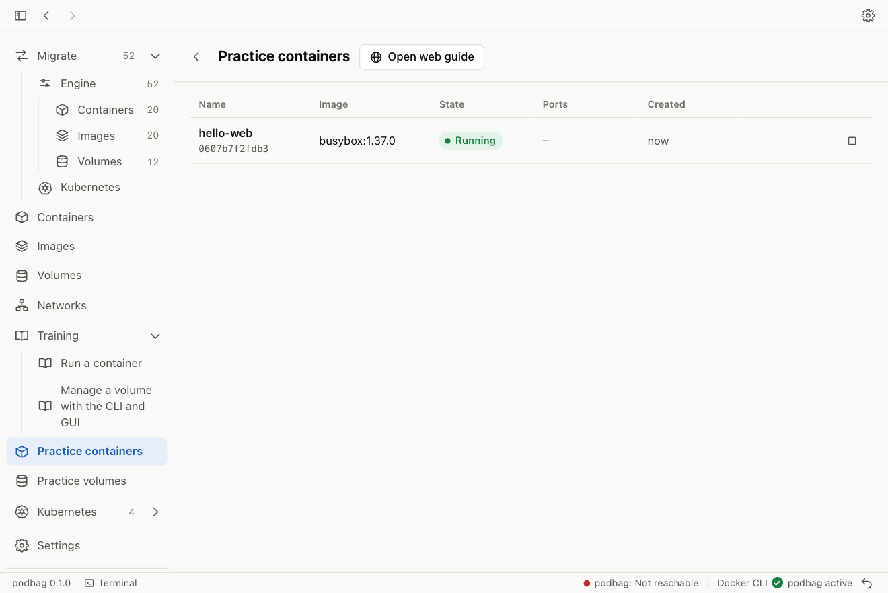

An image contains the files a program needs. A container runs the program from that image. In this lab, you run a small web server called `hello-web` and stop it with Podbag Desktop.

## Beginner course

**Run your first container** → [Open a web server in the browser](../web-basics/) → [Keep files across containers](../volume-persistence/) → [Replace and clean up a web service](../web-service-lifecycle/)

## Install the training module

[Download container-basics.podbag](https://github.com/SteelCrab/podbag/releases/download/training/container-basics/v1.0.0/container-basics.podbag). Open a training-compatible build of Podbag Desktop. In **Training**, select **Install module** at the top, choose the downloaded file, and confirm. You can also install it from your download folder.

```sh
podbag lab install container-basics.podbag
```



If you already installed this training module, install the new file over it to keep your completion record. Run `podbag lab list` to see your installed modules.

## Start the practice session

In the sidebar, expand **Training** and select **Run a container**. The module shows the current step and the steps that follow. Copy the command below and run it in your terminal. Continue when it shows `container-lab $`.

```sh
podbag lab start container-basics
```


## Run the web server in the CLI

Enter the command below in the practice terminal. Podbag downloads the practice image on the first run.

```sh
podbag run -d --name hello-web --network none docker.io/library/busybox:1.37.0 httpd -f -p 8080
```

`-d` runs the container in the background. `--name hello-web` gives it a name. The server listens on port 8080 inside the container. This lab focuses on the container's lifecycle, so the command leaves the server isolated from the host network.


## Stop the container in Desktop

Leave the practice terminal open. Select **Practice containers** in Desktop. Find `hello-web` with a running status and select **Stop** in its row. You can also open the container details and select **Stop** there.



The container row shows **Exited**. Select the module under **Training** to see **Check the status in the CLI** and copy its command.


## Check the result in the CLI

Return to the same practice terminal and list all containers. The `-a` option includes stopped containers.

```sh
podbag ps -a
```


Confirm that `hello-web` shows `Exited`. The practice terminal prints `Verified`.


## Finish the practice session

Type `exit`. Podbag removes the practice container, its downloaded image, and the temporary store. The module and its completion record remain available in Training.


[Next module · Open a web server in the browser](../web-basics/)
