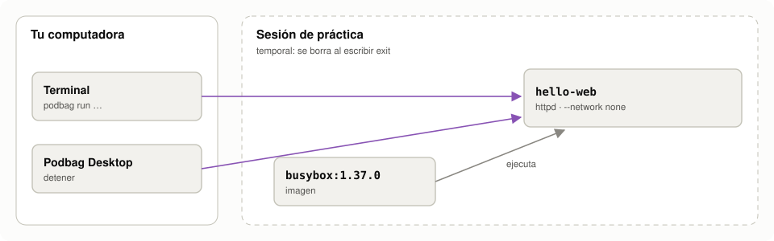
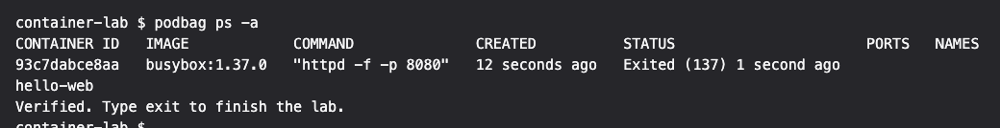

Una imagen contiene los archivos que necesita un programa. Un contenedor ejecuta el programa de esa imagen. En esta práctica, ejecutas un pequeño servidor web llamado `hello-web` y lo detienes con Podbag Desktop.



## Curso de iniciación

**Ejecuta tu primer contenedor** → [Abre un servidor web en el navegador](../web-basics/) → [Conserva archivos entre contenedores](../volume-persistence/) → [Sustituye y limpia un servicio web](../web-service-lifecycle/)

## Instala el módulo de práctica

[Descargar container-basics.podbag](https://github.com/SteelCrab/podbag/releases/download/training/container-basics/v1.0.0/container-basics.podbag). Abre una versión de Podbag Desktop compatible con Training. En **Training**, selecciona **Instalar módulo** en la parte superior, elige el archivo descargado y confirma. También puedes instalarlo desde tu carpeta de descargas.

```sh
podbag lab install container-basics.podbag
```


Si ya instalaste este módulo, instala el archivo nuevo encima para conservar tu registro de finalización. Ejecuta `podbag lab list` para ver los módulos instalados.

## Inicia la sesión de práctica

En la barra lateral, despliega **Training** y selecciona **Ejecuta un contenedor**. El módulo muestra el paso actual y los pasos siguientes. Copia el comando de abajo y ejecútalo en tu terminal. Continúa cuando aparezca `container-lab $`.

```sh
podbag lab start container-basics
```


## Ejecuta el servidor web en la CLI

Escribe este comando en la terminal de práctica. Podbag descarga la imagen de práctica la primera vez.

```sh
podbag run -d --name hello-web --network none docker.io/library/busybox:1.37.0 httpd -f -p 8080
```

`-d` ejecuta el contenedor en segundo plano. `--name hello-web` le da un nombre. El servidor escucha en el puerto 8080 dentro del contenedor. Esta práctica trata del ciclo de vida del contenedor. Por eso el comando deja el servidor aislado de la red del host.


## Detén el contenedor en Desktop

Deja abierta la terminal de práctica. Selecciona **Contenedores de práctica** en Desktop. Busca `hello-web` en estado de ejecución y selecciona **Detener** en su fila. También puedes abrir los detalles del contenedor y seleccionar **Detener** allí.


La fila del contenedor muestra **Detenido**. Selecciona el módulo en **Training** para ver **Comprueba el estado en la CLI** y copia su comando.


## Comprueba el resultado en la CLI

Vuelve a la misma terminal de práctica y lista todos los contenedores. La opción `-a` incluye los contenedores detenidos.

```sh
podbag ps -a
```


Comprueba que `hello-web` muestra `Exited`. La terminal de práctica muestra `Verified`.



## Termina la sesión de práctica

Escribe `exit`. Podbag elimina el contenedor de práctica, la imagen descargada y el almacenamiento temporal. El módulo y su registro de finalización siguen disponibles en Training.


[Siguiente módulo · Abre un servidor web en el navegador](../web-basics/)
