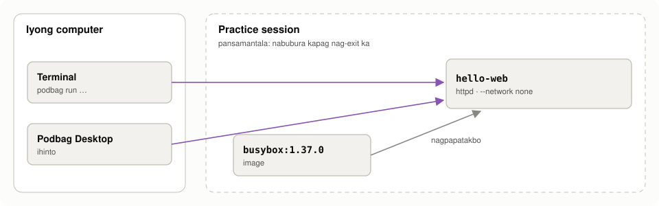

Nasa image ang mga file na kailangan ng isang program. Pinapatakbo ng container ang program mula sa image na iyon. Sa lab na ito, magpapatakbo ka ng maliit na web server na `hello-web` at ihihinto mo ito gamit ang Podbag Desktop.



## Kurso para sa baguhan

**Patakbuhin ang iyong unang container** → [Buksan ang web server sa browser](../web-basics/) → [Panatilihin ang mga file sa pagitan ng mga container](../volume-persistence/) → [Palitan at linisin ang web service](../web-service-lifecycle/)

## I-install ang training module

[I-download ang container-basics.podbag](https://github.com/SteelCrab/podbag/releases/download/training/container-basics/v1.0.0/container-basics.podbag). Buksan ang build ng Podbag Desktop na may Training. Sa **Training**, piliin ang **I-install ang module** sa itaas, piliin ang na-download na file, at kumpirmahin. Maaari mo rin itong i-install mula sa folder ng download.

```sh
podbag lab install container-basics.podbag
```


Kung naka-install na ang training module na ito, i-install ang bagong file sa ibabaw nito. Mananatili ang tala ng pagkumpleto mo. Patakbuhin ang `podbag lab list` para makita ang mga naka-install na module.

## Simulan ang practice session

Sa sidebar, palawakin ang **Training** at piliin ang **Magpatakbo ng container**. Ipinapakita ng module ang kasalukuyang hakbang at ang mga susunod na hakbang. Kopyahin ang command sa ibaba at patakbuhin ito sa terminal mo. Magpatuloy kapag lumabas ang `container-lab $`.

```sh
podbag lab start container-basics
```


## Patakbuhin ang web server sa CLI

I-type ang command sa ibaba sa practice terminal. Dina-download ng Podbag ang practice image sa unang pagpapatakbo.

```sh
podbag run -d --name hello-web --network none docker.io/library/busybox:1.37.0 httpd -f -p 8080
```

Pinapatakbo ng `-d` ang container sa background. Binibigyan ito ng pangalan ng `--name hello-web`. Nakikinig ang server sa port 8080 sa loob ng container. Nakatuon ang lab na ito sa lifecycle ng container. Kaya hiwalay ang server sa network ng host.


## Ihinto ang container sa Desktop

Panatilihing bukas ang practice terminal. Piliin ang **Mga practice container** sa Desktop. Hanapin ang `hello-web` na tumatakbo at piliin ang **Ihinto** sa hanay nito. Maaari mo ring buksan ang detalye ng container at piliin doon ang **Ihinto**.


Ipinapakita ng hanay ng container ang **Nakahinto**. Piliin ang module sa ilalim ng **Training** para makita ang **Tingnan ang status sa CLI** at kopyahin ang command nito.


## Tingnan ang resulta sa CLI

Bumalik sa parehong practice terminal at ilista ang lahat ng container. Isinasama ng option na `-a` ang mga nakahintong container.

```sh
podbag ps -a
```


Tiyaking `Exited` ang status ng `hello-web`. Lalabas ang `Verified` sa practice terminal.


## Tapusin ang practice session

I-type ang `exit`. Inaalis ng Podbag ang practice container, ang na-download na image, at ang pansamantalang storage. Mananatili sa Training ang module at ang tala ng pagkumpleto nito.


[Susunod na module · Buksan ang web server sa browser](../web-basics/)
