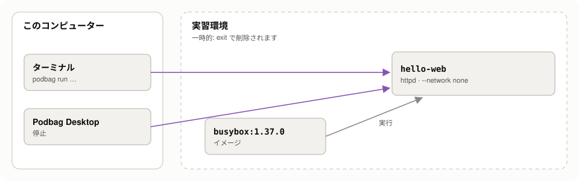
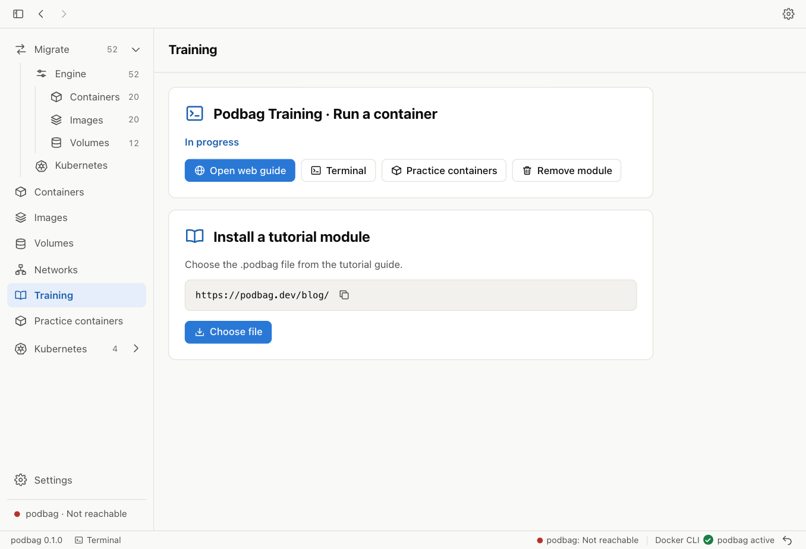

イメージには、プログラムに必要なファイルが入っています。コンテナは、そのイメージからプログラムを実行します。この実習では、`hello-web` という小さな Web サーバーを実行し、Podbag Desktop で停止します。



## 初心者コース

**最初のコンテナを実行する** → [ブラウザーで Web サーバーを開く](../web-basics/) → [コンテナが変わってもファイルを残す](../volume-persistence/) → [Web サービスを入れ替えて片付ける](../web-service-lifecycle/)

## 実習モジュールをインストールする

[container-basics.podbag をダウンロード](https://github.com/SteelCrab/podbag/releases/download/training/container-basics/v1.0.0/container-basics.podbag)します。Training に対応した Podbag Desktop を開きます。**Training** の上部にある**モジュールをインストール**を選び、ダウンロードしたファイルを指定して確認します。ダウンロード先のフォルダーで次のコマンドを実行してもインストールできます。

```sh
podbag lab install container-basics.podbag
```


このモジュールをインストール済みの場合も、新しいファイルを上書きでインストールできます。完了の記録は残ります。インストール済みのモジュールは `podbag lab list` で確認できます。

## 実習を開始する

サイドバーの **Training** を展開し、**コンテナを実行する**を選びます。現在の手順と、その後の手順が表示されます。次のコマンドをコピーし、お使いのターミナルで実行します。`container-lab $` が表示されたら続けます。

```sh
podbag lab start container-basics
```



## CLI で Web サーバーを実行する

実習ターミナルで次のコマンドを入力します。初回の実行では、Podbag が実習用のイメージをダウンロードします。

```sh
podbag run -d --name hello-web --network none docker.io/library/busybox:1.37.0 httpd -f -p 8080
```

`-d` はコンテナをバックグラウンドで実行します。`--name hello-web` はコンテナに名前を付けます。サーバーはコンテナ内のポート 8080 で待ち受けます。この実習ではコンテナの起動と停止を学びます。そのため、このコマンドはサーバーをホストのネットワークから切り離します。


## Desktop でコンテナを停止する

実習ターミナルは開いたままにします。Desktop で**実習コンテナ**を選びます。実行中の `hello-web` を探し、その行の**停止**を選びます。コンテナの詳細を開いて**停止**を選ぶこともできます。


コンテナの行に**停止**と表示されます。**Training** でモジュールを選ぶと、**CLI で状態を確認する**の手順とコマンドが表示されます。コマンドをコピーします。


## CLI で結果を確認する

同じ実習ターミナルに戻り、すべてのコンテナを一覧表示します。`-a` オプションを付けると、停止したコンテナも表示されます。

```sh
podbag ps -a
```


`hello-web` が `Exited` になっていることを確認します。実習ターミナルに `Verified` と表示されます。


## 実習を終了する

`exit` と入力します。Podbag は実習用のコンテナ、ダウンロードしたイメージ、一時ストアを削除します。モジュールと完了の記録は Training に残ります。


[次のモジュール · ブラウザーで Web サーバーを開く](../web-basics/)
