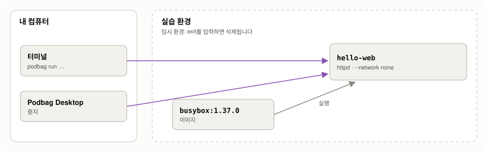
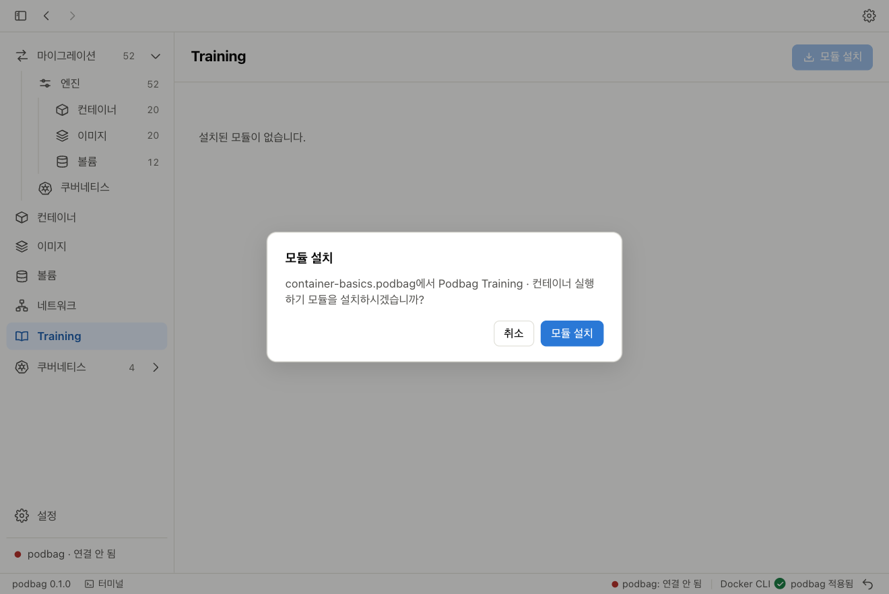
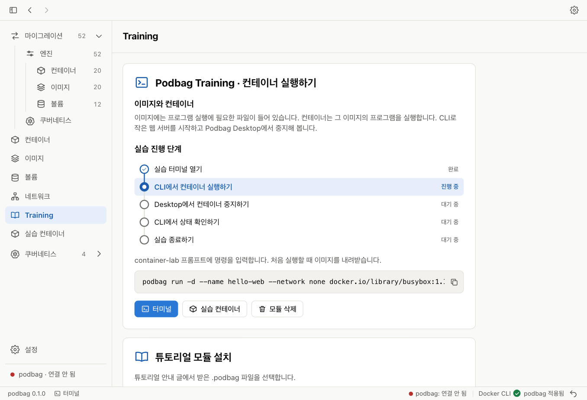
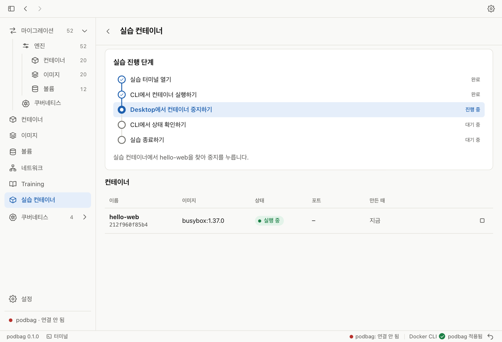
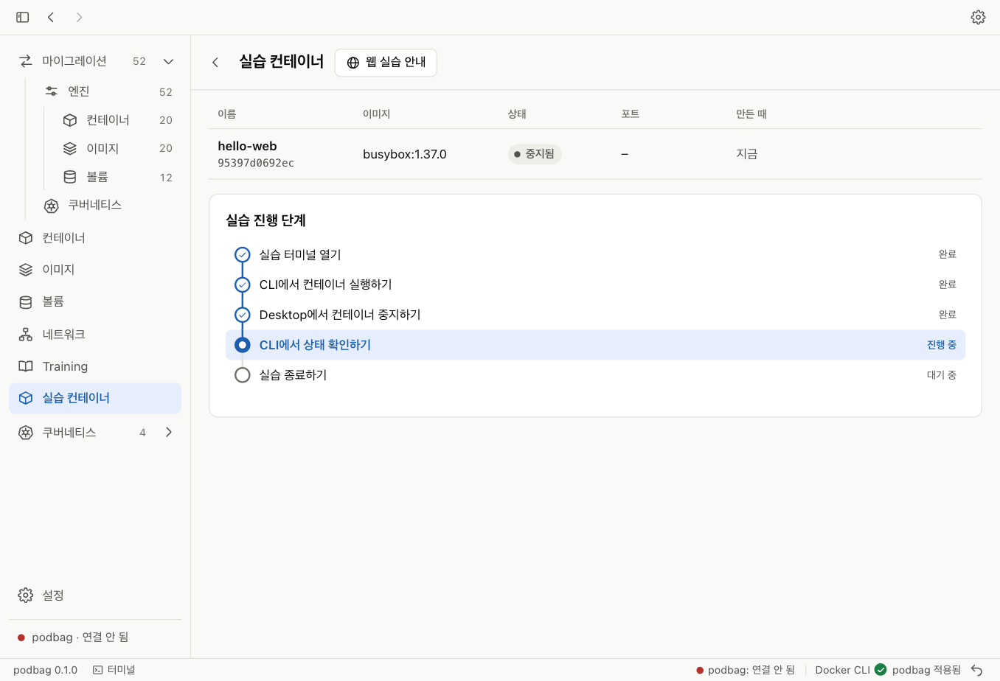
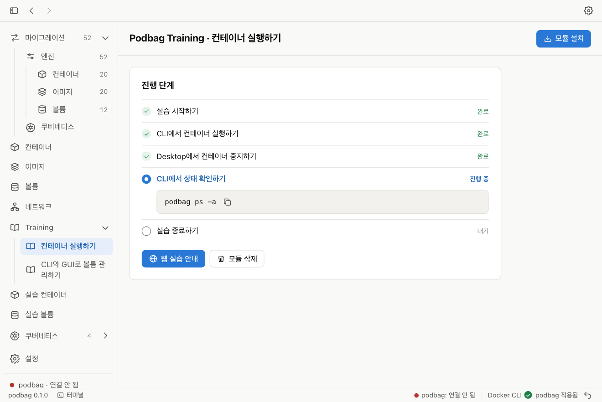
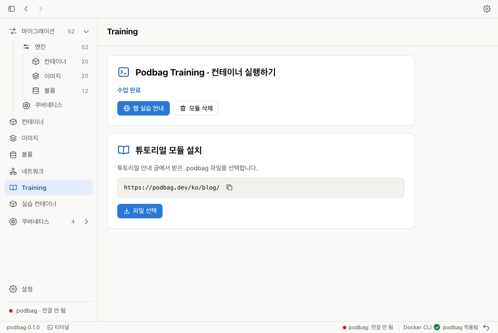

이미지에는 프로그램 실행에 필요한 파일이 들어 있습니다. 컨테이너는 그 이미지의 프로그램을 실행합니다. 이 실습에서는 `hello-web`이라는 작은 웹 서버를 실행하고 Podbag Desktop에서 중지합니다.



## 초보자 코스

**첫 컨테이너 실행하기** → [브라우저에서 웹 서버 열기](../web-basics/) → [컨테이너를 바꿔도 파일 남기기](../volume-persistence/) → [웹 서비스 교체하고 정리하기](../web-service-lifecycle/)

## 실습 모듈 설치하기

[container-basics.podbag 다운로드](https://github.com/SteelCrab/podbag/releases/download/training/container-basics/v1.0.0/container-basics.podbag). Training을 지원하는 Podbag Desktop을 엽니다. **Training** 화면 위의 **모듈 설치**를 누르고 다운로드한 파일을 선택한 뒤 확인합니다. 파일을 받은 폴더에서 다음 명령으로 설치할 수도 있습니다.

```sh
podbag lab install container-basics.podbag
```



이 실습을 이미 설치했다면 새 파일을 다시 설치해도 완료 기록이 유지됩니다. `podbag lab list`로 설치한 실습을 확인할 수 있습니다.

## 실습 시작하기

왼쪽 메뉴에서 **Training**을 펼치고 **컨테이너 실행하기**를 선택합니다. 현재 단계와 남은 단계를 확인할 수 있습니다. 아래 명령을 복사해 사용 중인 터미널에서 실행합니다. `container-lab $` 프롬프트가 나타나면 다음 단계로 이동합니다.

```sh
podbag lab start container-basics
```



## CLI에서 웹 서버 실행하기

같은 실습 터미널에서 다음 명령을 입력합니다. 처음 실행할 때 Podbag이 실습 이미지를 내려받습니다.

```sh
podbag run -d --name hello-web --network none docker.io/library/busybox:1.37.0 httpd -f -p 8080
```

`-d`는 컨테이너를 백그라운드에서 실행합니다. `--name hello-web`은 컨테이너 이름을 지정합니다. 웹 서버는 컨테이너 내부의 8080번 포트에서 실행됩니다. 이번 실습에서는 컨테이너의 시작과 중지를 배우므로 호스트 네트워크와 분리해 실행합니다.


## Desktop에서 컨테이너 중지하기

실습 터미널을 열어 둔 채 Desktop에서 **실습 컨테이너**를 선택합니다. 실행 중인 `hello-web`의 행에서 **중지**를 누릅니다. 컨테이너 상세 화면에서도 중지할 수 있습니다.



컨테이너 상태가 **종료됨**으로 바뀝니다. **Training** 아래의 모듈에서 **CLI에서 상태 확인하기** 단계와 해당 명령을 확인합니다.



## CLI에서 결과 확인하기

같은 실습 터미널로 돌아가 모든 컨테이너를 조회합니다. `-a` 옵션은 중지된 컨테이너도 목록에 표시합니다.

```sh
podbag ps -a
```



`hello-web`의 상태가 `Exited`인지 확인합니다. 실습 터미널에는 `Verified`가 표시됩니다.


## 실습 종료하기

`exit`를 입력합니다. Podbag이 실습 컨테이너와 내려받은 이미지, 임시 저장소를 정리합니다. 실습 모듈과 완료 기록은 Training에서 확인할 수 있습니다.



[다음 모듈 · 브라우저에서 웹 서버 열기](../web-basics/)
