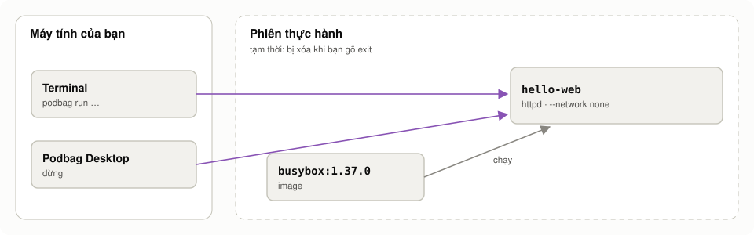
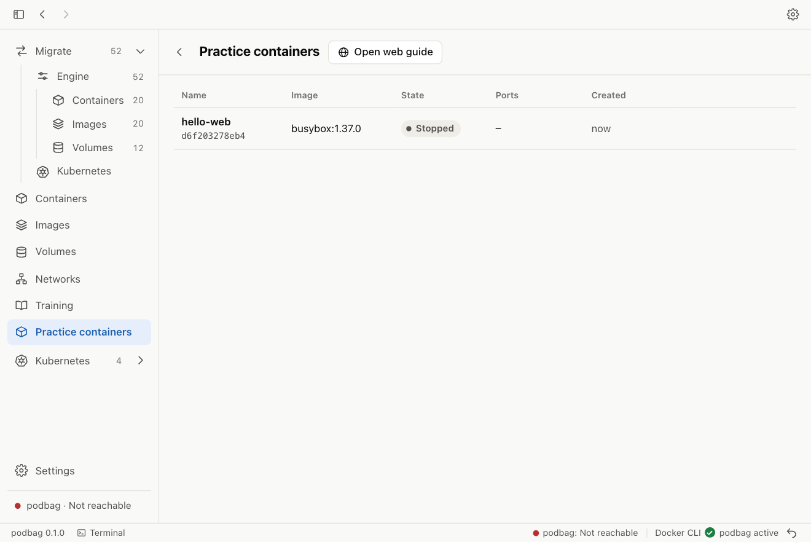

Image chứa các tệp mà một chương trình cần. Container chạy chương trình từ image đó. Trong bài thực hành này, bạn chạy một máy chủ web nhỏ tên `hello-web` và dừng nó bằng Podbag Desktop.



## Lộ trình cho người mới

**Chạy container đầu tiên** → [Mở máy chủ web trong trình duyệt](../web-basics/) → [Giữ tệp khi thay container](../volume-persistence/) → [Thay thế và dọn dẹp dịch vụ web](../web-service-lifecycle/)

## Cài mô-đun thực hành

[Tải container-basics.podbag](https://github.com/SteelCrab/podbag/releases/download/training/container-basics/v1.0.0/container-basics.podbag). Mở bản Podbag Desktop có hỗ trợ Training. Ở đầu mục **Training**, chọn **Cài mô-đun**, chọn tệp đã tải và xác nhận. Bạn cũng có thể cài từ thư mục tải xuống.

```sh
podbag lab install container-basics.podbag
```


Nếu bạn đã cài mô-đun này, hãy cài tệp mới đè lên. Bản ghi hoàn thành vẫn được giữ. Chạy `podbag lab list` để xem các mô-đun đã cài.

## Bắt đầu phiên thực hành

Ở thanh bên, mở rộng **Training** và chọn **Chạy một container**. Mô-đun hiển thị bước hiện tại và các bước tiếp theo. Sao chép lệnh dưới đây và chạy trong terminal của bạn. Tiếp tục khi thấy `container-lab $`.

```sh
podbag lab start container-basics
```


## Chạy máy chủ web trong CLI

Nhập lệnh dưới đây trong terminal thực hành. Ở lần chạy đầu, Podbag tải image thực hành về.

```sh
podbag run -d --name hello-web --network none docker.io/library/busybox:1.37.0 httpd -f -p 8080
```

`-d` chạy container ở chế độ nền. `--name hello-web` đặt tên cho container. Máy chủ nhận yêu cầu ở cổng 8080 bên trong container. Bài này tập trung vào vòng đời của container. Vì vậy, lệnh này tách máy chủ web khỏi mạng của máy host.


## Dừng container trong Desktop

Giữ terminal thực hành mở. Chọn **Container thực hành** trong Desktop. Tìm `hello-web` đang chạy và chọn **Dừng** ở hàng của nó. Bạn cũng có thể mở chi tiết container và chọn **Dừng** ở đó.


Hàng của container hiển thị **Đã dừng**. Chọn mô-đun trong **Training** để thấy bước **Kiểm tra trạng thái trong CLI** và sao chép lệnh của bước đó.



## Kiểm tra kết quả trong CLI

Quay lại cùng terminal thực hành và liệt kê tất cả container. Tùy chọn `-a` hiển thị cả container đã dừng.

```sh
podbag ps -a
```


Kiểm tra rằng `hello-web` hiển thị `Exited`. Terminal thực hành in `Verified`.


## Kết thúc phiên thực hành

Nhập `exit`. Podbag xóa container thực hành, image đã tải và kho tạm. Mô-đun và bản ghi hoàn thành vẫn còn trong Training.


[Mô-đun tiếp theo · Mở máy chủ web trong trình duyệt](../web-basics/)
