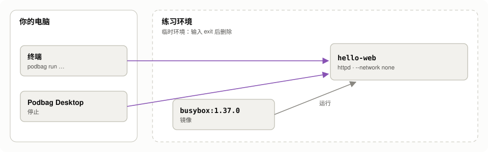
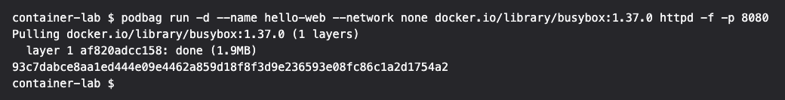
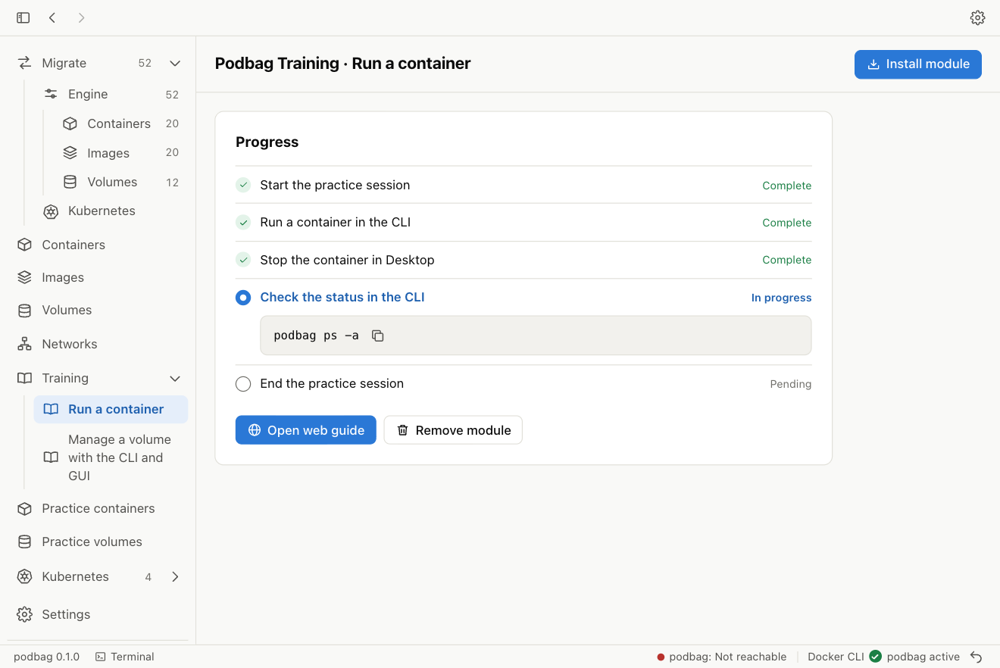
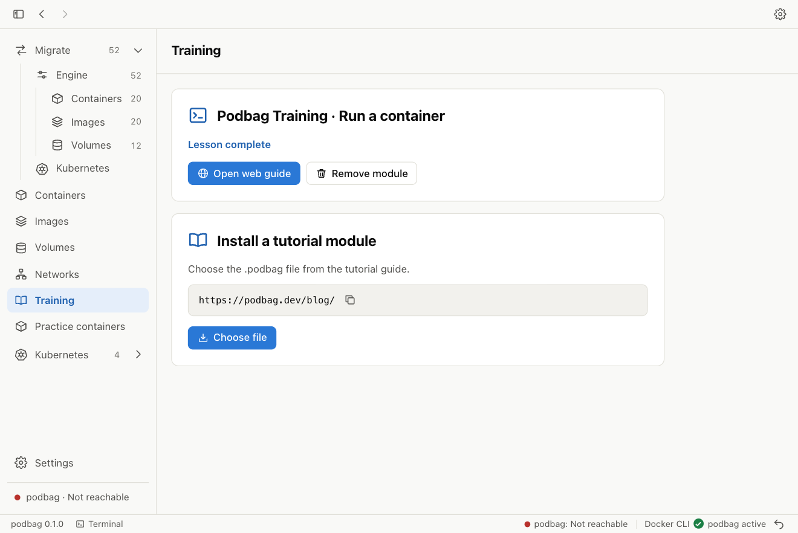

镜像包含程序运行所需的文件。容器从镜像运行程序。在本实验中，你将运行一个名为 `hello-web` 的小型 Web 服务器，并在 Podbag Desktop 中停止它。



## 入门课程

**运行第一个容器** → [在浏览器中打开 Web 服务器](../web-basics/) → [在不同容器之间保留文件](../volume-persistence/) → [替换并清理 Web 服务](../web-service-lifecycle/)

## 安装实验模块

[下载 container-basics.podbag](https://github.com/SteelCrab/podbag/releases/download/training/container-basics/v1.0.0/container-basics.podbag)。打开支持 Training 的 Podbag Desktop。在 **Training** 顶部点击**安装模块**，选择下载的文件并确认。也可以在下载目录中运行以下命令安装。

```sh
podbag lab install container-basics.podbag
```


如果已经安装过此模块，直接安装新文件即可。完成记录会保留。运行 `podbag lab list` 可以查看已安装的模块。

## 开始实验

在侧栏中展开 **Training**，选择**运行容器**。模块会显示当前步骤和后续步骤。复制下面的命令，在你的终端中运行。终端显示 `container-lab $` 后继续。

```sh
podbag lab start container-basics
```


## 在 CLI 中运行 Web 服务器

在实验终端中输入下面的命令。第一次运行时，Podbag 会下载实验镜像。

```sh
podbag run -d --name hello-web --network none docker.io/library/busybox:1.37.0 httpd -f -p 8080
```

`-d` 让容器在后台运行。`--name hello-web` 为容器命名。服务器在容器内的 8080 端口监听。本实验重点是容器的生命周期，所以命令让服务器与主机网络隔离。



## 在 Desktop 中停止容器

保持实验终端打开。在 Desktop 中选择**实验容器**。找到正在运行的 `hello-web`，点击该行的**停止**。也可以打开容器详情，在那里点击**停止**。


容器行显示**已停止**。在 **Training** 下选择该模块，找到**在 CLI 中检查状态**，复制其中的命令。


## 在 CLI 中检查结果

回到同一个实验终端，列出所有容器。`-a` 选项会包含已停止的容器。

```sh
podbag ps -a
```



确认 `hello-web` 显示 `Exited`。实验终端会显示 `Verified`。


## 结束实验

输入 `exit`。Podbag 会删除实验容器、下载的镜像和临时存储。模块及其完成记录仍保留在 Training 中。



[下一个模块 · 在浏览器中打开 Web 服务器](../web-basics/)
