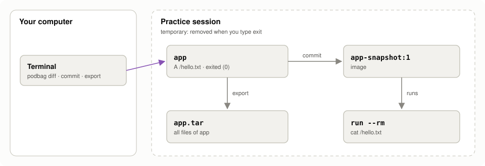

A container writes its changes on top of its image. The image itself stays the same. In this module, you list those changes, save them as a new image with `commit`, and write all the container's files to a tar archive with `export`.

**Time** 10 minutes.



## Start the module

You need a build of Podbag Desktop and the CLI with the Training catalog. It was added after v0.3.2.

Open **Training** in Podbag Desktop and select **Save a container's changes as an image**. New modules appear after **Refresh**. Or run this command in a terminal:

```sh
podbag lab start container-changes
```

Continue at the `training $` prompt.

## Run a container that writes a file

Run a container named `app`. It writes one file, `/hello.txt`, and ends. There is no `--rm`, so the stopped container stays.

```sh
podbag run --name app docker.io/library/busybox:1.37.0 sh -c 'echo "Hello from app" > /hello.txt'
```

Podbag checks that `app` exited with code 0.

## List the files the container changed

`diff` lists the paths a container changed. `A` means added, `C` changed and `D` deleted.

```sh
podbag diff app
```

The list has `A /hello.txt`. It also has files that podbag adds to every container, such as `/etc/hosts`. Podbag checks the output for `A /hello.txt`.

## Save the changes as an image

`commit` makes a new image: the container's image plus its changes.

```sh
podbag commit app app-snapshot:1
```

podbag prints the new image ID. Podbag checks that the image `app-snapshot:1` exists.

## Read the file from the new image

Start a new container from the new image. It reads the file that `app` wrote.

```sh
podbag run --rm app-snapshot:1 cat /hello.txt
```

The terminal prints `Hello from app`. Podbag checks this output.

## Export the container's files

`export` writes all the files of a container as one tar archive. Volumes are not in it. `-o` names the file.

```sh
podbag export -o app.tar app
```

The archive lands in the practice directory. Podbag checks that `app.tar` is there. A tar from `export` is a plain folder tree, not an image. Use `save` (in the module "Copy files and move an image as an archive") to keep an image.

## Clean up and finish

Remove the container and the new image in the same terminal. Then end the session.

```sh
podbag rm app
podbag rmi app-snapshot:1
exit
```

The temporary practice session is removed, `app.tar` with it. Training shows the module as complete.
