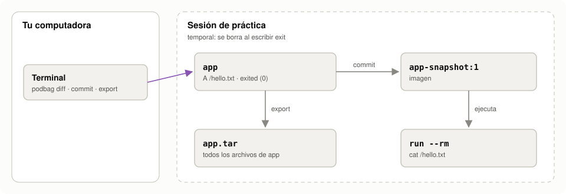

Un contenedor escribe sus cambios encima de su imagen. La imagen no cambia. En este módulo, listas esos cambios, los guardas como una imagen nueva con `commit` y escribes todos los archivos del contenedor en un archivo tar con `export`.

**Tiempo** 10 minutos.



## Inicia el módulo

Necesitas una versión de Podbag Desktop y de la CLI con el catálogo de Training. Se añadió después de v0.3.2.

Abre **Training** en Podbag Desktop y selecciona **Guarda los cambios de un contenedor como imagen**. Los módulos nuevos aparecen después de **Actualizar**. O ejecuta este comando en una terminal:

```sh
podbag lab start container-changes
```

Continúa en el prompt `training $`.

## Ejecuta un contenedor que escribe un archivo

Ejecuta un contenedor llamado `app`. Escribe un archivo, `/hello.txt`, y termina. No hay `--rm`, así que el contenedor detenido se queda.

```sh
podbag run --name app docker.io/library/busybox:1.37.0 sh -c 'echo "Hello from app" > /hello.txt'
```

Podbag comprueba que `app` terminó con el código 0.

## Lista los archivos que cambió el contenedor

`diff` lista las rutas que cambió un contenedor. `A` significa añadido, `C` cambiado y `D` eliminado.

```sh
podbag diff app
```

La lista tiene `A /hello.txt`. También tiene archivos que podbag añade a todos los contenedores, como `/etc/hosts`. Podbag busca `A /hello.txt` en la salida.

## Guarda los cambios como imagen

`commit` crea una imagen nueva: la imagen del contenedor más sus cambios.

```sh
podbag commit app app-snapshot:1
```

podbag muestra el ID de la imagen nueva. Podbag comprueba que existe la imagen `app-snapshot:1`.

## Lee el archivo desde la imagen nueva

Inicia un contenedor nuevo a partir de la imagen nueva. Lee el archivo que escribió `app`.

```sh
podbag run --rm app-snapshot:1 cat /hello.txt
```

La terminal muestra `Hello from app`. Podbag comprueba esta salida.

## Exporta los archivos del contenedor

`export` escribe todos los archivos de un contenedor en un solo archivo tar. Los volúmenes no se incluyen. `-o` indica el nombre del archivo.

```sh
podbag export -o app.tar app
```

El archivo queda en el directorio de práctica. Podbag comprueba que `app.tar` está ahí. Un tar de `export` es un simple árbol de carpetas, no una imagen. Para conservar una imagen, usa `save` (en el módulo «Copia archivos y mueve una imagen en un archivo tar»).

## Limpia y termina

Elimina el contenedor y la imagen nueva en la misma terminal. Luego termina la sesión.

```sh
podbag rm app
podbag rmi app-snapshot:1
exit
```

Se elimina la sesión de práctica temporal, y `app.tar` con ella. Training muestra el módulo como completado.
