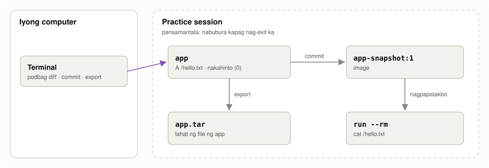

Isinusulat ng container ang mga pagbabago nito sa ibabaw ng image nito. Hindi nagbabago ang image mismo. Sa module na ito, ililista mo ang mga pagbabagong iyon. Ise-save mo ang mga ito bilang bagong image gamit ang `commit`. Isusulat mo rin ang lahat ng file ng container sa isang tar archive gamit ang `export`.

**Oras** 10 minuto.



## Simulan ang module

Kailangan mo ng build ng Podbag Desktop at ng CLI na may Training catalog. Idinagdag ito pagkatapos ng v0.3.2.

Buksan ang **Training** sa Podbag Desktop at piliin ang **I-save bilang image ang mga pagbabago sa container**. Lalabas ang mga bagong module pagkatapos ng **I-refresh**. O patakbuhin ang command na ito sa terminal:

```sh
podbag lab start container-changes
```

Magpatuloy sa prompt na `training $`.

Para gawin ang mga hakbang sa TUI sa halip na sa Podbag Desktop, idagdag ang `--tui`.

```sh
podbag lab start container-changes --tui
```

Sa TUI, pindutin ang `:` para buksan ang training shell sa isang hakbang na command. I-type ang `exit` para bumalik sa TUI. Pindutin ang `q` para tapusin ang practice session.

## Magpatakbo ng container na nagsusulat ng file

Magpatakbo ng container na `app`. Nagsusulat ito ng isang file, ang `/hello.txt`, at saka natatapos. Walang `--rm`, kaya nananatili ang nakahintong container.

```sh
podbag run --name app docker.io/library/busybox:1.37.0 sh -c 'echo "Hello from app" > /hello.txt'
```

Sinusuri ng Podbag na lumabas ang `app` na may code na 0.

## Ilista ang mga file na binago ng container

Inililista ng `diff` ang mga path na binago ng container. Ang `A` ay idinagdag, ang `C` ay binago, at ang `D` ay binura.

```sh
podbag diff app
```

May `A /hello.txt` sa listahan. May mga file din dito na idinadagdag ng podbag sa bawat container, gaya ng `/etc/hosts`. Hinahanap ng Podbag ang `A /hello.txt` sa output.

## I-save ang mga pagbabago bilang image

Gumagawa ang `commit` ng bagong image: ang image ng container kasama ang mga pagbabago nito.

```sh
podbag commit app app-snapshot:1
```

Ipinapakita ng podbag ang ID ng bagong image. Sinusuri ng Podbag na may image na `app-snapshot:1`.

## Basahin ang file mula sa bagong image

Magsimula ng bagong container mula sa bagong image. Binabasa nito ang file na isinulat ng `app`.

```sh
podbag run --rm app-snapshot:1 cat /hello.txt
```

Ipinapakita ng terminal ang `Hello from app`. Sinusuri ng Podbag ang output na ito.

## I-export ang mga file ng container

Isinusulat ng `export` ang lahat ng file ng container bilang iisang tar archive. Hindi kasama rito ang mga volume. Pinapangalanan ng `-o` ang file.

```sh
podbag export -o app.tar app
```

Napupunta ang archive sa practice directory. Sinusuri ng Podbag na nandoon ang `app.tar`. Simpleng puno ng mga folder ang tar mula sa `export`, hindi image. Gamitin ang `save` (sa module na "Kumopya ng mga file at ilipat ang image bilang archive") para itago ang image.

## Maglinis at tapusin

Alisin ang container at ang bagong image sa parehong terminal. Pagkatapos, tapusin ang session.

- **Sa Podbag Desktop:** Piliin ang **Mga practice container → app → Alisin** at kumpirmahin.
- **Sa TUI:** Piliin ang `app` sa **Mga container**, pindutin ang `d`, saka ang `y`.
- **Sa Podbag Desktop:** Piliin ang **Mga practice container → Alisin ang image na app-snapshot:1** at kumpirmahin.
- **Sa TUI:** Piliin ang `app-snapshot:1` sa **Mga image**, pindutin ang `d`, saka ang `y`.

```sh
podbag rm app
podbag rmi app-snapshot:1
exit
```

Naaalis ang pansamantalang practice session, kasama ang `app.tar`. Ipinapakita ng Training na tapos na ang module.
