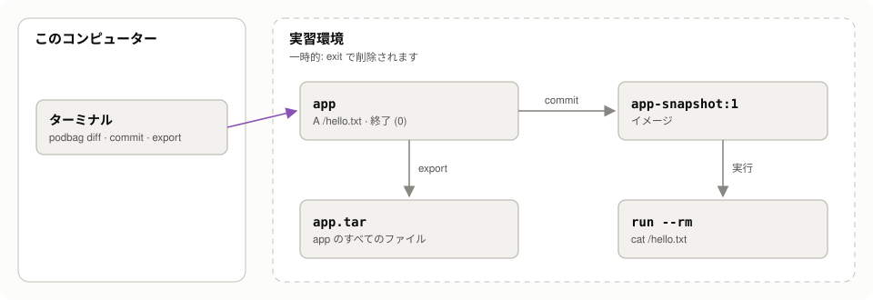

コンテナは、イメージの上に変更を書き込みます。イメージ自体は変わりません。このモジュールでは、その変更を一覧表示し、`commit` で新しいイメージとして保存します。さらに、`export` でコンテナのすべてのファイルを tar アーカイブに書き出します。

**所要時間** 10 分。



## モジュールを開始する

Training カタログがある Podbag Desktop と CLI のビルドが必要です。カタログは v0.3.2 より後に追加されました。

Podbag Desktop で **Training** を開き、**コンテナの変更をイメージとして保存する**を選びます。新しいモジュールは**更新**の後に表示されます。ターミナルで次のコマンドを実行しても開始できます。

```sh
podbag lab start container-changes
```

`training $` プロンプトが表示されたら続けます。

Podbag Desktop の代わりに TUI で手順を進めるには、`--tui` を付けます。

```sh
podbag lab start container-changes --tui
```

TUI では、コマンドの手順で `:` を押すと Training シェルが開きます。`exit` と入力すると TUI に戻ります。`q` を押すと実習を終了します。

## ファイルを書くコンテナを実行する

`app` という名前のコンテナを実行します。このコンテナはファイル `/hello.txt` を 1 つ書いて終了します。`--rm` がないので、停止したコンテナは残ります。

```sh
podbag run --name app docker.io/library/busybox:1.37.0 sh -c 'echo "Hello from app" > /hello.txt'
```

Podbag は `app` がコード 0 で終了したことを確認します。

## コンテナが変更したファイルを一覧表示する

`diff` は、コンテナが変更したパスを一覧表示します。`A` は追加、`C` は変更、`D` は削除です。

```sh
podbag diff app
```

一覧には `A /hello.txt` があります。`/etc/hosts` など、podbag がすべてのコンテナに追加するファイルも表示されます。Podbag は出力に `A /hello.txt` があることを確認します。

## 変更をイメージとして保存する

`commit` は新しいイメージを作ります。コンテナのイメージに、その変更を加えたものです。

```sh
podbag commit app app-snapshot:1
```

podbag は新しいイメージ ID を表示します。Podbag はイメージ `app-snapshot:1` があることを確認します。

## 新しいイメージからファイルを読む

新しいイメージから新しいコンテナを起動します。このコンテナは、`app` が書いたファイルを読みます。

```sh
podbag run --rm app-snapshot:1 cat /hello.txt
```

ターミナルに `Hello from app` と表示されます。Podbag はこの出力を確認します。

## コンテナのファイルを書き出す

`export` は、コンテナのすべてのファイルを 1 つの tar アーカイブに書き出します。ボリュームは含まれません。`-o` はファイル名を指定します。

```sh
podbag export -o app.tar app
```

アーカイブは実習用のディレクトリに保存されます。Podbag は `app.tar` があることを確認します。`export` で作る tar は、ただのフォルダーの階層で、イメージではありません。イメージを残すには、`save` を使います（モジュール「ファイルをコピーし、イメージをアーカイブで移す」で学びます）。

## 片付けて終了する

同じターミナルで、コンテナと新しいイメージを削除します。その後、実習を終了します。

- **Podbag Desktop で:** **実習コンテナ → app → 削除**を選び、確認します。
- **TUI で:** **コンテナ**で `app` を選び、`d` を押してから `y` を押します。
- **Podbag Desktop で:** **実習コンテナ → イメージ app-snapshot:1 を削除**を選び、確認します。
- **TUI で:** **イメージ**で `app-snapshot:1` を選び、`d` を押してから `y` を押します。

```sh
podbag rm app
podbag rmi app-snapshot:1
exit
```

一時的な実習環境が削除され、`app.tar` も一緒に消えます。Training にモジュールの完了が表示されます。
