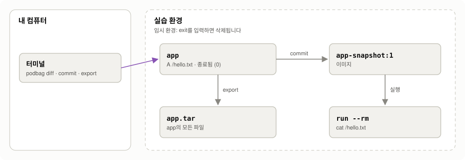

컨테이너는 바꾼 내용을 이미지 위에 따로 씁니다. 이미지 자체는 그대로입니다. 이번 트레이닝에서는 변경 내용을 확인하고 `commit`으로 새 이미지로 저장합니다. 그리고 `export`로 컨테이너의 모든 파일을 tar 아카이브로 씁니다.

**예상 시간** 10분.



## 실습 시작

Training 카탈로그가 들어 있는 Podbag Desktop과 CLI가 필요합니다. 이 기능은 v0.3.2 이후에 추가됐습니다.

Podbag Desktop에서 **Training**을 열고 **컨테이너 변경 내용을 이미지로 저장하기**를 선택합니다. 새 모듈은 **새로 고침**을 누르면 나타납니다. 터미널에서 다음 명령을 실행해도 됩니다.

```sh
podbag lab start container-changes
```

`training $` 프롬프트에서 계속 진행합니다.

Podbag Desktop 대신 TUI에서 실습하려면 `--tui`를 붙입니다.

```sh
podbag lab start container-changes --tui
```

TUI에서는 `:` 키로 명령 단계용 Training 셸을 열고, `exit`를 입력해 TUI로 돌아오며, `q` 키로 실습을 끝냅니다.

## 파일을 쓰는 컨테이너 실행하기

`app` 컨테이너를 실행합니다. 이 컨테이너는 `/hello.txt` 파일 하나를 쓰고 끝납니다. `--rm`이 없으므로 중지된 컨테이너가 남습니다.

```sh
podbag run --name app docker.io/library/busybox:1.37.0 sh -c 'echo "Hello from app" > /hello.txt'
```

Podbag은 `app`이 코드 0으로 종료됐는지 확인합니다.

## 컨테이너가 바꾼 파일 보기

`diff`는 컨테이너가 바꾼 경로를 보여 줍니다. `A`는 추가, `C`는 변경, `D`는 삭제입니다.

```sh
podbag diff app
```

목록에 `A /hello.txt`가 있습니다. `/etc/hosts`처럼 podbag이 모든 컨테이너에 넣는 파일도 함께 나옵니다. Podbag은 출력에 `A /hello.txt`가 있는지 확인합니다.

## 변경 내용을 이미지로 저장하기

`commit`은 컨테이너의 이미지에 변경 내용을 더해 새 이미지를 만듭니다.

```sh
podbag commit app app-snapshot:1
```

podbag은 새 이미지 ID를 출력합니다. Podbag은 `app-snapshot:1` 이미지가 있는지 확인합니다.

## 새 이미지에서 파일 읽기

새 이미지로 새 컨테이너를 시작합니다. 이 컨테이너가 `app`이 쓴 파일을 읽습니다.

```sh
podbag run --rm app-snapshot:1 cat /hello.txt
```

터미널에 `Hello from app`이 출력됩니다. Podbag은 이 출력을 확인합니다.

## 컨테이너 파일 내보내기

`export`는 컨테이너의 모든 파일을 tar 아카이브 하나로 씁니다. 볼륨은 들어가지 않습니다. `-o`는 파일 이름을 정합니다.

```sh
podbag export -o app.tar app
```

아카이브는 실습 디렉터리에 생깁니다. Podbag은 `app.tar`가 있는지 확인합니다. `export`로 만든 tar는 이미지가 아니라 평범한 폴더 구조입니다. 이미지를 보관하려면 `save`를 씁니다. "파일 복사하고 이미지를 아카이브로 옮기기" 모듈에서 다룹니다.

## 정리 및 실습 종료

같은 터미널에서 컨테이너와 새 이미지를 삭제합니다. 그다음 실습을 종료합니다.

- **Podbag Desktop에서:** **실습 컨테이너 → app → 삭제**를 누르고 확인합니다.
- **TUI에서:** **컨테이너**에서 `app` 선택 후 `d` 키, `y` 키를 차례로 누릅니다.
- **Podbag Desktop에서:** **실습 컨테이너 → 이미지 app-snapshot:1 삭제**를 누르고 확인합니다.
- **TUI에서:** **이미지**에서 `app-snapshot:1` 선택 후 `d` 키, `y` 키를 차례로 누릅니다.

```sh
podbag rm app
podbag rmi app-snapshot:1
exit
```

임시 실습 환경이 삭제되고 `app.tar`도 함께 사라집니다. Training에 모듈이 완료됨으로 표시됩니다.
