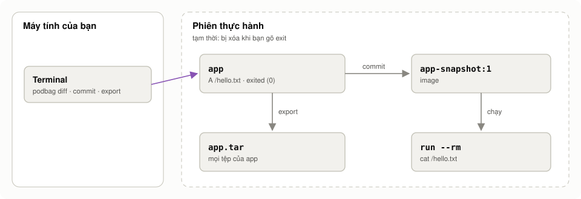

Container ghi các thay đổi của nó lên trên image. Bản thân image không thay đổi. Trong mô-đun này, bạn liệt kê các thay đổi đó, lưu chúng thành image mới bằng `commit`, và ghi mọi tệp của container vào một tệp lưu trữ tar bằng `export`.

**Thời gian** 10 phút.



## Bắt đầu mô-đun

Bạn cần bản Podbag Desktop và CLI có danh mục Training. Danh mục này được thêm sau v0.3.2.

Mở **Training** trong Podbag Desktop và chọn **Lưu thay đổi của container thành image**. Mô-đun mới xuất hiện sau khi chọn **Làm mới**. Hoặc chạy lệnh này trong terminal:

```sh
podbag lab start container-changes
```

Tiếp tục tại dấu nhắc `training $`.

## Chạy container ghi một tệp

Chạy một container tên `app`. Nó ghi một tệp, `/hello.txt`, rồi kết thúc. Lệnh không có `--rm`, nên container đã dừng vẫn còn.

```sh
podbag run --name app docker.io/library/busybox:1.37.0 sh -c 'echo "Hello from app" > /hello.txt'
```

Podbag kiểm tra rằng `app` đã thoát với mã 0.

## Liệt kê các tệp mà container đã thay đổi

`diff` liệt kê các đường dẫn mà container đã thay đổi. `A` nghĩa là đã thêm, `C` là đã sửa và `D` là đã xóa.

```sh
podbag diff app
```

Danh sách có `A /hello.txt`. Danh sách cũng có các tệp mà podbag thêm vào mọi container, như `/etc/hosts`. Podbag tìm `A /hello.txt` trong kết quả.

## Lưu thay đổi thành image

`commit` tạo một image mới: image của container cộng với các thay đổi của nó.

```sh
podbag commit app app-snapshot:1
```

podbag in ID của image mới. Podbag kiểm tra rằng image `app-snapshot:1` đã có.

## Đọc tệp từ image mới

Chạy một container mới từ image mới. Nó đọc tệp mà `app` đã ghi.

```sh
podbag run --rm app-snapshot:1 cat /hello.txt
```

Terminal in `Hello from app`. Podbag kiểm tra kết quả này.

## Xuất các tệp của container

`export` ghi mọi tệp của container thành một tệp lưu trữ tar. Volume không có trong đó. `-o` đặt tên cho tệp.

```sh
podbag export -o app.tar app
```

Tệp lưu trữ nằm trong thư mục thực hành. Podbag kiểm tra rằng `app.tar` có ở đó. Tệp tar từ `export` chỉ là một cây thư mục thông thường, không phải image. Để giữ một image, hãy dùng `save` (trong mô-đun "Sao chép tệp và chuyển image bằng tệp lưu trữ").

## Dọn dẹp và kết thúc

Xóa container và image mới trong cùng terminal. Sau đó kết thúc phiên.

```sh
podbag rm app
podbag rmi app-snapshot:1
exit
```

Phiên thực hành tạm thời đã được xóa, cùng với `app.tar`. Training hiển thị mô-đun đã hoàn thành.
