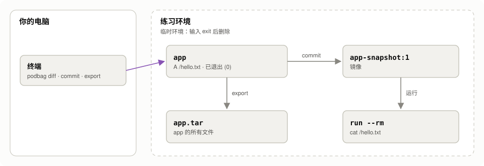

容器会把更改写在镜像之上。镜像本身保持不变。在本模块中，你将列出这些更改，用 `commit` 把它们保存为新镜像，再用 `export` 把容器的所有文件写入 tar 归档。

**预计用时** 10 分钟。



## 开始模块

需要带有 Training 目录的 Podbag Desktop 和 CLI 版本。该目录在 v0.3.2 之后加入。

在 Podbag Desktop 中打开 **Training**，选择**将容器的更改保存为镜像**。点击**刷新**后会出现新模块。也可以在终端中运行以下命令：

```sh
podbag lab start container-changes
```

出现 `training $` 提示符后继续。

## 运行写入文件的容器

运行一个名为 `app` 的容器。它写入一个文件 `/hello.txt`，然后结束。命令中没有 `--rm`，所以停止后的容器会保留。

```sh
podbag run --name app docker.io/library/busybox:1.37.0 sh -c 'echo "Hello from app" > /hello.txt'
```

Podbag 会检查 `app` 是否以退出码 0 退出。

## 列出容器更改的文件

`diff` 列出容器更改过的路径。`A` 表示新增，`C` 表示修改，`D` 表示删除。

```sh
podbag diff app
```

列表中有 `A /hello.txt`。列表中还有 podbag 为每个容器添加的文件，例如 `/etc/hosts`。Podbag 会检查输出中是否有 `A /hello.txt`。

## 将更改保存为镜像

`commit` 制作一个新镜像：容器的镜像加上它的更改。

```sh
podbag commit app app-snapshot:1
```

podbag 打印新镜像的 ID。Podbag 会检查镜像 `app-snapshot:1` 是否存在。

## 从新镜像读取文件

用新镜像启动一个新容器。它会读取 `app` 写入的文件。

```sh
podbag run --rm app-snapshot:1 cat /hello.txt
```

终端打印 `Hello from app`。Podbag 会检查这个输出。

## 导出容器的文件

`export` 把容器的所有文件写入一个 tar 归档。归档中不包含卷。`-o` 指定文件名。

```sh
podbag export -o app.tar app
```

归档文件保存在练习目录中。Podbag 会检查 `app.tar` 是否存在。`export` 生成的 tar 只是普通的文件夹树，不是镜像。如果要保留镜像，请使用 `save`（见模块“复制文件并用归档迁移镜像”）。

## 清理并结束

在同一个终端中删除容器和新镜像。然后结束实验。

```sh
podbag rm app
podbag rmi app-snapshot:1
exit
```

临时练习环境会被删除，`app.tar` 也会一起删除。Training 会显示该模块已完成。
