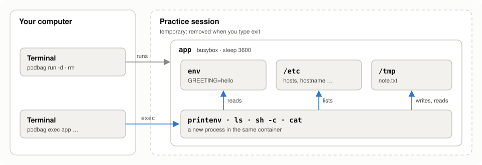

`podbag exec` runs one more command inside a container that is already running. You can use it to look inside the container, read its settings and change its files. In this module, you start a quiet container and then work inside it with `exec`.

**Time** 10 minutes.



## Start the module

Open **Training** in Podbag Desktop and select **Run commands inside a container**. New modules appear after **Refresh**. Or run this command in a terminal:

```sh
podbag lab start container-exec
```

You need a Podbag build with the Training catalog (after v0.3.2). Continue at the `training $` prompt.

## Run a container with an environment variable

An environment variable is a name with a value that programs can read. The `-e` option gives one to the container. The container runs `sleep 3600`, so it stays up for an hour and does nothing else. The `-d` option runs it in the background.

```sh
podbag run -d --name app -e GREETING=hello docker.io/library/busybox:1.37.0 sleep 3600
```

Podbag checks that `app` is running.

## Inspect the container

`podbag inspect` prints the details of a container as JSON: its image, its command, its state and its address.

```sh
podbag inspect app
```

Podbag checks that the output contains `"status": "running"`.

## Print the variable inside the container

`exec` runs `printenv GREETING` inside `app`. The command sees the variable that you gave with `-e`.

```sh
podbag exec app printenv GREETING
```

The output is `hello`. Podbag checks this output.

## Give one command its own variable

`exec` also has a `-e` option. This variable is only for this one command. The container itself does not change.

```sh
podbag exec -e MODE=debug app printenv MODE
```

The output is `debug`. If you run `podbag exec app printenv MODE` after this, it prints nothing, because `MODE` was only for that one command.

## List files in the container

The container has its own files. `ls /etc` lists the folder `/etc` inside the container, not on your computer.

```sh
podbag exec app ls /etc
```

Podbag checks that the list has the line `hosts`. Podbag writes this file so that containers can find each other by name.

## Write a file with a shell command

Shell symbols like `>` and `&&` must run inside the container. So put them in single quotes after `sh -c`. This command writes a line to `/tmp/note.txt` and then lists `/tmp`.

```sh
podbag exec app sh -c 'echo "Written by exec" > /tmp/note.txt && ls /tmp'
```

Podbag checks that the list has the line `note.txt`.

## Read the file back

Each `exec` is a new command, but it runs in the same container. The file from the last step is still there.

```sh
podbag exec app cat /tmp/note.txt
```

The output is `Written by exec`. Podbag checks this output.

## Run a command in another folder

The `-w` option sets the folder where the command starts. Here, `ls` with no folder name lists `/tmp`.

```sh
podbag exec -w /tmp app ls
```

Podbag checks that the list has the line `note.txt`.

To open a shell in the container yourself, use `podbag exec -it app sh`. Type `exit` to leave it. Training does not check this command.

## Clean up and finish

`app` is still running. `rm -f` stops it and removes it. Its files, with `/tmp/note.txt`, go with it.

```sh
podbag rm -f app
exit
```

The temporary practice resources are removed. Training shows the module as complete.
