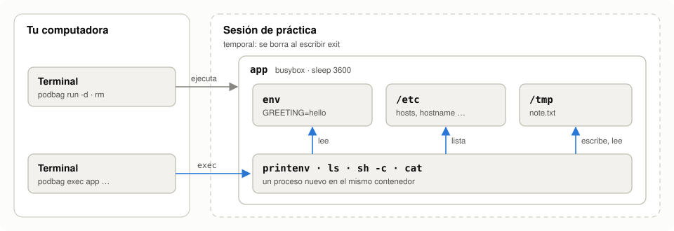

`podbag exec` ejecuta un comando más dentro de un contenedor que ya está en ejecución. Sirve para mirar dentro del contenedor, leer su configuración y cambiar sus archivos. En este módulo, inicias un contenedor que no hace nada y luego trabajas dentro de él con `exec`.

**Tiempo** 10 minutos.



## Inicia el módulo

Abre **Training** en Podbag Desktop y selecciona **Ejecuta comandos dentro de un contenedor**. Los módulos nuevos aparecen después de **Actualizar**. O ejecuta este comando en una terminal:

```sh
podbag lab start container-exec
```

Necesitas una versión de Podbag con el catálogo de Training (posterior a v0.3.2). Continúa en el prompt `training $`.

Para hacer los pasos en la TUI en lugar de Podbag Desktop, añade `--tui`.

```sh
podbag lab start container-exec --tui
```

En la TUI, pulsa `:` para abrir la shell de Training cuando un paso pida un comando, escribe `exit` para volver a la TUI y pulsa `q` para terminar la sesión.

## Ejecuta un contenedor con una variable de entorno

Una variable de entorno es un nombre con un valor que los programas pueden leer. La opción `-e` le da una al contenedor. El contenedor ejecuta `sleep 3600`. Así sigue activo durante una hora y no hace nada más. La opción `-d` lo ejecuta en segundo plano.

```sh
podbag run -d --name app -e GREETING=hello docker.io/library/busybox:1.37.0 sleep 3600
```

Podbag comprueba que `app` está en ejecución.

## Inspecciona el contenedor

`podbag inspect` muestra los detalles de un contenedor en JSON: su imagen, su comando, su estado y su dirección.

```sh
podbag inspect app
```

Podbag comprueba que la salida contiene `"status": "running"`.

## Muestra la variable dentro del contenedor

`exec` ejecuta `printenv GREETING` dentro de `app`. El comando ve la variable que diste con `-e`.

```sh
podbag exec app printenv GREETING
```

La salida es `hello`. Podbag comprueba esta salida.

## Da a un comando su propia variable

`exec` también tiene la opción `-e`. Esta variable es solo para ese comando. El contenedor no cambia.

```sh
podbag exec -e MODE=debug app printenv MODE
```

La salida es `debug`. Si después ejecutas `podbag exec app printenv MODE`, no muestra nada. `MODE` solo existía para aquel comando.

## Lista los archivos del contenedor

El contenedor tiene sus propios archivos. `ls /etc` lista la carpeta `/etc` dentro del contenedor, no la de tu computadora.

```sh
podbag exec app ls /etc
```

Podbag comprueba que la lista tiene la línea `hosts`. Podbag escribe este archivo para que los contenedores se encuentren por nombre.

## Escribe un archivo con un comando de shell

Los símbolos de shell como `>` y `&&` deben ejecutarse dentro del contenedor. Por eso van entre comillas simples después de `sh -c`. Este comando escribe una línea en `/tmp/note.txt` y luego lista `/tmp`.

```sh
podbag exec app sh -c 'echo "Written by exec" > /tmp/note.txt && ls /tmp'
```

Podbag comprueba que la lista tiene la línea `note.txt`.

## Vuelve a leer el archivo

Cada `exec` es un comando nuevo, pero se ejecuta en el mismo contenedor. El archivo del paso anterior sigue ahí.

```sh
podbag exec app cat /tmp/note.txt
```

La salida es `Written by exec`. Podbag comprueba esta salida.

## Ejecuta un comando en otra carpeta

La opción `-w` indica la carpeta donde empieza el comando. Aquí, `ls` sin nombre de carpeta lista `/tmp`.

```sh
podbag exec -w /tmp app ls
```

Podbag comprueba que la lista tiene la línea `note.txt`.

Para abrir tú mismo una shell en el contenedor, usa `podbag exec -it app sh`. Escribe `exit` para salir. Training no comprueba este comando.

## Limpia y termina

`app` sigue en ejecución. `rm -f` lo detiene y lo elimina. Sus archivos, con `/tmp/note.txt`, se eliminan con él.

- **En Podbag Desktop:** Selecciona **Contenedores de práctica → app → Eliminar** y confirma.
- **En la TUI:** Selecciona `app` en **Contenedores**, pulsa `d` y luego `y`.

```sh
podbag rm -f app
exit
```

Se eliminan los recursos temporales de la práctica. Training muestra el módulo como completado.
