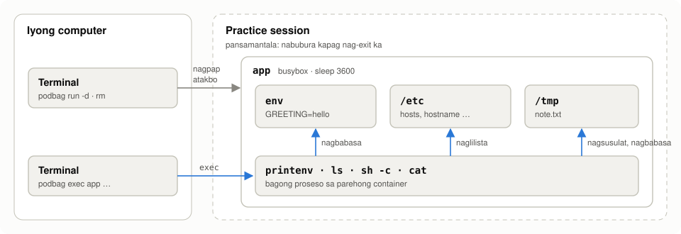

Nagpapatakbo ang `podbag exec` ng isa pang command sa loob ng container na tumatakbo na. Magagamit mo ito para tumingin sa loob ng container, basahin ang mga setting nito at baguhin ang mga file nito. Sa module na ito, magsisimula ka ng tahimik na container. Pagkatapos, gagawa ka sa loob nito gamit ang `exec`.

**Oras** 10 minuto.



## Simulan ang module

Buksan ang **Training** sa Podbag Desktop at piliin ang **Magpatakbo ng mga command sa loob ng container**. Lalabas ang mga bagong module pagkatapos ng **I-refresh**. O patakbuhin ang command na ito sa terminal:

```sh
podbag lab start container-exec
```

Kailangan mo ng build ng Podbag na may Training catalog (pagkatapos ng v0.3.2). Magpatuloy sa prompt na `training $`.

Para gawin ang mga hakbang sa TUI sa halip na sa Podbag Desktop, idagdag ang `--tui`.

```sh
podbag lab start container-exec --tui
```

Sa TUI, pindutin ang `:` para buksan ang training shell sa isang hakbang na command. I-type ang `exit` para bumalik sa TUI. Pindutin ang `q` para tapusin ang practice session.

## Magpatakbo ng container na may environment variable

Ang environment variable ay pangalan na may value na nababasa ng mga program. Nagbibigay ng isa sa container ang option na `-e`. Pinapatakbo ng container ang `sleep 3600`. Kaya tumatakbo ito nang isang oras at wala nang iba pang ginagawa. Pinapatakbo ito ng option na `-d` sa background.

```sh
podbag run -d --name app -e GREETING=hello docker.io/library/busybox:1.37.0 sleep 3600
```

Sinusuri ng Podbag na tumatakbo ang `app`.

## Siyasatin ang container

Ipinapakita ng `podbag inspect` ang detalye ng container bilang JSON: ang image, command, state at address nito.

```sh
podbag inspect app
```

Sinusuri ng Podbag na nasa output ang `"status": "running"`.

## I-print ang variable sa loob ng container

Pinapatakbo ng `exec` ang `printenv GREETING` sa loob ng `app`. Nakikita ng command ang variable na ibinigay mo gamit ang `-e`.

```sh
podbag exec app printenv GREETING
```

`hello` ang output. Sinusuri ng Podbag ang output na ito.

## Bigyan ng sariling variable ang isang command

May option ding `-e` ang `exec`. Para lang sa iisang command na ito ang variable. Hindi nagbabago ang container mismo.

```sh
podbag exec -e MODE=debug app printenv MODE
```

`debug` ang output. Kung patakbuhin mo ang `podbag exec app printenv MODE` pagkatapos nito, wala itong ipi-print. Para lang sa command na iyon ang `MODE`.

## Ilista ang mga file sa container

May sariling mga file ang container. Inililista ng `ls /etc` ang folder na `/etc` sa loob ng container, hindi sa computer mo.

```sh
podbag exec app ls /etc
```

Sinusuri ng Podbag na may linyang `hosts` ang listahan. Isinusulat ng Podbag ang file na ito para mahanap ng mga container ang isa't isa gamit ang pangalan.

## Magsulat ng file gamit ang shell command

Dapat tumakbo sa loob ng container ang mga shell symbol tulad ng `>` at `&&`. Kaya ilagay ang mga ito sa single quote pagkatapos ng `sh -c`. Nagsusulat ang command na ito ng isang linya sa `/tmp/note.txt` at saka inililista ang `/tmp`.

```sh
podbag exec app sh -c 'echo "Written by exec" > /tmp/note.txt && ls /tmp'
```

Sinusuri ng Podbag na may linyang `note.txt` ang listahan.

## Basahin ulit ang file

Bagong command ang bawat `exec`, pero tumatakbo ito sa parehong container. Nandoon pa rin ang file mula sa nakaraang hakbang.

```sh
podbag exec app cat /tmp/note.txt
```

`Written by exec` ang output. Sinusuri ng Podbag ang output na ito.

## Magpatakbo ng command sa ibang folder

Itinatakda ng option na `-w` ang folder kung saan magsisimula ang command. Dito, inililista ng `ls` na walang pangalan ng folder ang `/tmp`.

```sh
podbag exec -w /tmp app ls
```

Sinusuri ng Podbag na may linyang `note.txt` ang listahan.

Para ikaw mismo ang magbukas ng shell sa container, gamitin ang `podbag exec -it app sh`. I-type ang `exit` para lumabas. Hindi sinusuri ng Training ang command na ito.

## Maglinis at tapusin

Tumatakbo pa rin ang `app`. Inihihinto at inaalis ito ng `rm -f`. Kasama nitong naaalis ang mga file nito, pati ang `/tmp/note.txt`.

- **Sa Podbag Desktop:** Piliin ang **Mga practice container → app → Alisin** at kumpirmahin.
- **Sa TUI:** Piliin ang `app` sa **Mga container**, pindutin ang `d`, saka ang `y`.

```sh
podbag rm -f app
exit
```

Naaalis ang mga pansamantalang resource ng practice. Ipinapakita ng Training na tapos na ang module.
