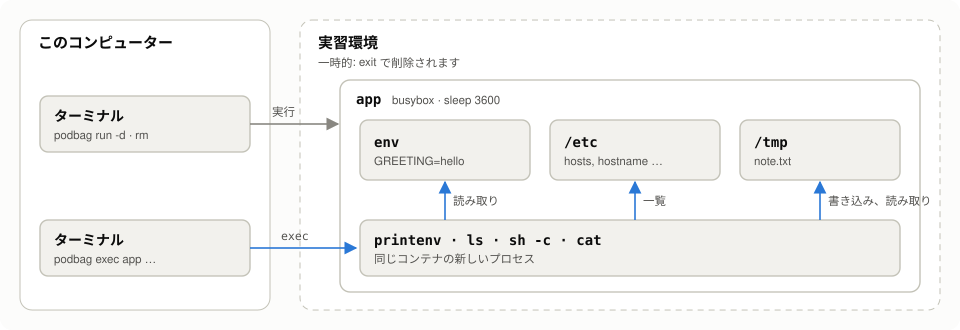

`podbag exec` は、すでに実行中のコンテナの中で、もう 1 つコマンドを実行します。コンテナの中を見たり、設定を読んだり、ファイルを変更したりできます。このモジュールでは、何もしないコンテナを起動し、`exec` でその中を操作します。

**所要時間** 10 分。



## モジュールを開始する

Podbag Desktop で **Training** を開き、**コンテナの中でコマンドを実行する**を選びます。新しいモジュールは**更新**の後に表示されます。ターミナルで次のコマンドを実行しても開始できます。

```sh
podbag lab start container-exec
```

Training カタログがある Podbag のビルド（v0.3.2 より後）が必要です。`training $` プロンプトが表示されたら続けます。

## 環境変数を付けてコンテナを実行する

環境変数は、名前と値の組です。プログラムはこの値を読めます。`-e` オプションはコンテナに環境変数を渡します。コンテナは `sleep 3600` を実行するので、1 時間動き続け、ほかには何もしません。`-d` オプションはコンテナをバックグラウンドで実行します。

```sh
podbag run -d --name app -e GREETING=hello docker.io/library/busybox:1.37.0 sleep 3600
```

Podbag は `app` が実行中であることを確認します。

## コンテナを調べる

`podbag inspect` は、コンテナの詳細を JSON で表示します。イメージ、コマンド、状態、アドレスがわかります。

```sh
podbag inspect app
```

Podbag は出力に `"status": "running"` があることを確認します。

## コンテナの中で変数を表示する

`exec` は `app` の中で `printenv GREETING` を実行します。このコマンドは、`-e` で渡した変数を読めます。

```sh
podbag exec app printenv GREETING
```

出力は `hello` です。Podbag はこの出力を確認します。

## 1 つのコマンドだけに変数を渡す

`exec` にも `-e` オプションがあります。この変数は、この 1 つのコマンドだけのものです。コンテナ自体は変わりません。

```sh
podbag exec -e MODE=debug app printenv MODE
```

出力は `debug` です。この後に `podbag exec app printenv MODE` を実行しても、何も表示されません。`MODE` はあのコマンドだけのものだったからです。

## コンテナ内のファイルを一覧表示する

コンテナには専用のファイルがあります。`ls /etc` は、このコンピューターではなく、コンテナ内のフォルダー `/etc` を一覧表示します。

```sh
podbag exec app ls /etc
```

Podbag は一覧に `hosts` の行があることを確認します。Podbag はこのファイルを書き込み、コンテナどうしが名前で相手を見つけられるようにします。

## シェルコマンドでファイルを書く

`>` や `&&` などのシェル記号は、コンテナの中で動く必要があります。そのため、`sh -c` の後にシングルクォートで囲んで書きます。このコマンドは `/tmp/note.txt` に 1 行書き、`/tmp` を一覧表示します。

```sh
podbag exec app sh -c 'echo "Written by exec" > /tmp/note.txt && ls /tmp'
```

Podbag は一覧に `note.txt` の行があることを確認します。

## ファイルを読み返す

`exec` は毎回新しいコマンドですが、同じコンテナの中で動きます。前の手順のファイルはまだ残っています。

```sh
podbag exec app cat /tmp/note.txt
```

出力は `Written by exec` です。Podbag はこの出力を確認します。

## 別のフォルダーでコマンドを実行する

`-w` オプションは、コマンドを開始するフォルダーを指定します。ここでは、フォルダー名のない `ls` が `/tmp` を一覧表示します。

```sh
podbag exec -w /tmp app ls
```

Podbag は一覧に `note.txt` の行があることを確認します。

自分でコンテナのシェルを開くには、`podbag exec -it app sh` を使います。`exit` と入力すると抜けます。Training はこのコマンドを確認しません。

## 片付けて終了する

`app` はまだ実行中です。`rm -f` はコンテナを停止して削除します。`/tmp/note.txt` を含むファイルも一緒に消えます。

```sh
podbag rm -f app
exit
```

一時的な実習用のリソースが削除されます。Training にモジュールの完了が表示されます。
