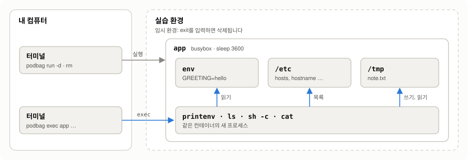

`podbag exec`는 이미 실행 중인 컨테이너 안에서 명령을 하나 더 실행합니다. 이 명령으로 컨테이너 안을 보고, 설정을 읽고, 파일을 바꿀 수 있습니다. 이번 트레이닝에서는 아무 일도 하지 않는 컨테이너를 실행하고 `exec`로 그 안에서 작업합니다.

**예상 시간** 10분.



## 실습 시작

Podbag Desktop에서 **Training**을 열고 **컨테이너 안에서 명령 실행하기**를 선택합니다. 새 모듈은 **새로 고침**을 누르면 나타납니다. 터미널에서 다음 명령으로 시작할 수도 있습니다.

```sh
podbag lab start container-exec
```

Training 카탈로그가 있는 Podbag 빌드(v0.3.2 이후)가 필요합니다. `training $` 프롬프트가 나오면 다음 단계로 진행합니다.

## 환경 변수를 넣어 컨테이너 실행

환경 변수는 프로그램이 읽을 수 있는 이름과 값입니다. `-e` 옵션으로 컨테이너에 환경 변수를 넣습니다. 이 컨테이너는 `sleep 3600`을 실행합니다. 그래서 다른 일은 하지 않고 한 시간 동안 실행 상태로 있습니다. `-d` 옵션은 컨테이너를 백그라운드로 실행합니다.

```sh
podbag run -d --name app -e GREETING=hello docker.io/library/busybox:1.37.0 sleep 3600
```

Podbag은 `app`이 실행 중인지 확인합니다.

## 컨테이너 상세 정보 보기

`podbag inspect`는 컨테이너의 상세 정보를 JSON으로 출력합니다. 이미지, 명령, 상태, 주소가 나옵니다.

```sh
podbag inspect app
```

Podbag은 출력에 `"status": "running"`이 있는지 확인합니다.

## 컨테이너 안에서 변수 출력

`exec`가 `app` 안에서 `printenv GREETING`을 실행합니다. 이 명령은 `-e`로 넣은 변수를 읽습니다.

```sh
podbag exec app printenv GREETING
```

`hello`가 출력됩니다. Podbag이 이 출력을 확인합니다.

## 명령 하나에만 변수 넣기

`exec`에도 `-e` 옵션이 있습니다. 이 변수는 이번 명령 하나에만 적용됩니다. 컨테이너 자체는 바뀌지 않습니다.

```sh
podbag exec -e MODE=debug app printenv MODE
```

`debug`가 출력됩니다. 이후에 `podbag exec app printenv MODE`를 실행하면 아무것도 출력되지 않습니다. `MODE`는 그 명령 하나에만 있었기 때문입니다.

## 컨테이너의 파일 목록 보기

컨테이너에는 자기만의 파일이 있습니다. `ls /etc`는 내 컴퓨터가 아니라 컨테이너 안의 `/etc` 폴더를 보여 줍니다.

```sh
podbag exec app ls /etc
```

Podbag은 목록에 `hosts` 줄이 있는지 확인합니다. Podbag은 컨테이너끼리 이름으로 서로 찾을 수 있도록 이 파일을 씁니다.

## 셸 명령으로 파일 쓰기

`>`나 `&&` 같은 셸 기호는 컨테이너 안에서 실행해야 합니다. 그래서 `sh -c` 뒤에 작은따옴표로 감쌉니다. 이 명령은 `/tmp/note.txt`에 한 줄을 쓰고 `/tmp` 목록을 보여 줍니다.

```sh
podbag exec app sh -c 'echo "Written by exec" > /tmp/note.txt && ls /tmp'
```

Podbag은 목록에 `note.txt` 줄이 있는지 확인합니다.

## 파일 다시 읽기

`exec`는 매번 새 명령이지만 같은 컨테이너에서 실행됩니다. 그래서 앞 단계에서 쓴 파일이 그대로 있습니다.

```sh
podbag exec app cat /tmp/note.txt
```

`Written by exec`가 출력됩니다. Podbag이 이 출력을 확인합니다.

## 다른 폴더에서 명령 실행

`-w` 옵션은 명령이 시작할 폴더를 정합니다. 여기서는 폴더 이름 없이 `ls`를 실행해도 `/tmp` 목록이 나옵니다.

```sh
podbag exec -w /tmp app ls
```

Podbag은 목록에 `note.txt` 줄이 있는지 확인합니다.

컨테이너 안에서 직접 셸을 열려면 `podbag exec -it app sh`를 실행합니다. 나올 때는 `exit`를 입력합니다. Training은 이 명령을 확인하지 않습니다.

## 실습 리소스 정리

`app`은 아직 실행 중입니다. `rm -f`는 컨테이너를 중지한 뒤 삭제합니다. `/tmp/note.txt`를 포함한 컨테이너의 파일도 함께 사라집니다.

```sh
podbag rm -f app
exit
```

임시 실습 환경이 정리되면 Training에서 **수업 완료**를 확인합니다.
