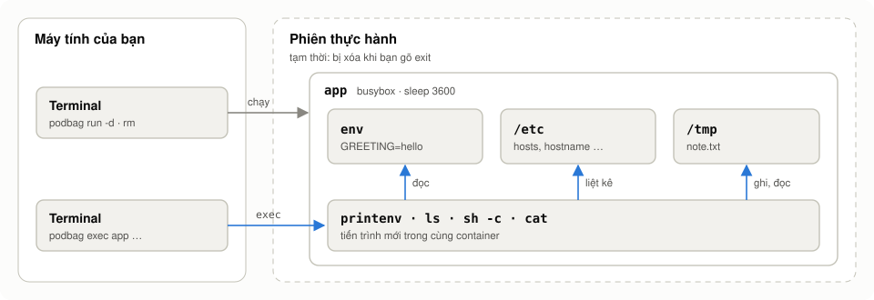

`podbag exec` chạy thêm một lệnh bên trong container đang chạy. Bạn có thể dùng nó để xem bên trong container, đọc cài đặt và thay đổi tệp của container. Trong mô-đun này, bạn chạy một container không làm gì, rồi làm việc bên trong nó bằng `exec`.

**Thời gian** 10 phút.



## Bắt đầu mô-đun

Mở **Training** trong Podbag Desktop và chọn **Chạy lệnh bên trong container**. Mô-đun mới xuất hiện sau khi chọn **Làm mới**. Hoặc chạy lệnh này trong terminal:

```sh
podbag lab start container-exec
```

Bạn cần bản Podbag có danh mục Training (sau v0.3.2). Tiếp tục tại dấu nhắc `training $`.

Để làm các bước trong TUI thay cho Podbag Desktop, hãy thêm `--tui`.

```sh
podbag lab start container-exec --tui
```

Trong TUI, nhấn `:` để mở shell Training cho bước chạy lệnh, gõ `exit` để quay lại TUI và nhấn `q` để kết thúc phiên.

## Chạy container với một biến môi trường

Biến môi trường là một tên kèm giá trị mà chương trình có thể đọc. Tùy chọn `-e` đưa một biến vào container. Container chạy `sleep 3600`, nên nó chạy trong một giờ và không làm gì khác. Tùy chọn `-d` chạy nó ở chế độ nền.

```sh
podbag run -d --name app -e GREETING=hello docker.io/library/busybox:1.37.0 sleep 3600
```

Podbag kiểm tra rằng `app` đang chạy.

## Xem chi tiết container

`podbag inspect` in chi tiết của container dưới dạng JSON: image, lệnh, trạng thái và địa chỉ của nó.

```sh
podbag inspect app
```

Podbag kiểm tra rằng kết quả có `"status": "running"`.

## In biến bên trong container

`exec` chạy `printenv GREETING` bên trong `app`. Lệnh này thấy biến mà bạn đã đưa vào bằng `-e`.

```sh
podbag exec app printenv GREETING
```

Kết quả là `hello`. Podbag kiểm tra kết quả này.

## Cho một lệnh biến riêng

`exec` cũng có tùy chọn `-e`. Biến này chỉ dành cho một lệnh đó. Bản thân container không thay đổi.

```sh
podbag exec -e MODE=debug app printenv MODE
```

Kết quả là `debug`. Nếu sau đó bạn chạy `podbag exec app printenv MODE`, lệnh không in gì, vì `MODE` chỉ dành cho lệnh trước.

## Liệt kê tệp trong container

Container có các tệp riêng. `ls /etc` liệt kê thư mục `/etc` bên trong container, không phải trên máy tính của bạn.

```sh
podbag exec app ls /etc
```

Podbag kiểm tra rằng danh sách có dòng `hosts`. Podbag ghi tệp này để các container tìm thấy nhau bằng tên.

## Ghi tệp bằng lệnh shell

Các ký hiệu shell như `>` và `&&` phải chạy bên trong container. Vì vậy, hãy đặt chúng trong dấu nháy đơn sau `sh -c`. Lệnh này ghi một dòng vào `/tmp/note.txt`, rồi liệt kê `/tmp`.

```sh
podbag exec app sh -c 'echo "Written by exec" > /tmp/note.txt && ls /tmp'
```

Podbag kiểm tra rằng danh sách có dòng `note.txt`.

## Đọc lại tệp

Mỗi `exec` là một lệnh mới, nhưng nó chạy trong cùng container. Tệp từ bước trước vẫn còn đó.

```sh
podbag exec app cat /tmp/note.txt
```

Kết quả là `Written by exec`. Podbag kiểm tra kết quả này.

## Chạy lệnh trong thư mục khác

Tùy chọn `-w` đặt thư mục mà lệnh bắt đầu chạy. Ở đây, `ls` không có tên thư mục sẽ liệt kê `/tmp`.

```sh
podbag exec -w /tmp app ls
```

Podbag kiểm tra rằng danh sách có dòng `note.txt`.

Để tự mở shell trong container, hãy dùng `podbag exec -it app sh`. Nhập `exit` để thoát. Training không kiểm tra lệnh này.

## Dọn dẹp và kết thúc

`app` vẫn đang chạy. `rm -f` dừng rồi xóa nó. Các tệp của nó, gồm cả `/tmp/note.txt`, cũng bị xóa theo.

- **Trong Podbag Desktop:** Chọn **Container thực hành → app → Xóa** và xác nhận.
- **Trong TUI:** Chọn `app` trong **Container**, nhấn `d`, rồi nhấn `y`.

```sh
podbag rm -f app
exit
```

Các tài nguyên thực hành tạm thời đã được xóa. Training hiển thị mô-đun đã hoàn thành.
