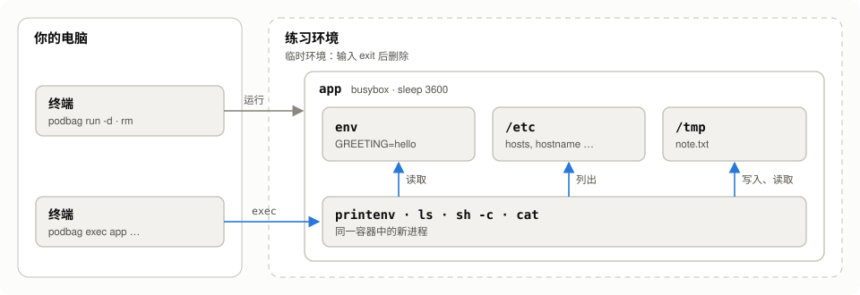

`podbag exec` 在已经运行的容器内再运行一条命令。你可以用它查看容器内部、读取设置和修改文件。在本模块中，你先启动一个安静运行的容器，然后用 `exec` 在其中操作。

**预计用时** 10 分钟。



## 开始模块

在 Podbag Desktop 中打开 **Training**，选择**在容器内运行命令**。点击**刷新**后会出现新模块。也可以在终端中运行以下命令：

```sh
podbag lab start container-exec
```

需要带有 Training 目录的 Podbag 版本（v0.3.2 之后）。出现 `training $` 提示符后继续。

## 运行带环境变量的容器

环境变量是一个带值的名称，程序可以读取它。`-e` 选项为容器设置一个环境变量。容器运行 `sleep 3600`，所以它会保持运行一小时，不做其他事情。`-d` 选项让它在后台运行。

```sh
podbag run -d --name app -e GREETING=hello docker.io/library/busybox:1.37.0 sleep 3600
```

Podbag 会检查 `app` 是否正在运行。

## 查看容器详情

`podbag inspect` 以 JSON 格式打印容器详情：镜像、命令、状态和地址。

```sh
podbag inspect app
```

Podbag 会检查输出中是否包含 `"status": "running"`。

## 在容器内打印变量

`exec` 在 `app` 内运行 `printenv GREETING`。这条命令可以看到你用 `-e` 设置的变量。

```sh
podbag exec app printenv GREETING
```

输出是 `hello`。Podbag 会检查这个输出。

## 为单条命令设置变量

`exec` 也有 `-e` 选项。这个变量只对这一条命令有效。容器本身不会改变。

```sh
podbag exec -e MODE=debug app printenv MODE
```

输出是 `debug`。之后如果运行 `podbag exec app printenv MODE`，不会打印任何内容，因为 `MODE` 只对那一条命令有效。

## 列出容器中的文件

容器有自己的文件。`ls /etc` 列出的是容器内的 `/etc` 文件夹，而不是你电脑上的。

```sh
podbag exec app ls /etc
```

Podbag 会检查列表中是否有 `hosts` 这一行。Podbag 会写入这个文件，让容器可以通过名称找到彼此。

## 用 shell 命令写入文件

`>` 和 `&&` 等 shell 符号必须在容器内运行。所以要把它们放在 `sh -c` 后面的单引号中。这条命令向 `/tmp/note.txt` 写入一行，然后列出 `/tmp`。

```sh
podbag exec app sh -c 'echo "Written by exec" > /tmp/note.txt && ls /tmp'
```

Podbag 会检查列表中是否有 `note.txt` 这一行。

## 读回文件

每次 `exec` 都是一条新命令，但都在同一个容器中运行。上一步写入的文件仍然存在。

```sh
podbag exec app cat /tmp/note.txt
```

输出是 `Written by exec`。Podbag 会检查这个输出。

## 在其他文件夹中运行命令

`-w` 选项设置命令开始运行时所在的文件夹。这里的 `ls` 没有指定文件夹，所以会列出 `/tmp`。

```sh
podbag exec -w /tmp app ls
```

Podbag 会检查列表中是否有 `note.txt` 这一行。

如果想自己在容器中打开 shell，请使用 `podbag exec -it app sh`。输入 `exit` 退出。Training 不检查这条命令。

## 清理并结束

`app` 仍在运行。`rm -f` 会停止并删除它。它的文件，包括 `/tmp/note.txt`，也会一起删除。

```sh
podbag rm -f app
exit
```

临时实验资源会被删除。Training 会显示该模块已完成。
