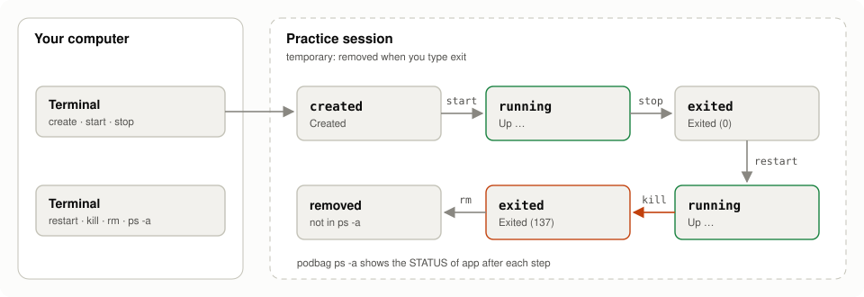

A container has a life: it is created, it runs, it stops, and in the end it is removed. `podbag run` does the first steps in one command. In this module, you do each step on its own and watch the status of one container change.

**Time** 10 minutes.



## Start the module

Open **Training** in Podbag Desktop and select **Follow a container from create to remove**. New modules appear after **Refresh**. Or run this command in a terminal:

```sh
podbag lab start container-lifecycle
```

You need a Podbag build with the Training catalog (after v0.3.2). Continue at the `training $` prompt.

To do the steps in the TUI instead of Podbag Desktop, add `--tui`.

```sh
podbag lab start container-lifecycle --tui
```

In the TUI, press `:` to open the training shell for a command step, type `exit` to return to the TUI, and press `q` to end the session.

## Create a container without starting it

`podbag create` makes the container but does not start its program. The program is a small shell loop. It runs until it gets a stop signal (`TERM`), and then it ends with exit code `0`.

```sh
podbag create --name app docker.io/library/busybox:1.37.0 sh -c 'trap "exit 0" TERM; while sleep 1; do :; done'
```

Podbag checks that `app` is in the state `created`.

## List all containers

`podbag ps` lists only running containers. Add `-a` to list all of them.

```sh
podbag ps -a
```

The status of `app` is `Created`. Podbag checks that the output contains this word.

## Start the container

`podbag start` runs the program of a created or stopped container.

```sh
podbag start app
```

- **In Podbag Desktop:** Select **Practice containers → app → Start**.
- **In the TUI:** Select `app` in **Containers** and press `s`.

Podbag checks that `app` is running.

## Stop the container

`podbag stop` sends the `TERM` signal. The program can end in its own way. If it does not end within the timeout (10 seconds), Podbag sends `KILL`. This loop ends at once.

```sh
podbag stop app
```

- **In Podbag Desktop:** Select **Practice containers → app → Stop**.
- **In the TUI:** Select `app` in **Containers** and press `x`.

Podbag checks that `app` is in the state `exited`.

## See the exit code 0

```sh
podbag ps -a
```

The status is `Exited (0)`. The program ended without an error. The container still exists, with its files and settings.

## Restart the container

`podbag restart` stops a container if it runs, and then starts it again. It uses the same container, the same name and the same command.

```sh
podbag restart app
```

- **In Podbag Desktop:** Select **Practice containers → app → Restart**.
- **In the TUI:** Select `app` in **Containers** and press `r`.

Podbag checks that `app` is running again.

## Kill the container

`podbag kill` sends `KILL` right away. The program cannot do anything about it.

```sh
podbag kill app
```

Podbag waits for the container to end and checks that the exit code is `137`. That is 128 + 9, and 9 is the number of the `KILL` signal.

## See the exit code 137

```sh
podbag ps -a
```

The status is `Exited (137)`. Compare it with `Exited (0)` after `stop`. Use `stop` first. Use `kill` only when a program does not stop.

## Remove the container and finish

`podbag rm` removes a stopped container. A running one needs `rm -f`.

- **In Podbag Desktop:** Select **Practice containers → app → Remove** and confirm.
- **In the TUI:** Select `app` in **Containers**, press `d`, then `y`.

```sh
podbag rm app
exit
```

The temporary practice resources are removed. Training shows the module as complete.
