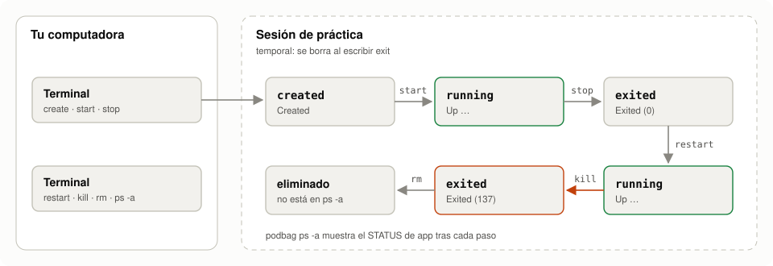

Un contenedor tiene una vida: se crea, se ejecuta, se detiene y, al final, se elimina. `podbag run` hace los primeros pasos con un solo comando. En este módulo, haces cada paso por separado y miras cómo cambia el estado de un contenedor.

**Tiempo** 10 minutos.



## Inicia el módulo

Abre **Training** en Podbag Desktop y selecciona **Sigue un contenedor desde su creación hasta su eliminación**. Los módulos nuevos aparecen después de **Actualizar**. O ejecuta este comando en una terminal:

```sh
podbag lab start container-lifecycle
```

Necesitas una versión de Podbag con el catálogo de Training (posterior a v0.3.2). Continúa en el prompt `training $`.

Para hacer los pasos en la TUI en lugar de Podbag Desktop, añade `--tui`.

```sh
podbag lab start container-lifecycle --tui
```

En la TUI, pulsa `:` para abrir la shell de Training cuando un paso pida un comando, escribe `exit` para volver a la TUI y pulsa `q` para terminar la sesión.

## Crea un contenedor sin iniciarlo

`podbag create` crea el contenedor, pero no inicia su programa. El programa es un pequeño bucle de shell. Se ejecuta hasta que recibe una señal de parada (`TERM`). Entonces termina con el código de salida `0`.

```sh
podbag create --name app docker.io/library/busybox:1.37.0 sh -c 'trap "exit 0" TERM; while sleep 1; do :; done'
```

Podbag comprueba que `app` está en el estado `created`.

## Lista todos los contenedores

`podbag ps` lista solo los contenedores en ejecución. Añade `-a` para listarlos todos.

```sh
podbag ps -a
```

El estado de `app` es `Created`. Podbag comprueba que la salida contiene esta palabra.

## Inicia el contenedor

`podbag start` ejecuta el programa de un contenedor creado o detenido.

```sh
podbag start app
```

- **En Podbag Desktop:** Selecciona **Contenedores de práctica → app → Iniciar**.
- **En la TUI:** Selecciona `app` en **Contenedores** y pulsa `s`.

Podbag comprueba que `app` está en ejecución.

## Detén el contenedor

`podbag stop` envía la señal `TERM`. El programa puede terminar a su manera. Si no termina dentro del tiempo de espera (10 segundos), Podbag envía `KILL`. Este bucle termina enseguida.

```sh
podbag stop app
```

- **En Podbag Desktop:** Selecciona **Contenedores de práctica → app → Detener**.
- **En la TUI:** Selecciona `app` en **Contenedores** y pulsa `x`.

Podbag comprueba que `app` está en el estado `exited`.

## Mira el código de salida 0

```sh
podbag ps -a
```

El estado es `Exited (0)`. El programa terminó sin errores. El contenedor sigue existiendo, con sus archivos y su configuración.

## Reinicia el contenedor

`podbag restart` detiene un contenedor si está en ejecución y luego lo inicia de nuevo. Usa el mismo contenedor, el mismo nombre y el mismo comando.

```sh
podbag restart app
```

- **En Podbag Desktop:** Selecciona **Contenedores de práctica → app → Reiniciar**.
- **En la TUI:** Selecciona `app` en **Contenedores** y pulsa `r`.

Podbag comprueba que `app` vuelve a estar en ejecución.

## Fuerza el final del contenedor

`podbag kill` envía `KILL` de inmediato. El programa no puede hacer nada para evitarlo.

```sh
podbag kill app
```

Podbag espera a que el contenedor termine y comprueba que el código de salida es `137`. Es 128 + 9, y 9 es el número de la señal `KILL`.

## Mira el código de salida 137

```sh
podbag ps -a
```

El estado es `Exited (137)`. Compáralo con `Exited (0)` después de `stop`. Usa primero `stop`. Usa `kill` solo cuando un programa no se detiene.

## Elimina el contenedor y termina

`podbag rm` elimina un contenedor detenido. Para uno en ejecución necesitas `rm -f`.

- **En Podbag Desktop:** Selecciona **Contenedores de práctica → app → Eliminar** y confirma.
- **En la TUI:** Selecciona `app` en **Contenedores**, pulsa `d` y luego `y`.

```sh
podbag rm app
exit
```

Se eliminan los recursos temporales de la práctica. Training muestra el módulo como completado.
