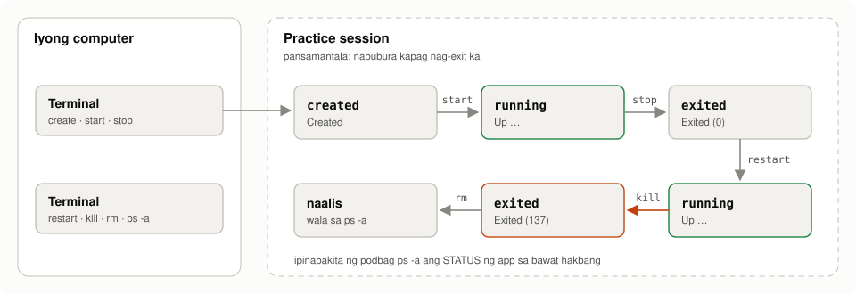

May buhay ang container. Ginagawa ito, tumatakbo, humihinto, at sa huli ay inaalis. Ginagawa ng `podbag run` ang mga unang hakbang sa iisang command. Sa module na ito, gagawin mo ang bawat hakbang nang hiwalay. Panonoorin mo ang pagbabago ng status ng iisang container.

**Oras** 10 minuto.



## Simulan ang module

Buksan ang **Training** sa Podbag Desktop at piliin ang **Sundan ang container mula sa paggawa hanggang sa pag-alis**. Lalabas ang mga bagong module pagkatapos ng **I-refresh**. O patakbuhin ang command na ito sa terminal:

```sh
podbag lab start container-lifecycle
```

Kailangan mo ng build ng Podbag na may Training catalog (pagkatapos ng v0.3.2). Magpatuloy sa prompt na `training $`.

Para gawin ang mga hakbang sa TUI sa halip na sa Podbag Desktop, idagdag ang `--tui`.

```sh
podbag lab start container-lifecycle --tui
```

Sa TUI, pindutin ang `:` para buksan ang training shell sa isang hakbang na command. I-type ang `exit` para bumalik sa TUI. Pindutin ang `q` para tapusin ang practice session.

## Gumawa ng container nang hindi ito sinisimulan

Ginagawa ng `podbag create` ang container pero hindi nito sinisimulan ang program. Maliit na shell loop ang program. Tumatakbo ito hanggang makatanggap ng stop signal (`TERM`). Pagkatapos, natatapos ito sa exit code na `0`.

```sh
podbag create --name app docker.io/library/busybox:1.37.0 sh -c 'trap "exit 0" TERM; while sleep 1; do :; done'
```

Sinusuri ng Podbag na nasa state na `created` ang `app`.

## Ilista ang lahat ng container

Inililista lang ng `podbag ps` ang mga tumatakbong container. Idagdag ang `-a` para ilista ang lahat.

```sh
podbag ps -a
```

`Created` ang status ng `app`. Sinusuri ng Podbag na nasa output ang salitang ito.

## Simulan ang container

Pinapatakbo ng `podbag start` ang program ng container na nagawa na o nakahinto.

```sh
podbag start app
```

- **Sa Podbag Desktop:** Piliin ang **Mga practice container → app → Simulan**.
- **Sa TUI:** Piliin ang `app` sa **Mga container** at pindutin ang `s`.

Sinusuri ng Podbag na tumatakbo ang `app`.

## Ihinto ang container

Nagpapadala ang `podbag stop` ng signal na `TERM`. Maaaring tapusin ng program ang sarili sa sarili nitong paraan. Kung hindi ito natapos sa loob ng timeout (10 segundo), magpapadala ang Podbag ng `KILL`. Agad na natatapos ang loop na ito.

```sh
podbag stop app
```

- **Sa Podbag Desktop:** Piliin ang **Mga practice container → app → Ihinto**.
- **Sa TUI:** Piliin ang `app` sa **Mga container** at pindutin ang `x`.

Sinusuri ng Podbag na nasa state na `exited` ang `app`.

## Tingnan ang exit code na 0

```sh
podbag ps -a
```

`Exited (0)` ang status. Natapos ang program nang walang error. Nandoon pa rin ang container, kasama ang mga file at setting nito.

## I-restart ang container

Inihihinto ng `podbag restart` ang container kung tumatakbo ito, at saka ito sinisimulan ulit. Pareho ang container, ang pangalan at ang command.

```sh
podbag restart app
```

- **Sa Podbag Desktop:** Piliin ang **Mga practice container → app → I-restart**.
- **Sa TUI:** Piliin ang `app` sa **Mga container** at pindutin ang `r`.

Sinusuri ng Podbag na tumatakbo ulit ang `app`.

## I-kill ang container

Agad na nagpapadala ang `podbag kill` ng `KILL`. Walang magagawa ang program tungkol dito.

```sh
podbag kill app
```

Hinihintay ng Podbag na matapos ang container. Sinusuri nito na `137` ang exit code. Iyon ay 128 + 9, at 9 ang numero ng signal na `KILL`.

## Tingnan ang exit code na 137

```sh
podbag ps -a
```

`Exited (137)` ang status. Ihambing ito sa `Exited (0)` pagkatapos ng `stop`. Gamitin muna ang `stop`. Gamitin lang ang `kill` kapag hindi humihinto ang program.

## Alisin ang container at tapusin

Inaalis ng `podbag rm` ang nakahintong container. Kailangan ng `rm -f` para sa tumatakbong container.

- **Sa Podbag Desktop:** Piliin ang **Mga practice container → app → Alisin** at kumpirmahin.
- **Sa TUI:** Piliin ang `app` sa **Mga container**, pindutin ang `d`, saka ang `y`.

```sh
podbag rm app
exit
```

Naaalis ang mga pansamantalang resource ng practice. Ipinapakita ng Training na tapos na ang module.
